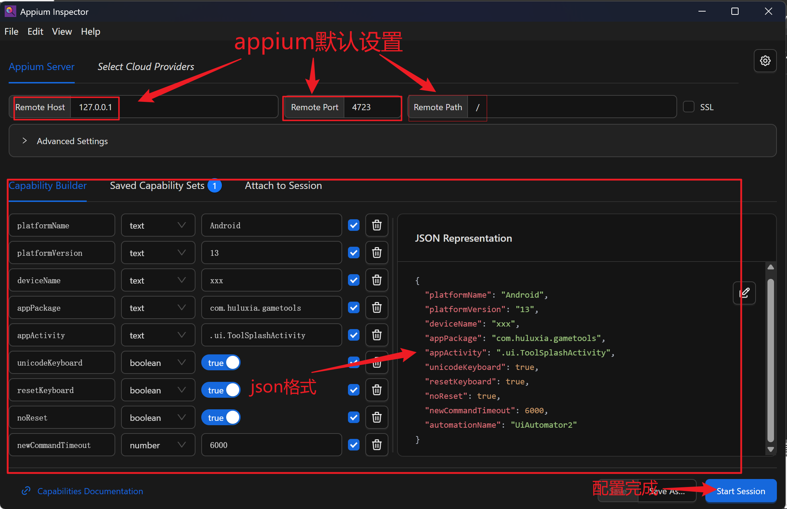

# Appium自动化测试

## 安装

### Node.js

[下载 Node.js®](https://nodejs.org/zh-cn/download)

建议安装LTS长期维护版本，安装之后加入环境变量


官方镜像慢，切换淘宝镜像源

```bash
npm config set registry https://registry.npmmirror.com
```

检验是否切换成功

```bash
npm config get registry
```


### Java JDK 11+

建议用`JDK 17`[Java Archive Downloads - Java SE 17.0.13 and later](https://www.oracle.com/java/technologies/javase/jdk17-0-13-later-archive-downloads.html)

加入环境变量用JAVA_HOME命名


### Android SDK

下载地址[SDK Android Developers](https://developer.android.google.cn/tools/releases/platform-tools?hl=zh-cn)

主要是adb命令软件 **platform-tools**，同样加入环境变量，ANDROID_HOME


### Appium

命令行安装

appium2.0之后应用和驱动分离，驱动需要另外安装


```bash
npm install -g appium
```

验证安装

```bash
npx appium -v
```


安装Android驱动

```bash
npx appium driver install uiautomator2
```


### 插件

#### 图像识别插件

```bash
npx appium plugin install images
```

临时使用

```bash
appium --plugins=images
```

永久配置

```bash
npx appium --use-plugins=images
```


### Appium Inspector有线连接

下载地址[Appium Inspector](https://github.com/appium/appium-inspector/releases)，使用需要开启appium

> [!NOTE]
>
> 手机需要开启开发者模式
>
> redmi手机为例：打开设置 --> 我的设备 --> 全部参数 --> 找到os版本，不是Android版本，连续点击直到弹出提示为开发者
>
> 在开发者模块打开USB调试，USB安装，允许USB调试修改权限或模拟点击

用于连接手机，能够查看应用的标签、按钮、输入框等id



```json
{
    "platformName":"Android",
    "platformVersion":"13",
    "deviceName":"xxx",
    "appPackage":"com.huluxia.gametools",
    "appActivity":".ui.ToolSplashActivity",
    "unicodeKeyboard":True,
    "resetKeyboard":True,
    "noReset":True,
    "newCommandTimeout":6000,
    "automationName":"UiAutomator2"
}
```


## 使用

### 启动服务

```bash
npx appium --allow-cors
```


### ADB工具查看应用包名/活动名

```cmd
adb shell dumpsys activity recents | find "intent={"
```


```cmd
intent={act=android.intent.action.MAIN cat=[android.intent.category.LAUNCHER] flg=0x10200000 cmp=com.huluxia.gametools/.ui.ToolSplashActivity}
```

cmp的斜杆前的为包名，后的为活动名


### 定位元素方法

```python
from appium.webdriver.common.appiumby import AppiumBy

# 通过 ID 查找
element = driver.find_element(AppiumBy.ID, "com.example:id/button")

# 通过 XPath 查找
element = driver.find_element(AppiumBy.XPATH, "//android.widget.Button[@text='登录']")

# 通过 Accessibility ID 查找
element = driver.find_element(AppiumBy.ACCESSIBILITY_ID, "menu_item")

# 通过文本查找（UiAutomator2）
element = driver.find_element(AppiumBy.ANDROID_UIAUTOMATOR, 'text("登录")')
```


## Python脚本

```python
from appium import webdriver
from appium.options.android import UiAutomator2Options
from appium.webdriver.common.appiumby import AppiumBy

options =UiAutomator2Options()  #代替旧版的desired_caps

options.platform_name = 'android'   #手机平台类型
options.device_name = 'xxx' #设备名称
options.app_package = "com.huluxia.gametools"   #应用包名
options.app_activity = '.ui.ToolSplashActivity'     #应用活动名
options.automation_name = 'UiAutomator2'    #驱动名
options.no_reset = True     #不重置应用状态
options.skip_device_initialization = True   #跳过应用初始化
options.new_command_timeout = 6000  #新命令超时时间（秒）

#创建连接
driver = webdriver.Remote('http://127.0.0.1:4723',options=options)

#隐式等待,统一设置超时时间，所有find_element调用，判断元素是否存在
driver.implicitly_wait(10)

#关闭连接
driver.quit()
```

