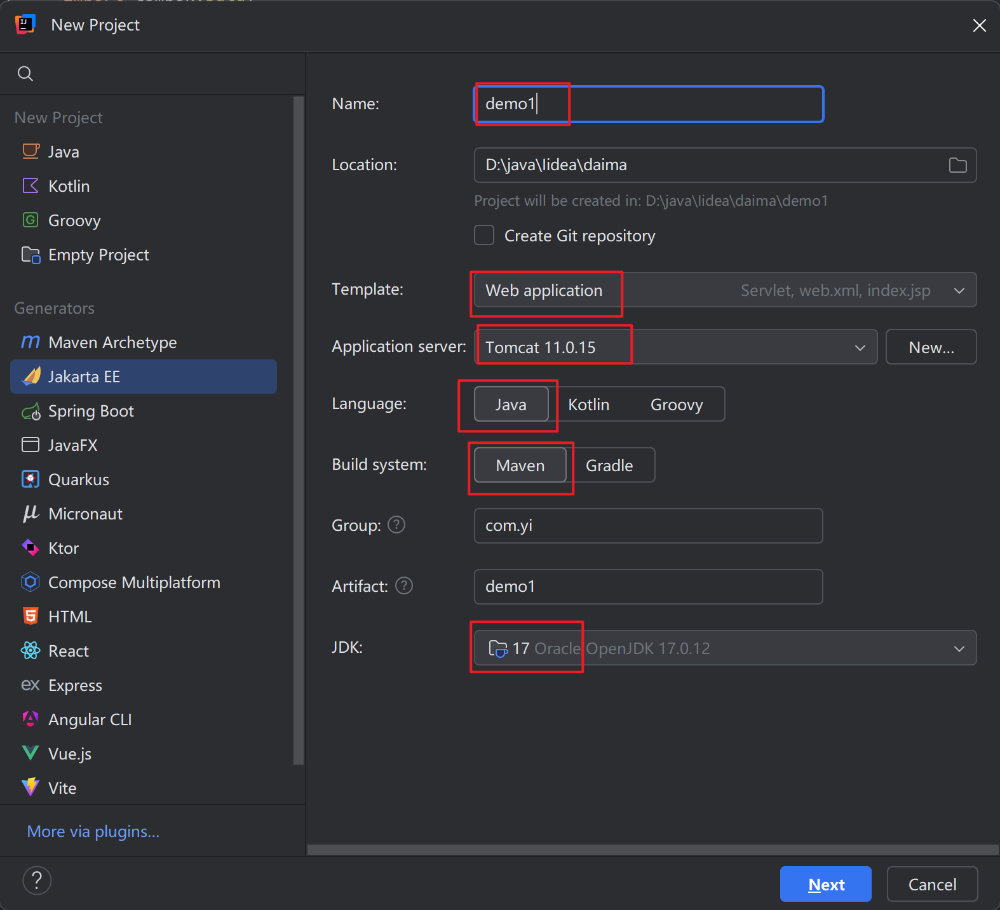

# JavaEE

## servlet

 **Server Applet** 的简称，中文名为**小服务程序**或**服务连接器**。它是用 **Java** 编写的服务器端程序，具有独立于平台和协议的特性，主要功能在于交互式地浏览和生成数据，生成动态 Web 内容。

主要功能包括：

1. **读取客户端发送的数据**：包括网页上的 HTML 表单数据，或者来自 applet 或自定义的 HTTP 客户端程序的表单数据。
2. **处理数据并生成结果**：可能需要访问数据库，执行 RMI 或 CORBA 调用，调用 Web 服务，或者直接计算得出响应。
3. **发送数据到客户端**：包括文本文件（HTML 或 XML）、二进制文件（GIF 图像）、Excel 等。
4. **发送 HTTP 响应到客户端**：包括设置 cookies 和缓存参数。


### 实现

创建JavaEE项目



在项目名称文件夹下创建Java类

继承HTTPServlet类，重写方法

```java
package com.yi.demo1.base;

import jakarta.servlet.ServletException;
import jakarta.servlet.annotation.WebServlet;
import jakarta.servlet.http.HttpServlet;
import jakarta.servlet.http.HttpServletRequest;
import jakarta.servlet.http.HttpServletResponse;

import java.io.IOException;

//WebServlet注解
@WebServlet("/api") //浏览器访问路径，在原有的路径下加上api访问
public class servlet extends HttpServlet {
    @Override
    //req请求，resp响应
    protected void doGet(HttpServletRequest req, HttpServletResponse resp) throws ServletException, IOException{
        System.out.println("hello");//控制台打印
        resp.getWriter().write("hello1");//访问后浏览器页面输出
    }
}
```


### servlet生命周期

**init**方法，在servlet实例创建之后执行，证明servlet有实例创建，只执行一次

```java
public void init(ServletConfig config) throws ServletException {
    System.out.println("创建了实例")
}
```


**service**方法，每次请求到达某个servlet方法时执行，用于处理请求

```java
protected void doGet(HttpServletRequest req, HttpServletResponse resp) throws ServletException, IOException {
    System.out.println("调用了服务")
}
```


**destroy**方法，servlet实例销毁时执行

```java
public void destory(){
    System.out.println("实例销毁")
}
```


### HttpServletRequest对象

HttpServletRequest用于接收客户端发送的请求


#### 常用方法

| 方法                 | 介绍                             |
| -------------------- | -------------------------------- |
| getRequestURL()      | 获取客户端发出请求时的完整URL    |
| getRequestURI()      | 获取请求行中的资源名称部分       |
| getQueryString()     | 获取请求行中的参数部分           |
| getMethod()          | 获取客户端请求方式               |
| getProtocol()        | 获取Http版本号                   |
| getContextPath()     | 获取webapp名字                   |
| getParameter()       | 获取指定参数的值，返回字符串     |
| getParameterValues() | 返回指定参数的所有值，字符串数组 |

示例

```java
String contextPath = req.getContextPath();
```


#### 请求乱码问题

Get请求不会，Post请求会乱码

设置编码格式

```java
req.setCharacterEncoding("UTF-8");
```


#### 请求转发

地址栏不变，请求跳转到其他路径

```java
req.getRequestDispatcher("路径").forward(req,resp);
```


### HttpServletrespond对象


## I/O Stream

流的分类

| 抽象类 | 字节流       | 字节流 |
| ------ | ------------ | ------ |
| 输入流 | InputStream  | Reader |
| 输出流 | OutputStream | Write  |


### 基础流

#### 文件操作

**创建文件**

```java
package iostream;

import java.io.File;
import java.io.IOException;

public class CreateFile {
    public static void main(String[] args) {
        File file = new File("source/1.txt");
        System.out.println(file);
        //文件是否存在
        if (file.exists()){
            System.out.println("file is exists");
        }
        //是否为文件
        if (file.isFile()){
            System.out.println("is file");
            //文件存在删除
            if (file.delete()) {
                System.out.println();
            }
        }else {
            try {
                //创建文件
                if (file.createNewFile()) {
                    System.out.println("文件创建成功");
                }
            } catch (IOException e) {
                throw new RuntimeException(e);
            }
        }
        //是否为文件夹
        if (file.isDirectory()){
            System.out.println(file+" is dir");
        }
    }
}
```


#### FileInputStream

一次接收字节

```java
package iostream;

import java.io.FileInputStream;
import java.io.IOException;

public class InputStream {
    public static void main(String[] args) {
        //写在try后的括号里出了块会自动关闭，出现异常也会直接关闭
        try (FileInputStream file = new FileInputStream("source/1.txt")) {
            //如果read为 -1，则文件读取完毕
            int read;
            while ((read = file.read()) != -1){
                System.out.println((char)read);
            }
        } catch (IOException e) {
            throw new RuntimeException(e);
        }
    }
}
```


一次接收多字节

字节数组

```java
package iostream;

import java.io.FileInputStream;
import java.io.IOException;

public class InputStream {
    public static void main(String[] args) {
        //写在try后的括号里出了块会自动关闭，出现异常也会直接关闭
        try (FileInputStream file = new FileInputStream("source/1.txt")) {
            //如果read为 -1，则文件读取完毕
            int read;
            //一次性接收8比特数据
            byte[] data = new byte[8];
            while ((read = file.read(data)) != -1){
                System.out.println(new String(data, 0, read));
            }
        } catch (IOException e) {
            throw new RuntimeException(e);
        }
    }
}
```


#### OutputStream

写入数据时文件不存在会创建文件

```java
package iostream;

import java.io.FileOutputStream;

public class OutputStream {

    public static void main(String[] args) {
        //new FileOutputStream("source/a.txt",true), 添加true是追加,否则为覆盖
        try (FileOutputStream fileOutputStream = new FileOutputStream("source/a.txt")) {
            //需要将字符串转成byte字节写入
            fileOutputStream.write("hello".getBytes());
            fileOutputStream.write(123);
        } catch (Exception e) {
            throw new RuntimeException(e);
        }
    }
}
```


#### 文件拷贝

边读边写

```java
package iostream;

import java.io.FileInputStream;
import java.io.FileOutputStream;

public class OutputStream {

    public static void main(String[] args) {
        try (
            FileOutputStream fileOutputStream = new FileOutputStream("source/a1.png");
            FileInputStream fileInputStream = new FileInputStream("source/1.png")
        ) {
            byte[] data = new byte[1024];
            int read = 0;
            while ((read = fileInputStream.read(data))!= -1) {
                //data byte数组， 0 从数组0下标开始写， read写多少个字节
                fileOutputStream.write(data, 0, read);
            }
        } catch (Exception e) {
            throw new RuntimeException(e);
        }
    }
}
```


#### FileReader

```java
package iostream;

import java.io.FileReader;
import java.io.IOException;

public class OutputStream {

    public static void main(String[] args) {
        try (FileReader fileReader = new FileReader("source/1.txt")) {
            int read;
            char[] data = new char[8];
            while ((read = fileReader.read(data)) != -1){
                //文件数组读不满建议用
                System.out.println(new String(data, 0,read));
            }
        } catch (IOException e) {
            throw new RuntimeException(e);
        }
    }
}
```


#### FileWrite

**常用方法**

1. new FileWriter(File/String): 覆盖模式，相当于流的指针在首端
2. new FileWrite(File/String, true)：追加模式，相当于流的指针在末尾
3. write(int)：写入单个字符
4. write(char[])：写入指定数组
5. write(char[], off, len)：写入指定数组的指定部分
6. write(String)：写入整个字符串
7. write(String, off, len)：写入字符串的指定部分

> [!caution]
>
> FileWriter使用后，必须关闭（close）或刷新（flush），否则不能写入指定文件


```java
package iostream;

import java.io.FileReader;
import java.io.FileWriter;
import java.io.IOException;

public class OutputStream {

    public static void main(String[] args) {
        try (
            FileReader fileReader = new FileReader("source/1.txt");
            //没有文件会自动创建
            FileWriter fileWriter =new FileWriter("source/12.txt")
        ) {
            int read;
            char[] data = new char[8];
            while ((read = fileReader.read(data)) != -1){
                fileWriter.write(data, 0, read);
                //用toCharArray不是getByte
                fileWriter.write("asdfa".toCharArray());
            }
        } catch (IOException e) {
            throw new RuntimeException(e);
        }
    }
}
```


### 高级流

#### 字节缓冲流

默认缓冲区为8192

| 方法                                         | 说明                                     |
| -------------------------------------------- | ---------------------------------------- |
| public BufferedInputStream(InputStream is)   | 把基本流包装成高级流，提高读取数据的性能 |
| public BufferedOutputStream(OutputStream os) | 把基本流包装成高级流，提高写出数据的性能 |

**单字节读取**

```java
package iostream;

import java.io.*;

public class BuffStream {
    public static void main(String[] args) {
        try(BufferedInputStream file = new BufferedInputStream(new FileInputStream("source\\1.txt"));
            BufferedOutputStream outputStream = new BufferedOutputStream(new FileOutputStream("source\\12.txt"))
        ){
            int ch;
            while ((ch = file.read()) != -1){
                outputStream.write(ch);
            }
        }catch (IOException e){
            System.out.println();
        }
    }
}
```


**多字节读取**

```java
package iostream;

import java.io.*;

public class BuffStream {
    public static void main(String[] args) {
        try(BufferedInputStream file = new BufferedInputStream(new FileInputStream("source\\1.txt"));
            BufferedOutputStream outputStream = new BufferedOutputStream(new FileOutputStream("source\\12.txt"))
        ){
            int ch;
            //创建byte数组
            byte [] arr = new byte[8];
            while ((ch = file.read(arr)) != -1){
                outputStream.write(arr, 0, ch);
            }
        }catch (IOException e){
            System.out.println();
        }
    }
}
```


#### 字符缓冲流

| 方法名                          | 说明               |
| ------------------------------- | ------------------ |
| public BufferedReader(Reader r) | 把基本流变成高级流 |
| public BufferedWrite(Write r)   | 把基本流变成高级流 |

**特有方法**

字符缓冲输入流特有方法

public String readLine()：读取一行数据，如果没有数据读取，返回null

字符缓冲输出流特有方法

public void newLine()：跨平台的换行


**单字符**

```java
package iostream;

import java.io.*;

public class BuffStream {
    public static void main(String[] args) {
        try (BufferedWriter bufferedWriter = new BufferedWriter(new FileWriter("source\\12.txt"));
             BufferedReader bufferedReader = new BufferedReader(new FileReader("source\\1.txt"))
        ){
            int a;
            while ((a = bufferedReader.read()) != -1){
                bufferedWriter.write(a);
            }
        }catch(IOException e){
            System.out.println();
        }
    }
}
```


**多字符**

```java
package iostream;

import java.io.*;

public class BuffStream {
    public static void main(String[] args) {
        try (BufferedWriter bufferedWriter = new BufferedWriter(new FileWriter("source\\12.txt"));
             BufferedReader bufferedReader = new BufferedReader(new FileReader("source\\1.txt"))
        ){
            String a;
            //readLine读取一行数据
            while ((a = bufferedReader.readLine()) != null){
                bufferedWriter.write(a);
                //换行，跨端
                bufferedWriter.newLine();
            }
        }catch(IOException e){
            System.out.println();
        }
    }
}

```


#### 转换流

是字节流和字符流之间的桥梁

```java
package iostream;

import java.io.FileReader;
import java.io.IOException;
import java.nio.charset.Charset;

public class BuffStream {
    public static void main(String[] args) {
//        try (InputStreamReader inputStreamReader = new InputStreamReader(new FileInputStream("source\\1.txt"));
//             OutputStreamWriter outputStreamWriter = new OutputStreamWriter(new FileOutputStream("source\\12.txt"),"GBK")
//        ){
//            int a;
//            while ((a = inputStreamReader.read()) !=-1){
//                outputStreamWriter.write(a);
//            }
//        }catch(IOException e){
//            System.out.println();
//        }
        

        try(FileReader fileReader = new FileReader("source\\1.txt", Charset.forName("GBK"))){
            int a;
            while ((a = fileReader.read()) != -1){
                System.out.println((char)a);
            }
        }catch (IOException e){
            System.out.println();
        }
    }
}
```

```java
package iostream;

import java.io.FileReader;
import java.io.FileWriter;
import java.io.IOException;
import java.nio.charset.Charset;

public class BuffStream {
    public static void main(String[] args) {
//        try (InputStreamReader inputStreamReader = new InputStreamReader(new FileInputStream("source\\1.txt"));
//             OutputStreamWriter outputStreamWriter = new OutputStreamWriter(new FileOutputStream("source\\12.txt"),"GBK")
//        ){
//            int a;
//            while ((a = inputStreamReader.read()) !=-1){
//                outputStreamWriter.write(a);
//            }
//        }catch(IOException e){
//            System.out.println();
//        }
        
        //上面了解，下面的需要掌握
        //Charset.forName转换编码格式
        try(FileReader fileReader = new FileReader("source\\1.txt", Charset.forName("utf-8"));
            FileWriter fileWriter =new FileWriter("source\\12.txt", Charset.forName("GBK"))
        ){
            int a;
            while ((a = fileReader.read()) != -1){
                fileWriter.write(a);
            }
        }catch (IOException e){
            System.out.println();
        }
    }
}
```

> [!caution]
>
> 文件从utf-8转成gbk，大多情况会出现直接丢失，编译成gbk转不回utf-8


#### 序列化流

可以将java对象写在本地文件中

| 构造方法                                    | 说明                 |
| ------------------------------------------- | -------------------- |
| public ObjectOutputStream(OutputStream out) | 把基本流包装成高级流 |

| 成员方法                                  | 说明                     |
| ----------------------------------------- | ------------------------ |
| public final void writeObject(Object obj) | 将对象序列化写到文件中去 |


Student**类**

```java
package iostream;

import java.io.Serializable;

//需要实现Serializable接口才能被序列化
public class Student implements Serializable {
    private String name;
    private int age;

    public Student() {
    }

    public Student(String name, int age) {
        this.name = name;
        this.age = age;
    }

    public String getName() {
        return name;
    }

    public void setName(String name) {
        this.name = name;
    }

    public int getAge() {
        return age;
    }

    public void setAge(int age) {
        this.age = age;
    }
    @Override
    public String toString() {
        return "Student{" +
                "name='" + name + '\'' +
                ", age=" + age +
                '}';
    }
}
```

**ObjectStream类**

```java
package iostream;

import java.io.FileOutputStream;
import java.io.IOException;
import java.io.ObjectOutputStream;

public class ObjectStream {
    public static void main(String[] args) {
        Student stu = new Student("zhangs",23);

        try(ObjectOutputStream objectOutputStream = new ObjectOutputStream(new FileOutputStream("source\\12.txt"))){
            objectOutputStream.writeObject(stu);
        }catch (IOException e){
            System.out.println();
        }
    }
}
```

> [!note]
>
> 类需要实现Serializable接口才能被序列化


#### 反序列化流

可以将本地的序列化对象读取到程序中

| 构造方法                   | 说明                           |
| -------------------------- | ------------------------------ |
| public Object readObject() | 把序列化到本地的对象读取到程序 |

| 构造方法                                  | 说明               |
| ----------------------------------------- | ------------------ |
| public ObjectInputStream(InputStream out) | 把基础流变成高级流 |

```java
package iostream;

import java.io.*;

public class ObjectStream {
    public static void main(String[] args) {
        try(ObjectInputStream objectInputStream = new ObjectInputStream(new FileInputStream("source\\12.txt"))){
            try {
                Object o = objectInputStream.readObject();
                System.out.println(o);
            } catch (ClassNotFoundException e) {
                throw new RuntimeException(e);
            }
        }catch (IOException e){
            e.printStackTrace();
        }
    }
}
```


#### 序列化反序列化流使用问题及解决办法

##### 问题1

一个类实现了Serializable接口，并将对象序列化到了本地，本地的序列化对象会自动生成一个类似uuid的唯一值，如果修改了类中的数据这个唯一值就会改变，本地的序列化对象将进行反序列化就会报错

解决：

让idea自动生成

```java
package iostream;

import java.io.Serializable;

//需要实现Serializable接口才能被序列化
public class Student implements Serializable {

    @Serial
    private static final long serialVersionUID = -12389889348575345L;  //值任意
    
    private String name;
    private int age;

    public Student() {
    }

    public Student(String name, int age) {
        this.name = name;
        this.age = age;
    }

    public String getName() {
        return name;
    }

    public void setName(String name) {
        this.name = name;
    }

    public int getAge() {
        return age;
    }

    public void setAge(int age) {
        this.age = age;
    }
    @Override
    public String toString() {
        return "Student{" +
                "name='" + name + '\'' +
                ", age=" + age +
                '}';
    }
}
```


##### 问题2

不想反序列化的属性，不反序列化

解决：

在属性前添加`transient`

```java
package iostream;

import java.io.Serial;
import java.io.Serializable;

public class Student implements Serializable {
    @Serial
    private static final long serialVersionUID = -12389889348575345L;

    private String name;
    private int age;
    private transient String email;


    @Override
    public String toString() {
        return "Student{" +
                "name='" + name + '\'' +
                ", age=" + age +
                ", tel=" + tel +
                '}';
    }

    public String getName() {
        return name;
    }

    public void setName(String name) {
        this.name = name;
    }

    public int getAge() {
        return age;
    }

    public void setAge(int age) {
        this.age = age;
    }

    public int getTel() {
        return tel;
    }

    public void setTel(int tel) {
        this.tel = tel;
    }

    public Student(String name, int age, int tel) {
        this.name = name;
        this.age = age;
        this.tel = tel;
    }

    public Student() {
    }
}
```

反序列操作将不会将email反序列化，email直接返回null


#### 打印流

分类：打印流一般指：PrintStream，PrintWrite两类

特点1：打印流只操作文件目的地，不操作数据源

特点2：特有的写出方法可以实现，数据原样写出

特点3：特有的写出方法，可以实现自动刷新，自动换行

打印一次数据 = 写出 + 换行 + 刷新


##### 字节打印流

| 构造方法                                                     | 说明                       |
| ------------------------------------------------------------ | -------------------------- |
| public PrintStream(OutputStream/File/String)                 | 关联字节输出/文件/文件路径 |
| public PrintStream(String fileName, Charset charset)         | 指定字符编码               |
| public PrintStream(OutputStream out, boolean autoFlush)      | 自动刷新                   |
| public PrintStream(OutputStream out, boolean autoFlush, String encoding) | 指定字符编码和自动刷新     |

| 成员方法                                          | 说明                                       |
| ------------------------------------------------- | ------------------------------------------ |
| public void write(int b)                          | 常规方法：规则和之前一样，将指定的字节写出 |
| public void println(xxx xx)                       | 特有方法：打印任意数据，自动刷新，自动换行 |
| public void print(xxx xx)                         | 特有方法：打印任意数据，不换行             |
| public void printf(String format, Object... args) | 特有方法：带有占位符的打印语句，不换行     |

字节流底层没有缓冲区，开不开自动刷新都一样


##### 字符打印流

| 构造方法                                                     | 说明                       |
| ------------------------------------------------------------ | -------------------------- |
| public PrintWrite(Write/File/String)                         | 关联字节输出/文件/文件路径 |
| public PrintWrite(String fileName, Charset charset)          | 指定字符编码               |
| public PrintWrite(Write w, boolean autoFlush)                | 自动刷新                   |
| public PrintWrite(OutputStream out, boolean autoFLush, Charset charset) | 指定字符编码并刷新         |

| 成员方法                                          | 说明                                       |
| ------------------------------------------------- | ------------------------------------------ |
| public void write(int b)                          | 常规方法：规则和之前一样，将指定的字符写出 |
| public void println(xxx xx)                       | 特有方法：打印任意数据，自动刷新，自动换行 |
| public void print(xxx xx)                         | 特有方法：打印任意数据，不换行             |
| public void printf(String format, Object... args) | 特有方法：带有占位符的打印语句，不换行     |


#### 解压流

```java
package iostream;

import java.io.File;
import java.io.FileInputStream;
import java.io.FileOutputStream;
import java.io.IOException;
import java.util.zip.ZipEntry;
import java.util.zip.ZipInputStream;

public class ZipStream {
    public static void main(String[] args) {
        //读取的压缩包
        try (ZipInputStream zipInputStream = new ZipInputStream(new FileInputStream("source\\1.zip"))) {
            int a;
            ZipEntry nextEntry ;
            //获取压缩包中的文件和文件夹
            while ((nextEntry = zipInputStream.getNextEntry()) != null){

                if (nextEntry.isDirectory()){
                    File file = new File("source\\pr",nextEntry.toString());
                    file.mkdir();
                }else {
                    FileOutputStream outputStream = new FileOutputStream(new File("source\\pr",nextEntry.toString()));
                    int b;
                    while ((b= zipInputStream.read()) != -1){
                        outputStream.write(b);
                    }
                }
//                System.out.println(nextEntry);
            }
        }catch (IOException e){
//            System.out.println();
            e.printStackTrace();
        }

    }
}
```


#### 压缩流

##### 压缩单个文件

```java
package iostream;

import java.io.File;
import java.io.FileInputStream;
import java.io.FileOutputStream;
import java.io.IOException;
import java.util.zip.ZipEntry;
import java.util.zip.ZipInputStream;
import java.util.zip.ZipOutputStream;

public class ZipStream {
    public static void main(String[] args) {
        try (ZipOutputStream zipOutputStream = new ZipOutputStream(new FileOutputStream(new File("source\\", "2.zip")))
        ) {
            //压缩包中新文件名
            ZipEntry zipEntry = new ZipEntry("a2.txt");
            zipOutputStream.putNextEntry(zipEntry);
            //要写入的文件
            FileInputStream nweF = new FileInputStream("source\\pr\\2.txt");
            int b;
            while ((b = nweF.read()) != -1){
                zipOutputStream.write(b);
            }
            zipOutputStream.closeEntry();
            nweF.close();
        }catch (IOException e){
//            System.out.println();
            e.printStackTrace();
        }

    }
}

```


##### 压缩文件夹
