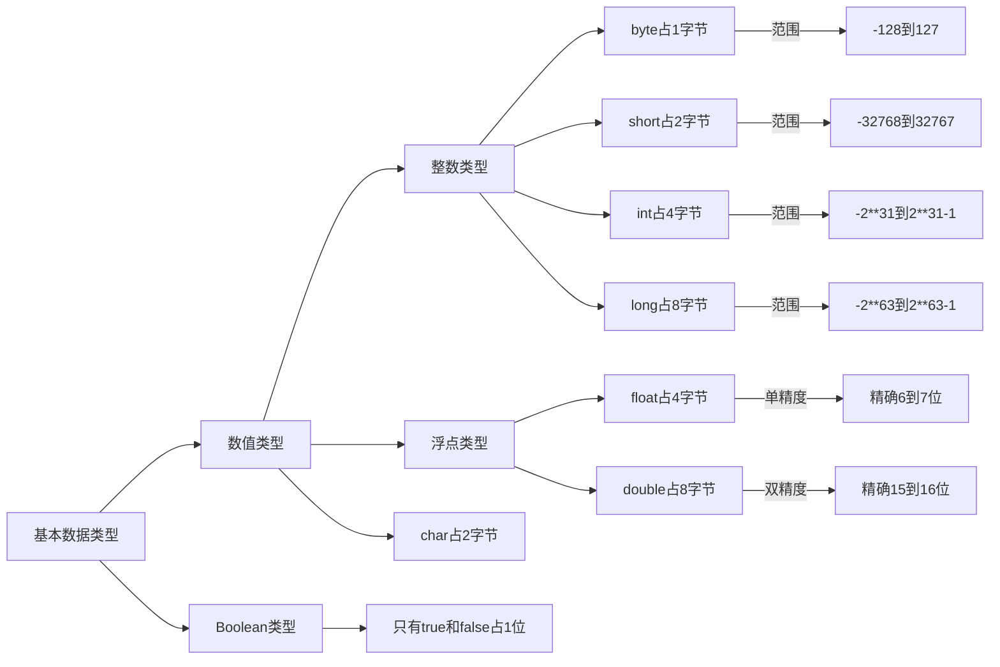
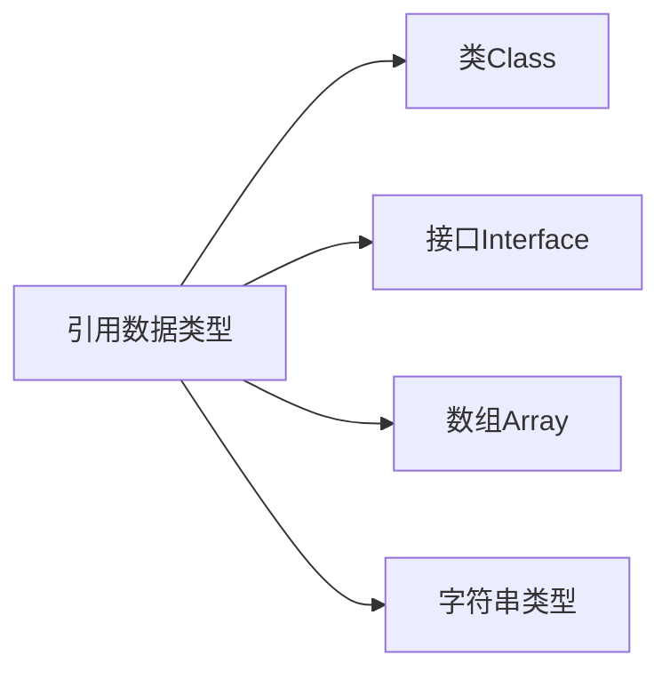

# JavaSE

## 基础

### 注释

注释不会执行


#### 单行注释 //

```java
//单行注释
```


#### 多行注释 /* */

```java
/*多行注释*/
```


#### 文档注释 /** */

```java
/**
 * @Description 注释
 */
```


### 权限修饰符（常用private和public）

|    访问包位置    | 类修饰符 |           |        |
| :--------------: | -------- | --------- | ------ |
|                  | private  | protected | public |
|       本类       | 可见     | 可见      | 可见   |
| 同包其它类或子类 | 不可见   | 可见      | 可见   |
| 其他包的类或子类 | 不可见   | 可见      | 可见   |


### 关键字

不能用关键字命名


| abstract                                                     | assert                                                       | [boolean](https://baike.baidu.com/item/boolean/0?fromModule=lemma_inlink) | break                                                        | [byte](https://baike.baidu.com/item/byte/0?fromModule=lemma_inlink) |
| ------------------------------------------------------------ | ------------------------------------------------------------ | ------------------------------------------------------------ | ------------------------------------------------------------ | ------------------------------------------------------------ |
| case                                                         | [catch](https://baike.baidu.com/item/catch/0?fromModule=lemma_inlink) | [char](https://baike.baidu.com/item/char/0?fromModule=lemma_inlink) | [class](https://baike.baidu.com/item/class/0?fromModule=lemma_inlink) | const                                                        |
| continue                                                     | [default](https://baike.baidu.com/item/default/0?fromModule=lemma_inlink) | [do](https://baike.baidu.com/item/do/0?fromModule=lemma_inlink) | [double](https://baike.baidu.com/item/double/0?fromModule=lemma_inlink) | [else](https://baike.baidu.com/item/else/0?fromModule=lemma_inlink) |
| [enum](https://baike.baidu.com/item/enum/0?fromModule=lemma_inlink) | [extends](https://baike.baidu.com/item/extends/0?fromModule=lemma_inlink) | [final](https://baike.baidu.com/item/final/0?fromModule=lemma_inlink) | [finally](https://baike.baidu.com/item/finally/0?fromModule=lemma_inlink) | float                                                        |
| [for](https://baike.baidu.com/item/for/0?fromModule=lemma_inlink) | goto                                                         | [if](https://baike.baidu.com/item/if/0?fromModule=lemma_inlink) | [implements](https://baike.baidu.com/item/implements/0?fromModule=lemma_inlink) | [import](https://baike.baidu.com/item/import/0?fromModule=lemma_inlink) |
| [instanceof](https://baike.baidu.com/item/instanceof/0?fromModule=lemma_inlink) | [int](https://baike.baidu.com/item/int/0?fromModule=lemma_inlink) | [interface](https://baike.baidu.com/item/interface/0?fromModule=lemma_inlink) | long                                                         | native                                                       |
| new                                                          | [package](https://baike.baidu.com/item/package/0?fromModule=lemma_inlink) | [private](https://baike.baidu.com/item/private/0?fromModule=lemma_inlink) | [protected](https://baike.baidu.com/item/protected/0?fromModule=lemma_inlink) | [public](https://baike.baidu.com/item/public/0?fromModule=lemma_inlink) |
| record                                                       | return                                                       | strictfp                                                     | short                                                        | static                                                       |
| super                                                        | switch                                                       | synchronized                                                 | this                                                         | throw                                                        |
| throws                                                       | transient                                                    | try                                                          | void                                                         | volatile                                                     |
| while                                                        |                                                              |                                                              |                                                              |                                                              |


---

### 命名规则

- **使用有意义的名字：** 变量名应该具有清晰的含义，能够准确地反映变量的用途。避免使用单个字符或无意义的缩写。
- **驼峰命名法（Camel Case）：** 在变量名中使用驼峰命名法，即将每个单词的首字母大写，除了第一个单词外，其余单词的首字母都采用大写形式。例如：`myVariableName`。
- **避免关键字：** 不要使用 Java 关键字（例如，class、int、boolean等）作为变量名。
- **区分大小写：** Java 是大小写敏感的，因此变量名中的大小写字母被视为不同的符号。例如，`myVariable` 和 `myvariable` 是两个不同的变量。
- **不以数字开头：** 变量名不能以数字开头，但可以包含数字。
- **遵循命名约定：** 对于不同类型的变量（局部变量、实例变量、静态变量等），可以采用不同的命名约定，例如使用前缀或后缀来区分。


---

### 数据类型

强类型语言：要求变量的使用要严格符合规定，所有变量必须先定义后使用


#### Java类型分为两大类

- 基础类型（primitive type）




- 引用类型（reference type）




#### 八大基本类型

##### 整数

```java
int num=10;
byte num1=20;
short num2=30;
long num3=10L;   //long数据类型后面要加L
```


##### 小数

float和double会出现精度丢失，用于高精度场景用BigDecimal

```java
float num4=12.1F;  //float后面要加F
double num5=123.123;
```


##### 字符

```java
char name='A';
```


##### 字符串

```java
String name="qwert";
```


##### Boolean类型

```java
boolean b=true;  //只有两个值true和false
```


#### 类型转换

转换时要注意内存溢出问题或精度问题

运算中，不同类型的数据先转换成同一类型，再进行计算

```java
低----------------------------------------高
byte，short，char，->int->long->float->double
```

高转到低需要转换，低到高自动转换


```java
int i=10;
byte u=(byte)i;
```


jdk7新特性，数字之间可以用下划线分割

```java
int p=100_0000;  //输出还是1000000
```


---

### 变量

声明变量

```java
数据类型 变量名=值;
```

可以用逗号隔开声明多个相同类型的变量，建议分开写


#### 全局变量、局部变量

局部变量是在方法、构造函数或代码块中定义的变量。它们只能在声明它们的区域内部被访问和使用。一旦方法或代码块执行完毕，局部变量的生命周期就结束了，它们也随之被销毁。

全局变量（也称为成员变量）是在类中定义的，它们的作用域覆盖整个类。这意味着它们可以在类的任何地方被访问。全局变量分为两类：实例变量和静态变量。


#### static静态变量


#### final常量

可用于定义不可修改的常量，结合 **static** 可创建全局唯一的类常量，从而提升代码可读性与安全性。


### 运算符

算术运算符：+，-，*，/，%（取模或取余），++（自增），--（自减）

```java
++a; 先自增再赋值
b++; 先赋值再自增
减法雷同
```


赋值运算符：=


关系运算符：>，<，>=，<=，==，!=（不等于），instanceof


逻辑运算符：&&，||，!

&&：和，左右条件同时成立，结果为真

||：或，左右条件有一个为真，结果为真

!：非，条件为假，结果为真


位运算符：&，|，^，~，>>，<<，>>>（了解就行）

`>>`（左移）：*2

`<<`（右移）：/2


条件运算符 ? :（三元运算符）

条件?结果1:结果2；

条件为真输出结果1，条件为假输出结果2


扩展赋值运算符：+=，-=，*=，/=

```java
int a=10;
int b=20;
a+=b;     //等同于a=a+b，其余同理
```


### 包机制

用于区别类名的命名空间

包语句语法：

```java
package pkg1[.pkg2[.pkg3...]];
```


一般利用公司域名倒置作为包名；

为了能够使用某一个包的成员，需要在Java程序中明确导入该包。使用`import`语句

```java
import package1[.package2...].(classname|*);
```


### JavaDoc

参数

- @author 作者名
- @version 版本号
- @since 指明需要最早使用的jdk版本
- @param 参数名
- return 返回值情况
- @throws 异常抛出情况

```java
/**
 * @author YI
 * @since 17
 */
```


### 流程控制

#### Scanner对象

需要导入`import java.util.Scanner;`

用于获取用户输入

基础语法：

```java
Scanner sc = new Scanner(System.in);
```


##### 输入类型

next()  //返回字符串

1. 一定要读取到有效字符后才可以结束输入
2. 对输入有效字符之前遇到的空白，next()方法会自动将其去掉
3. 只对输入有效字符后才将其后面输入的空白作为分隔符或结束符
4. next()不能得到带有空格的字符串


nextLine()  //返回字符串

1. 以`enter`为结束符，也就是nextLine()方法返回的是输入回车之前的所有字符
2. 可以输入空白


nextInt()  //返回整数

nextDouble()  //返回小数

nextFloat()  //返回小数

has以上类型：

用于判断是否输入，和类型是否对应

```java
System.out.print(hasNextInt());  //输入12，返回true，输入非整数类型返回false
```


用完关闭，减少资源消耗：

```java
sc.close();
```


### 结构

#### 顺序结构

从上到下顺序执行


#### 选择结构

##### if语句

语法：

if单选择

```java
if(Boolean语句){代码块}  //Boolean语句为true执行代码，否则跳过
```


```java
if(Boolean语句){代码块}else{代码块}
//Boolean语句为true执行if后面的代码块，否则执行else后面的代码块
```


if多选择

```java
if(Boolean语句){代码块}
else if (Boolean语句){代码块}

...
    
else{代码块}
```


if嵌套

可多层嵌套

```java
if(Boolean语句){
    if(Boolean语句){代码块}
}
```


##### switch语句

多选择

如果输入值在case中有则执行case后面的语句，没有则执行default后面的语句

break可防止case穿透


```java
Scanner sc = new Scanner(System.in);
        int t = sc.nextInt();
        switch (t){
            case 0:
                System.out.println(0);
                break;
            case 1:
                System.out.println(1);
                break;
            default:
                System.out.println("default");
        }
```


#### 循环结构

循环需要有结束条件，没结束条件为死循环，会造成内存溢出，造成程序崩溃


##### while循环

语法：

```java
while(条件){代码块}
```


##### do…while循环

语法：

```java
do{代码块}while(条件);
```


##### for循环

语法：

```java
for(初始值;条件;更新){代码块}
```


##### 增强for循环

语法：

```java
for(int i:数组){代码块}
```


#### break、continue、goto

break用于强行退出循环，不执行循环中剩余的语句


continue用于终止某次循环过程，即跳过循环体中尚未执行的语句，接着进行下一次是否执行循环的判定


goto很早就在程序设计语言中出现，尽管goto任是Java的一个保留字，但并未在语言中得到正式使用；Java没有goto。然而在break和continue这两个关键字上，仍然能看到一些goto的影子----带标签的break和continue

标签是指后面跟一个冒号的标识符，例如：label:

对Java来说唯一用到标签的地方是在循环语句之前。而在循环之前设置标签的唯一理由是：希望在其中嵌套另一个循环，由于break和continue关键字通常只中断当前循环，但若随同标签使用，就会中断到存在标签的地方

---


### 方法

方法是语句的集合它们在一起执行一个功能

- 方法是解决一类问题的步骤的有序组合
- 方法包含于类或对象中
- 方法在程序中被创建，在其他地方被引用

设计方法的原则：方法的本意是功能块，就是实现某个功能的语句块的集合。我们设计方法的时候，最好保持方法的原子性，就是一个方法只完成一个功能，这样有利于我们后期的扩展


#### 定义方法

方法包含一个方法头和一个方法体，以下是方法的所有部分

- 修饰符：修饰符，这是可选的，告诉编译器如何调用方法。定义了该方法的访问类型
- 返回值类型：方法可能有返回值。returnValueType是方法返回值的数据类型。有些方法执行所需的操作，但没有返回值，这种情况下，returnValueType是关键字void
- 方法名：方法的实际名称。方法名和参数表共同构成方法标签
- 参数类型：参数像是一个占位符。当方法被调用是，传递值给参数，这个值被称为实参或变量。参数列表是指方法的参数类型、顺序和参数的个数。参数是可选的，方法可以不包含任何参数

1. 形参：在方法被调用时用于接收外界输入的数据
2. 实参：调用方法时实际传给方法的数据

- 方法体：方法体包含具体的语句，定义该方法的功能


语法：

```java
修饰符 返回值类型 方法名(参数类型 参数名){
	...
    方法体
    ...
    return 返回值;  //如果是void就不需要
}
```


#### 方法调用

调用方法：对象名.方法名(实参列表)

Java支持两种调用方法的方式，根据方法是否返回值来选择

当方法返回一个值的时候，方法调用通常被当作一个值


#### 方法重载

就是在一个类中，有相同的函数名称，但形参不同的函数


规则：

1. 方法名必须相同
2. 参数列表必须不同（个数不同或类型不同或参数排列顺序不同等）
3. 方法的返回类型可以相同也可以不相同
4. 仅仅返回类型不同不足以成为方法的重载

实现理论：

方法名称相同时，编译器会根据调用方法的参数个数、参数类型等去逐个匹配，以选择对应的方法，如果匹配失败，则编译器会报错


#### 命令行传参


#### 可变参数

java支持传递同类型的可变参数给一个方法

在方法声明中，指定参数类型后加一个省略号（...）

一个方法中只能指定一个可变参数，它必须是方法的最后一个参数，任何普通的参数必须在它之前声明


#### 递归

简单理解就是方法可以多次自己调用自己

递归结构包括两部分：

递归头：什么时候不调用自己方法，如果没有会陷入死循环

递归体：什么时候需要调用自身方法

---

### 数组

数组是相同类型数据的有序集合

数据描述的是相同类型的若干个数据，按照一定的先后次序排列组合而成

其中，每一个数据称作一个数组元素，每个数组元素可以通过下标访问


#### 声明创建数组

```java
数据类型 [] 数组名;  //首选
数据类型 数组名 [];
```


new创建

```java
数据类型 [] 数组名 = new 数据类型 [个数];
```


数组的元素通过索引访问，数组索引从`0`开始

用`length`获取数组长度

```java
数组.length   //返回数组长度
```


#### 初始化

##### 静态初始化

```java
数据类型 [] 数组名 = {data1,data2,data3,...};
```


##### 动态初始化

```java
数据类型 [] 数组名 = new 数据类型 [个数];
数组名[0] =data1;
数组名[1] =data2;
...
数组名[个数-1] =data;
```


##### 数组默认初始化

数组是引用类型，元素相当于类的实例变量，因此数组一经分配空间，其中的每个元素也被按照实例变量同样的方式被隐式初始化


> [!CAUTION]
>
> 数组下标最大值是空间最大值-1，0~length-1


#### 遍历数组

```java
for(int i=0;i<数组.length;i++){代码块}
```


##### foreach（增强for循环）

```java
for(数据类型 变量 : 数组){代码块}
```


#### 多维数组

**二维数组**

每个元素都是数组

语法

```java
数据类型 [][] 数组名 = new 数据类型 [行][列];
```

行：有几个数组

列：数组中能放几个元素


### Arrays类

导入包：

```java
import java.util.Arrays;
```


#### sort（升序）

```java
Arrays.sort(数组);   //将数组从小到大排序
```


#### fill（填充）

```java
Arrays.fill(数组[,起始,结束-1],值);
```


### 排序

#### 冒泡排序

两层循环，外层为轮数，里层依次比较


**升序**

```java
int []arr={12,244,5,5,6,78,435};
        for (int i = 0; i < arr.length; i++) {
            for (int j = 0; j < arr.length; j++) {
                if (arr[i]<arr[j]){   //将 < 改成 > 为降序
                    int temp=arr[i];
                    arr[i]=arr[j];					
                    arr[j]=temp;
                }
            }
        }
        for(int i:arr){
            System.out.print(i+" ");
        }
```


### 稀疏数组

当一个数组中大部分元素为0，或者为同一值的数组时，可以使用稀疏数组保存该数组


处理方式

1. 记录数组一共有几行几列，有多少个不同值
2. 吧具有不同值的元素和行列及值记录在一个小规模的数组中，从而缩小程序的规模


实例：

```java
int [][] arr=new int[9][9];
        arr[2][3]=2;
        arr[6][6]=1;
        arr[6][5]=1;
        for (int []row:arr) {
            for (int i:row) {
                System.out.print(i+" ");
            }
            System.out.println();
        }
        int count=0;
        for (int[] row : arr) {
            for (int j = 0; j < arr.length; j++) {
                if (row[j] != 0) {
                    count++;
                }
            }
        }
        System.out.println(count);
        int [][] arr2=new int[count+1][3];
        arr2[0][0]=9;
        arr2[0][1]=9;
        arr2[0][2]=3;
        int index=1;
        for (int i = 1; i < arr.length; i++) {
            for (int j = 0; j < arr.length; j++) {
                    if (arr[i][j]!=0){
                        arr2[index][0]=i;
                        arr2[index][1]=j;
                        arr2[index][2]=arr[i][j];
                        index++;
                    }

            }
        }
        for (int i = 0; i < arr2.length; i++) {
            for (int j = 0; j < 3; j++) {
                System.out.print(arr2[i][j]+" ");
            }
            System.out.println();
        }
```


### 面向对象

以类的方式组织代码，以对象的组织（封装）数据

三大特性：封装、继承、多态

对象能执行的方法主要看左边的类型


#### 创建与初始化对象

使用`new`关键字创建对象

使用new关键字创建的时候，除了分配内存空间之外，还会给创建好的对象进行默认初始化以及对类中构造器的调用

类中的构造器也称为构造方法，是在进行创建对象的时候必须要调用的。并且构造器有以下特点

1. 必须和类的名字相同
2. 必须没有返回类型，也不能写void

`构造器必须掌握`


```java
public class t3 {
    public void hello(){
        System.out.println("Hello!");
    }

    public static void main(String[] args) {
        t3 t3 = new t3();
        t3.hello();
    }
}
```


#### 封装

- 程序追求`高内聚，低耦合`，高内聚就是类的内部数据操作细节自己完成，不允许外部干涉，低耦合，仅暴露少量方法给外部使用
- 封装（数据的隐藏）

通常，应禁止直接访问一个对象中数据的实际表示，而应通过操作接口来访问，这称为信息隐藏

`属性私有，get/set`


##### this

能够调用本类的属性，方法和构造函数


```java
private String name;
    public String getName() {
        return name;               //在main方法中可以用该方法获取name属性
    }

    public void setName(String name) {
        this.name = name;		  //在main方法中可以用该方法设置name属性
    }
```


#### 继承

本质是对某一批类的抽象

Java中所有类直接或间接继承object类


`extends`的意思是扩展，子类是父类的扩展

Java只有单继承没有多继承

继承是类和类之间的一种关系。除此之外，类和类之间的关系还有依赖、组合、聚集等

继承关系的两个类，一个为子类（派生类），一个为父类（基类）。子类继承父类，使用关键字extends来表示

子类和父类之间，从意义上讲应该具有“is a”的关系


```java
public class Person {
}

public class Student extends Person{
}
```


object类


##### super

只能出现在子类的方法或构造方法中

能够调用父类属性、成员变量、方法或构造函数


```java
public class Person {
    public void say(){System.out.print("hello!")}
}

public class Student extends Person{
    public void say1(){
        super.say();    //调用父类方法
    }
}
```


```java
public class Person {
    public Person(){
        System.out.print("name");
    }
}

public class Student extends Person{
    public Student(){
        super();   //可不写默认自动调用
    }
}
```


调用父类构造器需要放在子类构造器的第一行


#### 方法重写

重写要有继承关系，子类重写父类方法

1. 方法名必须相同
2. 参数列表必须相同
3. 修饰符：范围可以扩大但不能缩小
4. 抛出异常：范围，可以被缩小，但不能扩大；ClassNotFoundException-->Exception(大)

重写，子类的方法和父类必须一致；方法体不同

@Override  ：重写注解

没有static时，person调用的是对象方法，而person是用Student类new的

有static时，person调用的是Person类的方法，因为person是Person定义的

因为静态方法是类方法，而非静态方法是对象方法

```java
public class Person {
    public static void say(){
        System.out.println("Person=>say()");
    }
}
public class Student extends Person{
    public static void say(){
        System.out.println("Student=>say()");
    }
}
public static void main(String[] args) {
    Student student = new Student();
    student.say();  //Student=>say()
    Person person = new Student();
    person.say();  //Person=>say()
}
```

```java
public class Person {
    public void say(){
        System.out.println("Person=>say()");
    }
}
public class Student extends Person{
    @Overrode
    public void say(){
        System.out.println("Student=>say()");
    }
}
public static void main(String[] args) {
    Student student = new Student();
    student.say();  //Student=>say()
    Person person = new Student();
    person.say();  //Student=>say()
}
```


#### 多态

同一方法可以根据发送对象的不同而采用多种不同的行为方式

一个对象的实际类型是确定的，但可以指向对象的引用类型有很多（父类，有关系的类）


存在条件：要有继承关系，方法需要重写，父类指向子类对象     //Person stu=new Student()

父类不能调用子类独有方法

> [!CAUTION]
>
> 方法可多态，属性不行


#### instanceof

用于检测左侧的对象是否为右侧类或接口的实例，它返回一个布尔值，如果对象是指定类的实例或者是这个类的子类的实例，则返回**true**；否则返回**false**

```java
studnt instanceof Student;
```


#### static

static放在属性前面为静态属性

```java
public class t4 {
    private static int age;
    private String name;
    public static void main(String[] args) {
        t4 t = new t4();
        System.out.println(t.name);		//非静态变量要用对象调
        System.out.println(t.age);
        System.out.println(t4.age);    //静态变量
    }
}
```


#### 抽象类（abstract）

抽象方法只有名字，没有方法的实现

1. 不能new这个抽象类，只能靠子类去实现
2. 抽象类中可以写普通方法
3. 抽象方法必须写在抽象类中

子类继承抽象类，必须重写抽象类的所有方法

抽象的抽象：约束


```java
public abstract class Person {
    public abstract void run();
    public  void say(){
        System.out.println("Person=>say()");
    }
}
```


#### 接口（interface）

接口就是规范，定义的是一组规则

接口的本质是契约


public static final ：能够定义常量

接口不能够被实例化，接口中没有构造方法

implements可以实现多接口

必须重写接口中方法


接口定义的方法其实是public abstract方法

```java
public interface t5 {
    void user();
    void id();
    void address();
}
```


#### 内部类

##### 成员内部类

```java
public class t6 {
    private int age;
    public void b(){
        System.out.println("hello");
    }
    public class t7{
        public void c(){
            System.out.println("world");
        }
    }
}
//测试类
public class t4 {
    public static void main(String[] args) {
        t6 t = new t6();
        t6.t7 t2 = t.new t7();
        t2.c();
    }
}
```


##### 静态内部类


##### 局部内部类

```java
public class t6 {
   public void add(){
       class t7{
           public void run(){}
       }
   }
}
```


##### 匿名内部类

没有名字初始化类

```java
public class t4 {
    public static void main(String[] args) {
        new ser(){
            @Override
            public void run(){}
        };
    }
    interface ser{
        void run();
    }
}
```


### 异常类

**检查性异常**：最具代表性的检查性异常是用户错误或问题引起的异常，这是程序员无法预见的，例如要打开一个不存在文件时，一个异常就发生了，这些异常在编译时不能被简单的忽略

**运行时异常**：运行时异常是可能被程序员避免的异常。与检查性异常相反，运行时异常可以在被编译时忽略

**错误**：错误不是异常，而是脱离程序员控制的问题。错误在代码中通常被忽略。例如，当栈溢出时，一个错误就会发生，它们在编译也检查不到


**异常处理关键字**：

```java
try，catch，finally，throw，throws
```


#### Exception

Exception分支中有一个重要的子类RuntimeException（运行时异常）

1. ArrayIndexOutOfBoundsException（数组下标越界）
2. NullPointerException（空指针异常）
3. ArithmeticException（算数异常）
4. MissingResourceException（丢失资源）
5. ClassNotFoundException（找不到类）等异常，这些异常是不检查异常，程序中可以选择捕获处理，也可以不处理

这些异常一般是由程序逻辑错误引起的，程序应该从逻辑角度尽可能避免这类异常的发生


#### 异常捕获

```java
try{要捕获异常的代码}
catch(异常类型){出现异常时执行的代码}
finally{出不出现异常都会执行的代码}	//finally尽量使用释放占用的资源
```


#### 主动抛出异常

一般在方法中使用

```java
public class t4 {
    public static void main(String[] args) {
        try {
            new t4().a(1,0);
        } catch (ArithmeticException e) {
            e.printStackTrace();
        }
    }
    public void a(int a,int b)throws ArithmeticException{
        int c=a/b;
    }
}
```


#### 错误

由Java虚拟机生成并抛出，大多数错误与代码编写者所执行的操作无关

Java虚拟机运行错误，当JVM不再有继续操作所需的内存资源时，将出现OutOfMemoryError。这些异常发生时，Java虚拟机一般会选择线程终止

还有发生在虚拟机试图执行应用时，如类定义错误（NoClassDefFoundError）、链接错误（LinkageError）。这个错误是不可查的，因为它们在应用程序的控制和处理能力之外，而且绝大多数是程序运行时不允许出现的状况


**Error和Exception的区别**：

Error通常是灾难性的致命错误，是程序无法控制和处理的，当出现这些异常时，Java虚拟机一般会选择终止线程；Exception通常情况下可以被程序处理的，并且在程序中应该尽可能的去处理这些异常


#### 自定义异常

写一个类继承Exception类……


