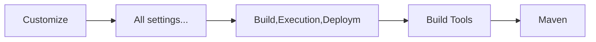

# Maven

### 环境配置

Java环境建议：jdk17

到官网下载apache-maven-版本-bin.zip

解压之后，找到apache-maven-版本-bin --> conf --> settings.xml -->找到`<mirror>`标签，将下面的添加到mirror标签前	

```xml
<!-- 阿里云镜像地址 -->
    <mirror>
      <id>aliyunMaven</id>
      <mirrorOf>*</mirrorOf>
      <name>阿里云公共仓库</name>
      <url>https://Maven.aliyun.com/repository/public</url>
    </mirror>
    <!-- 华为云镜像地址 -->
    <mirror>
      <id>huaweicloud</id>
      <mirrorOf>*</mirrorOf>
      <url>https://repo.huaweicloud.com/repository/Maven/</url>
    </mirror>
```

将apache-maven-版本-bin配置到电脑环境变量中

配置完成后用cmd检查：mvn -v


到idea中配置Maven




### 创建maven项目

#### 命令行创建

cmd输入：mvn archetype:generate


看到这个就成功了


---

#### idea创建


**项目目录**


### xml文件

#### **坐标信息**

groupId：域名反过来写

artifactId：项目名

version：版本


#### 用坐标信息引用jar包

到https://mvnrepository.com中央仓库找需要的对应版本jar包，然后复制Maven下的代码粘贴到pom.xml文件中的dependencies标签下，没有dependencies标签就创建一个


```xml
<dependencies>
    <!-- https://mvnrepository.com/artifact/javax.servlet/javax.servlet-api -->
    <dependency>
        <groupId>javax.servlet</groupId>
        <artifactId>javax.servlet-api</artifactId>
        <version>3.1.0</version>
        <scope>provided</scope>
    </dependency>
</dependencies>
```


#### 当前文件的jdk版本

```xml
<properties>
        <maven.compiler.source>17</maven.compiler.source>
        <maven.compiler.target>17</maven.compiler.target>
        <project.build.sourceEncoding>UTF-8</project.build.sourceEncoding>
    </properties>
```


#### 打包方式

默认jar

```xml
<packaging>war</packaging>
```


### 执行Maven命令

主要


#### 命令行窗口

必须在Hello目录下执行命令


#### idea上执行


### 依赖

#### 依赖范围

`<scope>`标签

|                 | 编译  | 测试  | 打包  |
| --------------- | ----- | ----- | ----- |
| runtime         |       | **☑** | **☑** |
| compile（默认） | **☑** | **☑** | **☑** |
| provided        | **☑** | **☑** |       |
| system          |       |       |       |
| test            |       | **☑** |       

system=provided不会依赖仓库中的jar包，而是引用本地物理路径的jar包`<systemPath></systemPath>`


#### 依赖传递

创建新项目，将新项目的坐标id给其他项目的xml文件

```xml
<!--项目坐标写在其他项目的xml文件<dependencies>中-->
<dependency>
<groupId>xxx</groupId>
<artifactId>xxx</artifactId>
<version>xxx</version>
</dependency>
```


设置依赖将依赖的`<scope></scope>`标签中修改范围为provided，test都就不会传递

```xml
<dependencies>
 <!-- https://mvnrepository.com/artifact/javax.servlet/javax.servlet-api -->
        <dependency>
            <groupId>javax.servlet</groupId>
            <artifactId>javax.servlet-api</artifactId>
            <version>3.1.0</version>
            <scope>provided</scope>  <!--修改scope-->
        </dependency>

    </dependencies>
```


或者设置`<optional></optional>`标签

```xml
<dependency>
    <groupId>javax.servlet</groupId>
    <artifactId>javax.servlet-api</artifactId>
    <version>3.1.0</version>
    <optional>false</optional>  <!--默认为false，传递，改成true就不会传递-->
</dependency>
```


#### 排除依赖

```xml
<dependency>
    <groupId>xxx</groupId>
    <artifactId>xxx</artifactId>
    <version>xxx</version>
	<exclusions>
		<exclusion>
		<groupId>javax.servlet</groupId>
    	<artifactId>javax.servlet-api</artifactId>
		</exclusion>
	</exclusions>
</dependency>
```


#### 覆盖依赖

自己写项目依赖版本，跟引入的不一样就行


#### 依赖项目链


### Maven聚合项目

用于管理其他项目不写代码，所以删除src文件

1. 改`<packaging>pom</packaging>`，没有就加
2. 在聚合项目下创建一个或多个子项目


通过聚合项目就可以同时管理多个子项目


### Maven继承

在聚合项目管理的依赖子都能继承

```xml
<!--hello2的xml文件-->
<dependencies>
        <dependency>
            <groupId>com.yi</groupId>
            <artifactId>hello1</artifactId>
            <version>1.0-SNAPSHOT</version>
        </dependency>
    </dependencies>
```


子项目编写`<parent>`标签

```xml
<parent>
        <groupId>com.yi</groupId>
        <artifactId>Hello</artifactId>
        <version>1.0-SNAPSHOT</version>
</parent>
```


不是所有子项目都需要的依赖时，用`<dependencyManagement></dependencyManagement>`标签

```xml
<!--主项目添加-->
<dependencyManagement>
    <dependencies>
        <dependency>
            <groupId>javax.servlet</groupId>
            <artifactId>javax.servlet-api</artifactId>
            <version>4.0.1</version>
        </dependency>
    </dependencies>
</dependencyManagement>
```

在需要该依赖的子项目中配置，不需要版本号，聚合项目同一管理

```xml
<dependencies>
    <dependency>
        <groupId>javax.servlet</groupId>
        <artifactId>javax.servlet-api</artifactId>
    </dependency>
</dependencies>
```


### 总结

| 核心       | 掌握目标                                           |
| ---------- | -------------------------------------------------- |
| 安装       | Maven安装、环境变量、Maven配置文件修改             |
| 工程创建   | gav属性理解、工程创建、项目结构                    |
| 依赖管理   | 依赖添加、依赖传递、版本提取                       |
| 构建管理   | 构建过程、构建场景、构建周期                       |
| 继承和聚合 | 理解继承和聚合作用、继承语法和实践、聚合语法和实践 |

