# Vue

Vue官方网站：cn.vuejs.org

学习Vue之前要掌握JavaScript基础知识

`ES6语法规范`

`ES6模块化`

`包管理器`

`原型，原型链`

`数组常用方法`

`axios`

`promise`

## Vue2基础

### 安装

需要在浏览器上安装Vue.js devtools插件

直接用`<script>`引入

```html
<!DOCTYPE html>
<html lang="en">
<head>
  <meta charset="UTF-8">
  <title>Title</title>
</head>
<body>

<script type="text/javascript" src="../js/vue.js"></script>
<script type="text/javascript">
  Vue.config.productionTip=false; //阻止Vue启动时生成生产提示
</script>
</body>
</html>
```


### 起步

创建实例对象

```html
<!DOCTYPE html>
<html lang="en">
<head>
  <meta charset="UTF-8">
  <title>Title</title>
</head>
<body>
<!--创建容器-->
<div id="root">
  <h1>user</h1>
</div>

<script type="text/javascript" src="../js/vue.js"></script>
<script type="text/javascript">
  Vue.config.productionTip=false; //阻止Vue启动时生成生产提示

  //创建Vue实例对象
  new Vue({
    el:'#root',
    data:{}
  })
</script>
</body>
</html>
```

`el`用于指定当前Vue实例为哪个容器服务，通常为css选择器字符串，例如class，id，等

`data`用于存放数据让容器使用，可以是基础数据类型，引用数据类型等

`{{xxx}}`能调用data中的数据，除了调用也还可以写js表达式


> [!CAUTION]
>
> 一个容器只能对应一个实例对象
>
> 
>
> - `错误示范1`
>
> ```html
> <!DOCTYPE html>
> <html lang="en">
> <head>
>   <meta charset="UTF-8">
>   <title>Title</title>
> </head>
> <body>
> <!--创建容器-->
> <div id="root">
>   <h1>user:{{name}},address:{{address}}</h1>
> </div>
> 
> <script type="text/javascript" src="../js/vue.js"></script>
> <script type="text/javascript">
>   Vue.config.productionTip=false; //阻止Vue启动时生成生产提示
> 
>   //创建Vue实例对象
> 	new Vue({
>         el:'#root',
>         data:{name:'YI'}
>       })
> 	new Vue({
>         el:'#root',
>         data:{address:'重庆'}
>     })
> </script>
> </body>
> </html>
> ```
>
> 容器被第一个Vue实例对象接管，第二个实例对象就不生效
>
> 
>
> - `错误示范2`
>
> ```html
> <!DOCTYPE html>
> <html lang="en">
> <head>
>   <meta charset="UTF-8">
>   <title>Title</title>
> </head>
> <body>
> <!--创建容器-->
> <div class="root">
>   <h1>user:{{name}},address:{{address}}</h1>
> </div>
> <div class="root">
>   <h1>user:{{name}},address:{{address}}</h1>
> </div>
> 
> <script type="text/javascript" src="../js/vue.js"></script>
> <script type="text/javascript">
>   Vue.config.productionTip=false; //阻止Vue启动时生成生产提示
> 
>   //创建Vue实例
>   new Vue({
>     el:'.root',
>     data:{name:'YI',address:'重庆'}
>   })
> </script>
> </body>
> </html>
> ```
>
> 对象找到第一个容器，就停止继续向下寻找，第二个容器没有对象接管


### 模块语法

#### 插值语法

用于标签

用`{{}}`直接调

```html
<div class="root">
  <h1>user:{{name}},address:{{address}}</h1>
</div>
<script type="text/javascript">
  Vue.config.productionTip=false;

  new Vue({
    el:'.root',
    data:{name:'YI',address:'重庆'}
  })
</script>
```


#### 指令语法

用于标签属性

用`v-bind:`绑定href=“xxx”，xxx是js表达式，引号里就能写表达式，变量

`v-bind:`能简写成`:`

```html
<div class="root">
  <h1>user:{{name}},address:{{address}}</h1>
  <a v-bind:href='url'>baidu</a>
  <a :href='url'>baidu</a>
</div>
<script type="text/javascript">
  Vue.config.productionTip=false;

  new Vue({
    el:'.root',
    data:{name:'YI',address:'重庆',url:'http:baidu.com'}
  })
</script>
```


### 数据绑定

`v-bind:`：单向绑定

修改数据不会影响对象中data的数据

```html
<input type="text" >
```


`v-model`：双向绑定

修改数据会影响对象中data的数据，并且只能于表单类元素（输入类元素）上


## vue3基础

### 安装

需要有Node.js 22.12.0以上的版本

在终端运行

```cmd
npm init vue@latest
```

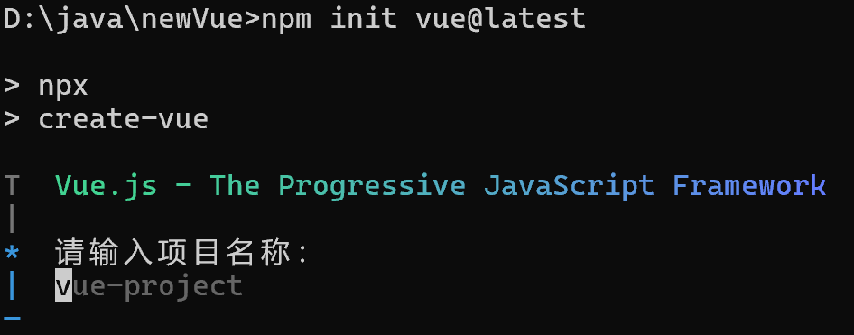

输入项目名称


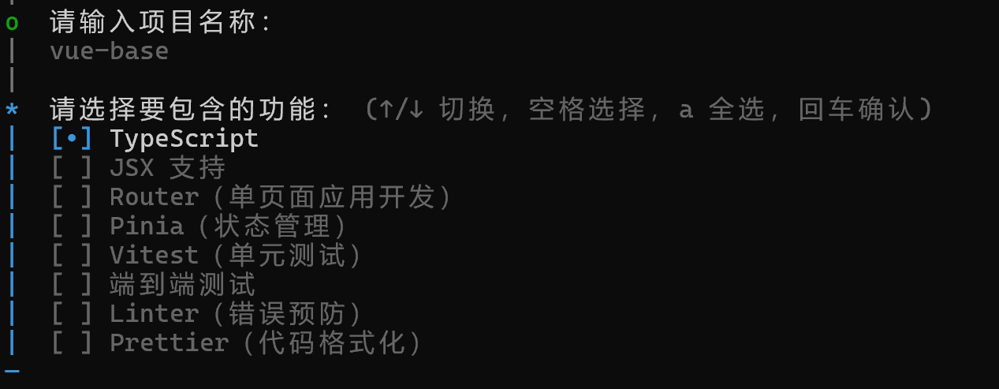

这里根据自己需求勾选，或输入enter跳过


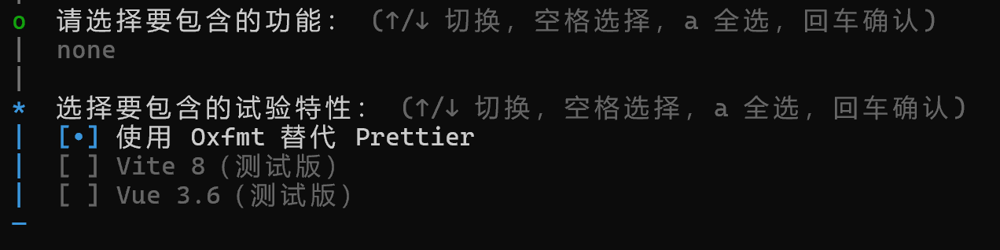

这里也是根据自己需求勾选，或输入enter跳过


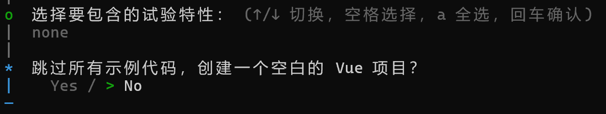

这里也是根据自己需求选，或输入enter


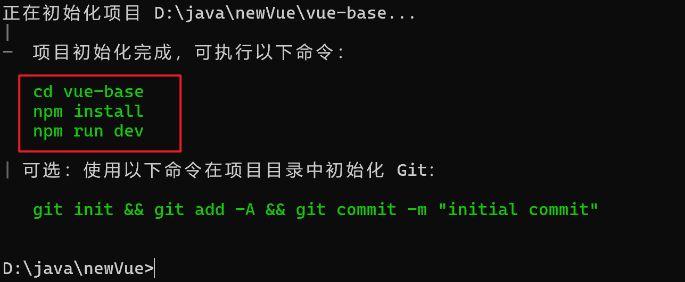

然后依次执行这三条命令

npm install 可用cnpm install替换


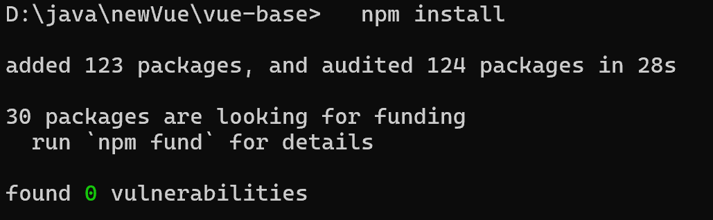

没有出现error就没有问题


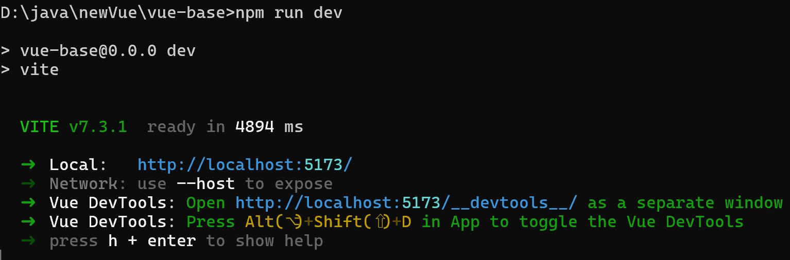

这样表示成功运行，浏览器输入上面的local地址，出现下图

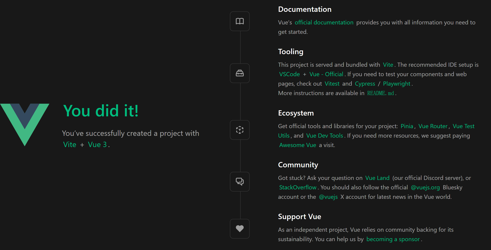


官方推荐用vscode +  Vue (Official)插件


vscode打开，项目结构如下

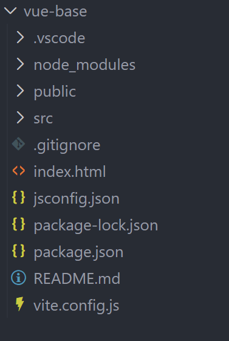

src下components中的文件可选择删除同时删除App.vue中的，保留如下（两标签位置不影响）

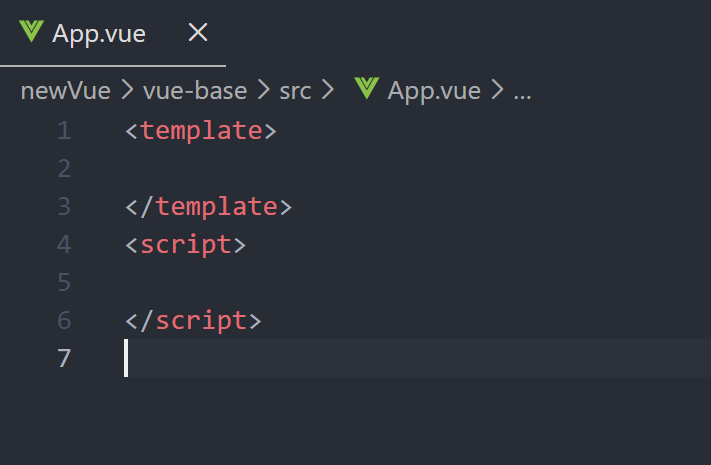


这些也可以删掉

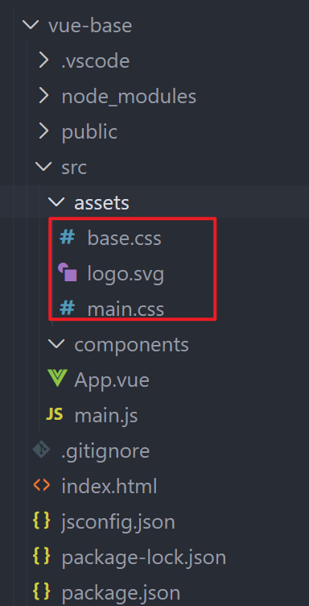

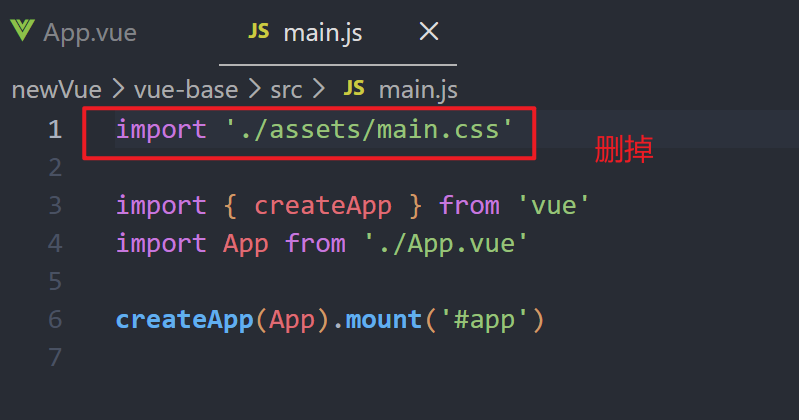


> [!CAUTION]
>
> 要运行vue服务才能运行vue代码，控制台输入
>
> ```cmd
> npm run dev
> ```
>
> 服务跑起来后用里面的地址访问页面


### 模块语法

#### 插值语法

`{{xxx}}`：xxx为js表达式，也可以是data中的数据

App.vue

```vue
<template>
	<h1>{{msg}} </h1>
	<p>
        {{hello}}
    </p>
</template>
<script>
export default{
    data(){
        return{
            msg:"神奇的语法",
            hello:'hello world'
        }
    }
}
</script>
```


插入原始html

```vue
<template>
	<p v-html="nHtml"></p>
</template>
<script>
export default{
    data(){
        return{
            nHtml:'<a href="https://www.baidu.com">baidu</a>'
        }
    }
}
</script>
```


### 属性绑定

#### `v-bind:`

绑定href=“xxx”，xxx是js表达式，引号里就能写表达式，变量

`v-bind:`可以简写成`:`


给p标签绑定class属性

```vue
<template>
	<p v-bind:class="c" v-bind:id="b">123</p>
	<p :class="c" :id="a">1234</p>
</template>
<script>
export default{
    data(){
        return{
            c:'first',
            b:"end",
            a:"end1"
        }
    }
}
</script>
```


p标签qq同时设置class，id属性

```vue
<template>
	<p v-bind:class="c" v-bind:id="b">123</p>
	<p :class="c" :id="a">123</p>
  <p v-bind="d">qq</p>
</template>
<script>
export default{
    data(){
        return{
            c:'first',
            b:"end",
            a:"end1",
            d:{class:'qwe',id:'asd'}
        }
    }
}
</script>
```


#### `v-model:`

应用于input输入框


### 条件渲染

#### `v-if`

v-if=“”

```vue
<template>
	<div v-if="flag">1234</div>
</template>
<script>
export default{
    data(){
        return{
            flag: true            //页面输出1234
        }
    }
}
</script>
```


#### `v-else`

```vue
<template>
	<div v-if="flag">1234</div>
    <div v-else>123</div>
</template>
<script>
export default{
    data(){
        return{
            flag: false            //页面输出123
        }
    }
}
</script>
```


#### `v-else-if`

```vue
<template>
	<div v-if="flag==='false'">false</div>
    <div v-else-if="flag==='true'">true</div>
    <div v-else>not false and true</div>
</template>
<script>
export default{
    data(){
        return{
            flag: '1'        //输出not false and true
        }
    }
}
</script>
```


#### `v-show`

用于元素的显示与隐藏


```vue
<template>
	<div v-if="flag==='false'">false</div>
    <div v-else-if="flag==='true'">true</div>
    <div v-else>not false and true</div>
    <div v-show="flag">show</div>
</template>
<script>
export default{
    data(){
        return{
            flag: true             //输出show，注意没有true
        }
    }
}
</script>
```


### 列表渲染

#### `v-for`

基于数组来渲染列表，`v-for`指令的值需要使用`item in items`形式的特殊语法，其中items是元数据的数组，而item是迭代项的别名

```vue
<template>
	<div v-for="name in nameLsit">{{ name }}</div>
</template>
<script>
export default{
    data(){
        return{
            nameLsit:['zhangs','lis','wangw']
        }
    }
}
</script>
```

出现三个div分别打印name


`v-for`也可以使用可选的第二参数表示当前项的位置索引

```vue
<template>
	<div v-for="(user,index) in nameLsit">
        {{ user }}-{{ index }}
    </div>
</template>
<script>
export default{
    data(){
        return{
            nameLsit:['zhangs','lis','wangw']
        }
    }
}
</script>
```


of替代in更接近迭代器的使用,两种效果相同

```vue
<template>
	<div v-for="(user,index) of nameLsit">
        {{ user }}-{{ index }}
    </div>
</template>
<script>
export default{
    data(){
        return{
            nameLsit:['zhangs','lis','wangw']
        }
    }
}
</script>
```


`v-for`第三个可选参数`key`

```vue
<template>
	<div v-for="(user,key,index) of nameLsit">
        {{ user }}-{{key}}-{{ index }}
    </div>
</template>
<script>
export default{
    data(){
        return{
            userInfo:{
                name:'zhangs',
                age:19,
                sex:"man"
            }
        }
    }
}
</script>
```


##### 处理复杂数据

```vue
<template>
	<div v-for="user in userLsit">
        <p>name:{{ user.name }}</p>
        <p>age:{{ user.age }}</p>
    </div>
</template>
<script>
export default{
    data(){
        return{
            userList:[{name:'zhangs',age:18},{name:'lis',age:20},{name:'wangw',age:19}]
        }
    }
}
</script>
```


#### 通过key管理状态

vue默认按照’就地更新的策略来更新通过v-for渲染的元素列表，当数据项的顺序发生改变时，vue不会随之移动dom元素顺序

为了给vue一个提示，以便它可以跟踪每个节点的标识，从而重用和重新排列现有的元素，需要为每一个元素对应的块提供一个唯一的`key`attribute:

```vue
<template>
	<div v-for="(user,index) of nameLsit" :key="index">
        {{user}}
    </div>
</template>
<script>
export default{          //不建议用index当key
    data(){
        return{
           nameLsit:['zhangs','lis','wangw']
        }
    }
}
</script>
```

> [!TIP]
>
> `key`在这里是一个通过`v-bind`绑定的特殊attribute
>
> 推荐在任何可行的时候为`v-for`提供一个`key`attribute
>
> `key`绑定的值期望是一个基础类型的值，如字符串，数字……


### 事件绑定

#### `v-on`

简写为`@`，监听dom事件，并在事件触发时执行对应的JavaScript

用法：

```vue
v-on:click="methodName"或@click="handler"
```


事件处理器的值可以是

1. 内联事件处理器：事件被触发时执行的内联JavaScript语句（与onclick类似）
2. 方法事件处理器：一个指向组件上定义的方法的属性名或是路径


#### 内联事件处理器

```vue
<template>
    <div>
        <button v-on:click="cou++">add</button>
        <p>{{ cou }}</p>
    </div>
    <div>
        <button @click="cou1+=2">add+2</button>
        <p>{{ cou1 }}</p>
    </div>
</template>
<script>
export default{
    data(){
        return{
        cou:0,
        cou1:0
    }}
}
</script>
```


#### 方法事件处理器

```vue
<template>
    <div>
        <button @click="addCou">add</button>
        <p>{{ cou }}</p>
    </div>
</template>
<script>
export default{
    data(){
        return{
        cou:0,
    }},
    //存放所有函数方法
    methods:{
        addCou(){
            this.cou++
        }
    }
}
</script>
```


### 事件参数

事件参数可获取vue封装的`event`对象和通过事件传递数据

```vue
<template>
    <div>
        <button @click="addCou">add</button>
        <p>{{ cou }}</p>
    </div>
</template>
<script>
export default{
    data(){
        return{
        cou:0,
    }},
    methods:{
        addCou(e){
            console.log(e.target.innerHTML="add"+this.cou);
            this.cou++
        }
    }
}
</script>
```


#### 传递参数

```vue
<template>
    <div>
        <p @click="getName(name)" v-for="(name,index) in names" :key="index">{{name}}</p>
    </div>
</template>
<script>
export default{
    data(){
        return{
        names:['zhans','lis','wangw']
    }},
    methods:{
        getName(e){
            console.log(e);				//点谁获取谁
        }
    }
}
</script>
```


传递参数的同时获取vue封装的event对象,用`$event`

```vue
<template>
    <div>
        <p @click="getName(name,$event)" v-for="(name,index) in names" :key="index">{{name}}</p>
    </div>
</template>
<script>
export default{
    data(){
        return{
        names:['zhans','lis','wangw']
    }},
    methods:{
        getName(name,e){
            console.log(name)
            console.log(e);
        }
    }
}
</script>
```


### 事件修饰符

处理事件时调用`event.preventDefault()`或`event.stopPropagation()`是很常见的，尽管可以直接在方法内调用，但如果方法能更专注于数据逻辑而不用去处理dom事件的细节会更好

`v-on`常用事件修饰符：

1. `.stop`
2. `.prevent`
3. `.once`
4. `.enter`


#### 阻止默认事件

```vue
<template>
    <div>
                <!-- 阻止a标签默认的跳转 -->
        <a @click.prevent="getName()" href="https:www.baidu.com">baidu</a>
    </div>
</template>
<script>
export default{
    data(){
        return{

    }},
    methods:{
       getName(){
        console.log(1);
        
       }
    }
}
</script>
```


#### 阻止事件冒泡

```vue
<template>
    <div @click="getName">
        <!-- 不添加 .stop 点击文本外层的div也会输出打印 -->
        <p @click.stop="clickP">文本</p>
    </div>
</template>
<script>
export default{
    data(){
        return{

    }},
    methods:{
       getName(){
        console.log('div');
       },
       clickP(){
        console.log('p')
       }
    }
}
</script>
```


### 数组变化侦测

#### 变更方法

==会引起UI界面发生变化==

vue能侦听响应式数组的变更方法，并在他们被调用时触发相关的更新

- `push()`
- ``pop()`
- `shift()`
- `unshift()`
- `splice()`
- `sort()`
- `reverse()`


```vue
<template>
    <button @click="clickP">add</button>
        <p v-for="name in names">{{ name }}</p>
    
</template>
<script>
export default{
    data(){
        return{
            names:['zhangs','lis','wangw']
    }},
    methods:{
        clickP(){
            this.names.push('zhaol')
        }
    }
}
</script>
```


#### 替换一个数组

==不会引起UI界面发生变化==

变更方法，就是会对调用他们的原数组进行变更，相对的也有一些不可变（immutable）方法，列如`filter()`,`concat()`,`slice()`这些都不会改变原数组，而是返回一个新数组，当遇到的是非变更方法时，我们需要将旧数组替换为新数组

```vue
<template>
    <button @click="clickP">add</button>
        <p v-for="name in names">{{ name }}</p>
    
</template>
<script>
export default{
    data(){
        return{
            names:['zhangs','lis','wangw']
    }},
    methods:{
        clickP(){
            this.names.concat(['zhaol'])		//数据添加了，UI不更新
            console.log(this.names.concat(['zhaol']));
            
        }
    }
}
</script>
```


```vue
<template>
    <button @click="clickP">合并数组</button><br>
    name数组
        <p v-for="name in names">{{ name }}</p>
        num数组
        <p v-for="num in nums">{{ num }}</p>
</template>
<script>
export default{
    data(){
        return{
            names:['zhangs','lis','wangw'],
            nums:[1,2,3,4]
    }},
    methods:{
        clickP(){		//将合并的数组赋值给names就会引起ui变化
            this.names=this.names.concat(this.nums)   
        }
    }
}
</script>
```


### 计算属性

推荐使用计算属性来描述依赖响应式状态的复杂逻辑

`computed`

```vue
<template>
        <p>{{ hasArrLen }}</p>
</template>
<script>
export default{
    data(){
        return{
            names:['zhangs','lis','wangw'],
    }},
    computed:{
        hasArrLen(){
            return this.names.length>0? 'yes':'no'
        }
    }
}
</script>
```


> [!NOTE]
>
> 计算属性缓存 VS 方法
>
> 在表达式中编写函数能实现和计算属性相同的结果
>
> ==重要区别==
>
> 计算属性：计算属性会基于其响应式依赖被缓存，一个计算属性仅会在其响应式依赖更新时才重新计算
>
> 方法：方法调用总是会在重渲染发生时再次执行函数


### class绑定

数据绑定的一个常见需求场景是操纵元素的css `class`列表，因为class是attribute，可以和其他attribute一样使用`v-bind`将它们和动态字符串绑定，但是，在处理比较复杂的绑定时，通过拼接生成字符串是麻烦且易出现错误，因此，专门为class的v-bind用法提供了特殊的功能增强。除了字符串外，表达式的值也可以是对象或数组


#### 绑定对象

```vue
<template>
	<!-- 两种写法 -->
    <div :class="{'col':iscol,'fontSize':fontSize}">123</div>
    <div :class="allStyle">1234</div>
</template>

<script>
    export default{
        data(){
            return{
                iscol: true,
                fontSize:false,
                allStyle:{
                    'col': true,
                    'fontSize':true,
                }
            }
        }
    }
</script>

<style>
    .col{
        color: brown;
    }
    .fontSize{
        font-size: 59px;
    }
</style>
```


#### 绑定数组

```vue
<template>
    <div :class="[iscol,fontSize]">123</div>
</template>

<script>
    export default{
        data(){
            return{
                iscol: 'col',
                fontSize:'fontSize',
            }
        }
    }
</script>

<style>
    .col{
        color: brown;
    }
    .fontSize{
        font-size: 59px;
    }
</style>
```


```vue
<template>
    <div :class="[isTrue? 'col fontSize':'']">123</div>
</template>

<script>
    export default{
        data(){
            return{
                iscol: 'col',
                fontSize:'fontSize',
                isTrue: true
            }
        }
    }
</script>

<style>
    .col{
        color: brown;
    }
    .fontSize{
        font-size: 59px;
    }
</style>
```


#### 数组和对象

```vue
<template>
    <div :class="[isTrue? 'col':'',{fontSize}]">123</div>
</template>

<script>
    export default{
        data(){
            return{
                iscol: 'col',
                fontSize:'fontSize',
                isTrue: true
            }
        }
    }
</script>

<style>
    .col{
        color: brown;
    }
    .fontSize{
        font-size: 59px;
    }
</style>
```


### Style绑定

`style`是attribute，可以和其他attribute一样使用`v-bind`将它们和动态字符串绑定，但是，在处理比较复杂的绑定时，通过拼接生成字符串是麻烦且易出现错误，因此，专门为style的v-bind用法提供了特殊的功能增强。除了字符串外，表达式的值也可以是对象或数组

接收对象格式或数组格式的值，样式名支持驼峰命名（如 `fontSize`）或短横线命名（如 `font-size`，需加引号）；


```vue
<template>
    <div :style="{fontSize:activeFont,color:activeCol,cursor:isCursor}">123</div>
</template>
<script>
    export default{
        data(){
            return{
                activeFont:'50px',
                activeCol:'red',
                isCursor:'pointer'
            }
        }
    }
</script>
```


#### 对象绑定

```vue
<template>
    <div :style="allClass">123</div>
</template>
<script>
    export default{
        data(){
            return{
                allClass:{
                    color:'red',
                    fontSize:'10px'
                }
            }
        }
    }
</script>
```


#### 数组绑定

```vue
<template>
    <div :style="[allClass]">123</div>
</template>
<script>
    export default{
        data(){
            return{
                activeFont:'50px',
                activeCol:'red',
                isCursor:'pointer',
                allClass:{
                    color:'red',
                    fontSize:'10px'
                }
            }
        }
    }
</script>
```


### 侦听器

可以使用`watch`选项在每次响应式属性发生变化时触发一个函数

```vue
<template>
    <button @click="updateData">update</button>
    <p>{{ msg }}</p>
</template>
<script>
    export default{
        data(){
            return{
                msg:'hello'
            }
        },
        methods:{
            updateData(){
                this.msg='world'
            }
        },
        watch:{
            //数据发生改变自动调用
            msg(newData,oldData){
                console.log(newData,oldData);
            }
        }
    }
</script>
```

> [!CAUTION]
>
> watch中的函数名必须跟data中变化的数据对象一致


### 表单输入绑定

前端处理表单时，常常需要将表单输入框的内容同步给JavaScript中相对应的变量，手动连接值绑定和更改事件监听器可能会很麻烦，`v-model`指令帮我们简化了这一步


输入框输入的数据会改变data中的数据

```vue
<template>
    <input type="text" v-model="msg">
    <p>{{ msg }}</p>
</template>
<script>
    export default{
        data(){
            return{
                msg:''
            }
        }
    }
</script>
```


#### 复选框

单一的复选框，绑定Boolean值

```vue
<template>
    <input type="checkbox" id="ch" v-model="checkbox">
    <label for="ch">{{ checkbox }}</label>
</template>
<script>
    export default{
        data(){
            return{
                checkbox: false
            }
        }
    }
</script>
```


#### 修饰符

1. `.lazy`
2. `.number`
3. `.trim`


##### `.lazy`

默认情况下，`v-model`会在每次input事件后更新数据，可添加`lazy`修饰符来改为在每次`change`事件后更新数据

```vue
<template>
    <input type="text" v-model.lazy="msg">
    <p>{{ msg }}</p>
    <input type="checkbox" id="ch" v-model="checkbox">
    <label for="ch">{{ checkbox }}</label>
</template>
<script>
    export default{
        data(){
            return{
                msg:'',
                checkbox: false
            }
        }
    }
</script>
```


### 模板引用

可以使用特殊的`ref`attribute

挂载结束后引用都会被暴露在`this.$refs`之上

```vue
<template>
    <div ref="container" class="container">{{ content }}</div>
    <button @click="updateD">update</button>
</template>
<script>
export default{
    data(){
        return{
            content:'123'
        }
    },
    methods:{
        updateD(){
            //js原生属性
            this.$refs.container.innerHTML='456'
        }
    }
}
</script>
```


### 组件组成

组件最大的优势就是可复用性

当使用构建步骤时，一般会将vue组件定义在一个单独的`.vue`文件中，被叫做单文件组件（SFC）


#### 组件组成结构

```vue
<template>
    <div>承载标签</div>
</template>
<script>
    export default{}
</script>
<style scoped></style>
```


#### 组件引用

目录

```
|-- components/

| 	| - - myComponent.vue

|__  App.vue
```

App.vue

```vue
<script>
        //第一步引入组件
        //import 组件名称 from "文件地址/位置"
        import myComponent from "./components/myComponent.vue"
    export default{
        //第二步注册组件
        components:{
            // 组件名称
            myComponent
        }
    }
</script>
<template>
    <!-- 第三步显示组件 -->
    <!-- <组件名称 /> -->
    <myComponent />
    <!-- 也可以这样写
     <my-Component /> -->
</template>
<style></style>
```

myComponent.vue

```vue
<!-- 正常编写vue代码 -->
<template></template>    <!-- 必须要 -->
<script></script>
<style scoped></style>    <!-- scoped当前组件生效，不加全局生效 -->
```


#### 组件嵌套关系

组件允许将ui划分为独立的、可重用的部分，并且可以对每个部分进行单独思考

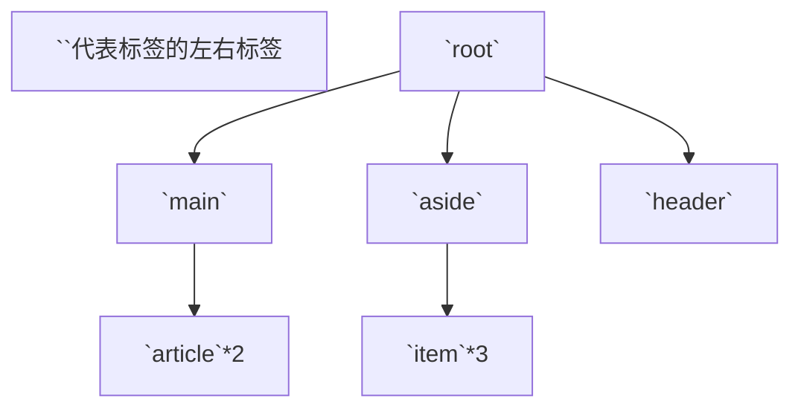


##### 创建组件及引用关系

根据上图，先在App.vue中引入、注册、显示main.vue、aside.vue、header.vue，然后在main.vue中根据引（一次）注（一次）显三步，显article.vue两次，在aside.vue中显item.vue三次


#### 组件注册方式

一个vue组件在使用前需要被注册，这样vue才能渲染模板时找到其对应关系的实现


##### 全局注册

在main.js中写注册信息

```vue
import { createApp } from 'vue'
import App from './App.vue'
//引入要注册的组件

const app = createApp(App)
//必须在这中间写组件的注册

app.mount('#app')
```


全局注册虽然方便，但是存在以下问题

1. 全局注册，但并没有被使用的组件无法在生产打包时被自动移除（也叫tree-shaking），如果全局注册一个组件，即使没有被实际使用，他仍然会出现在打包后的js文件中
2. 全局注册在大项目中使项目的依赖关系变得不那么明确，在父组件中使用子组件时，不太容易定位子组件的实现，和使用过多的全局变量一样，这可能会影响应用长期的可维护性


##### 局部注册

注册需要使用`components`选项

```vue
<script>
        //第一步引入组件
        //import 组件名称 from "文件地址/位置"
        import myComponent from "./components/myComponent.vue"
    export default{
        //第二步注册组件
        components:{
            // 组件名称
            myComponent
        }
    }
</script>
<template>
    <!-- 第三步显示组件 -->
    <!-- <组件名称 /> -->
    <myComponent />
    <!-- 也可以这样写
     <my-Component /> -->
</template>
<style></style>
```


### 组件传递数据_Props

组件与组件之间不是完全独立的，而是有交集的，那就是组件与组件之间是可以传递数据的传递数据的解决方法就是`props`

目录

```
|-- components/
|	|-- parent.vue
|	|-- son.vue
|--App.vue
```

App.vue

```vue
<script>
    import parent from './components/parent.vue';
    export default{
        components:{
            parent,
            
        }
    }
</script>
<template>

<parent />

</template>
<style></style>
```


parent.vue

```vue
<template>
    <p>parent</p>
    <son title="parent data" deo="data" />
</template>
<script>
    import son from './son.vue';
    export default{
        data(){
            return{

            }
        },
        components:{
            son
        }
    }
</script>
```


son.vue

```vue
<template>
    <p>son</p>
    <p>{{ title }}</p>
	<p>{{ deo }}</p>
</template>
<script>
    export default{
        data(){
            return{
            }
        },
        props:['title','deo']
    }
</script>
```


#### 动态数据传递

修改parent.vue

```vue
<template>
    <p>parent</p>
    <son :title=" msg " deo="data" />
</template>
<script>
    import son from './son.vue';
    export default{
        data(){
            return{
                msg:'parent data'
            }
        },
        components:{
            son
        }
    }
</script>
```

> [!CAUTION]
>
> `props`传递数据，只能从父级传递到子级,但是通过传递函数可以间接实现子传父
>
> parent.vue
>
> ```vue
> <template>
>     <p>parent</p>
>     <p>{{ msg }}</p>
>     
>     <son :onEvent="getdata" />
> </template>
> <script>
>     import son from './son.vue';
>     export default{
>         data(){
>             return{
>                 msg:''
>             }
>         },
>         methods:{
>             getdata(a){
>                 this.msg=a
>             }
>         },
>         components:{
>             son
>         }
>     }
> </script>
> ```
>
> son.vue
>
> ```vue
> <template>
>     <p>son</p>
>     <p>{{ onEvent('son data to parent') }}</p>   <!--调用函数-->
> </template>
> <script>
>     export default{
>         emits:['someEvent'],    //声明要触发的自定义事件
>         data(){
>             return{
>                 data:''
>             }
>         },
>         props:{
>             onEvent:Function
>         }
>     }
> </script>
> ```


#### 组件传递多种数据类型

通过`props`传递数据，不仅可以传递字符串类型的数据，还可以传递其他类型，如：数字，对象，数组等

实际上任何类型的数据都可以作为props的值被传递

parent.vue

```vue
<template>
    <p>parent</p>
    <son :title=" msg " :number="number" :arr="arr" :userInfo="userInfo" />
</template>
<script>
    import son from './son.vue';
    export default{
        data(){
            return{
                msg:'parent data',
                number:20,
                arr:['zhangs','lis'],
                userInfo:{
                    name:'zhangs',
                    age:19
                }
            }
        },
        components:{
            son
        }
    }
</script>
```

son.vue

```vue
<template>
    <p>son</p>
    <p>{{ title }}</p>
	<p>{{ number }}</p>
    <p>{{ arr }}</p>
    <p>{{ userInfo }}</p>
</template>
<script>
    export default{
        data(){
            return{
            }
        },
        props:['title','number','arr','userInfo']
    }
</script>
```


#### 组件传递数据校验

parent.vue

```vue
<template>
    <p>parent</p>
    <son :title=" msg " />
</template>
<script>
    import son from './son.vue';
    export default{
        data(){
            return{
                msg:'parent data'
            }
        },
        components:{
            son
        }
    }
</script>
```

son.vue

```vue
<template>
    <p>son</p>
    <p>{{ title }}</p>
</template>
<script>
    export default{
        data(){
            return{
            }
        },
        props:{
            title:{
                type:String,  
               
                //type:[String,Number,Array] 	//校验数据类型为String，类型可以写多个
                
                //不传显示默认值，字符串和数字能直接写
                default: 'usrname'	
                //如果是数组和对象必须通过工厂函数返回默认值
                //default(){
                //    return ['']
                //}
            }
        }
    }
</script>
```


必传

son.vue

```vue
<template>
    <p>son</p>
    <p>{{ title }}</p>
</template>
<script>
    export default{
        data(){
            return{
            }
        },
        props:{
            title:{
                type:String,
                required: true      //true必传选项，反正为false
            }
        }
    }
</script>
```

> [!CAUTION]
>
> 父组件传递的参数，子组件不允许修改


### 组件事件

在组件的模板表达式中，可以直接使用`$emit`方法触发自定义事件

触发自定义事件的目的是组件之间传递数据

parent.vue

```vue
<template>
    <p>parent</p>
    <p>{{ msg }}</p>
    <son @someEvent="getdata" />
</template>
<script>
    import son from './son.vue';
    export default{
        data(){
            return{
                msg:''
            }
        },
        methods:{
            getdata(a){
                console.log(a);
                this.msg=a
            }
        },
        components:{
            son
        }
    }
</script>
```

son.vue

```vue
<template>
    <p>son</p>
    <button @click="sendTo">send</button>
</template>
<script>
    export default{
        emits:['someEvent'],    //声明要触发的自定义事件
        data(){
            return{
                data:'son data'
            }
        },
        methods:{
            sendTo(){
                this.$emit('someEvent',this.data)
            }
        }
    }
</script>
```

>==提示==
>
>组件之间传递数据的方案：
>
>1. 父传子：`props`
>2. 子传父：`自定义事件(this.$emit)`


#### 组件事件配合`v-model`使用

parent.vue

```vue
<template>
    <p>parent</p>
    <p>{{ msg }}</p>
    <son @someEvent="getdata" />
</template>
<script>
    import son from './son.vue';
    export default{
        data(){
            return{
                msg:''
            }
        },
        methods:{
            getdata(a){
                console.log(a);
                this.msg=a
            }
        },
        components:{
            son
        }
    }
</script>
```

son.vue

```vue
<template>
    <p>son</p>
    <input type="text" v-model="data">
</template>
<script>
    export default{
        emits:['someEvent'],    //声明要触发的自定义事件
        data(){
            return{
                data:''
            }
        },
        watch:{
            data(newdata,olddata){
                this.$emit('someEvent',newdata)
            }
        }
    }
</script>
```


### 透传attribute

传递给一个组件，却没有被该组件声明为props或emits的attribute或者`v-on`事件监听器，常见例子`class`,`style`,`id`

当一个组件以单个元素为跟做渲染时，透传的attribute会自动被添加到根元素上

App.vue

```vue
<script>
    import parent from './components/parent.vue';
    export default{
        components:{
            parent
        }
    }
</script>
<template>

<parent class="tet" />

</template>
<style></style>
```

parent.vue

```vue
<template>
    <div>123</div>		<!-- 可以看到div标签上有class属性 -->
</template>
```

这种情况组件中只能有一个根标签，有第二个标签就失效


`inheritAttrs:false`防止穿透

```vue
<template>
    <div>123</div>
</template>
<script>
    export default{
        inheritAttrs:false    //false阻止attribute穿透
    }
</script>
```


### 插槽slots

某些场合，想要为子组件传递一些模板片段，让子组件在它们的组件中渲染这些片段

App.vue

```vue
<script>
    
    import parent from './components/parent.vue';
    export default{
        components:{
            parent
        }
    }
</script>
<template>

    <parent>
        <div>插槽123</div>		//从原来的单标签变为双标签
    </parent>

</template>
<style></style>
```

parent.vue

```vue
<template>
    <slot></slot>		<!--插槽插入位置，一定为slot双标签 -->
</template>
<script>
    export default{
        inheritAttrs:false    //false阻止attribute穿透
    }
</script>
```


#### 渲染作用域

插槽内容可以访问到父组件的数据作用域，因为插槽内容本身是在父组件中定义的

App.vue

```vue
<script>
    
    import parent from './components/parent.vue';
    export default{
        components:{
            parent
        },
        data(){
            return{
                msg:'chacao text'
            }
        }
    }
</script>
<template>

    <parent>
        <div>{{ msg }}</div>
    </parent>

</template>
<style></style>
```

parent.vue

```vue
<template>
    <slot></slot>
</template>
<script>
    export default{
        inheritAttrs:false    //false阻止attribute穿透
    }
</script>
```


#### 插槽默认值

插槽中没有传递值，在slot标签中的内容就是默认值，传了就覆盖

App.vue

```vue
<script>
    
    import parent from './components/parent.vue';
    export default{
        components:{
            parent
        },
        data(){
            return{
                
            }
        }
    }
</script>
<template>

    <parent>
        
    </parent>

</template>
<style></style>
```

parent.vue

```vue
<template>
    <slot>123</slot>
</template>
<script>
    export default{
        inheritAttrs:false    //false阻止attribute穿透
    }
</script>
```


#### 具名插槽

`v-slot:名` 

`v-slot`简写为`#`

用`name`获取

App.vue

```vue
<script>
    
    import parent from './components/parent.vue';
    export default{
        components:{
            parent
        },
        data(){
            return{
                msg:'chacao text'
            }
        }
    }
</script>
<template>

    <parent>
        <template v-slot:one>
            <div>{{ msg }}</div>
        </template>
        <template #two>
            <div>chacao 2</div>
        </template>
        
    </parent>

</template>
<style></style>
```

parent.vue

```vue
<template>
    <slot name="one"></slot>
    <hr>		<!--可写入任何内容 -->
    <slot name="two"></slot>
</template>
<script>
    export default{
        inheritAttrs:false    //false阻止attribute穿透
    }
</script>
```


某些情况下，插槽内容需要父、子组件中的数据，需要一种方法让子组件在渲染时将一部分数据提供给插槽

可以像对组件传递props那样，像一个插槽的出口向上传递attributes

简单理解，先将传递数据给父组件，父组件在将数据写进插槽中

App.vue

```vue
<script>
    
    import parent from './components/parent.vue';
    export default{
        components:{
            parent
        },
        data(){
            return{
                msg:'chacao text'
            }
        }
    }
</script>
<template>

    <parent v-slot='fromParent'>
            <div>{{ msg }}-{{ fromParent.msg }}</div>
    </parent>

</template>
<style></style>
```

parent.vue

```vue
<template>
    <slot :msg="msg"></slot>
</template>
<script>
    export default{
        inheritAttrs:false ,   //false阻止attribute穿透
        data(){
            return{
                msg:123
            }
        }
    }
</script>
```


具名插槽传递

App.vue

```vue
<script>
    
    import parent from './components/parent.vue';
    export default{
        components:{
            parent
        },
        data(){
            return{
                msg:'chacao text'
            }
        }
    }
</script>
<template>

    <parent>
        <template #first="fromParent">
            <div>{{ msg }}-{{ fromParent.msg }}</div>
        </template>
    </parent>

</template>
<style></style>
```

parent.vue

```vue
<template>
    <slot name="first" :msg="msg"></slot>
</template>
<script>
    export default{
        inheritAttrs:false ,   //false阻止attribute穿透
        data(){
            return{
                msg:'123q'
            }
        }
    }
</script>
```


### 组件生命周期

vue组件实例在创建时都需要经历一系列的初始化步骤，如设置数据侦听，编译模板，挂载实例到dom，以及在数据改变时更新dom。在这过程中，它也会运行被称为生命周期的钩子函数，让开发者有机会在特定阶段运行自己的代码

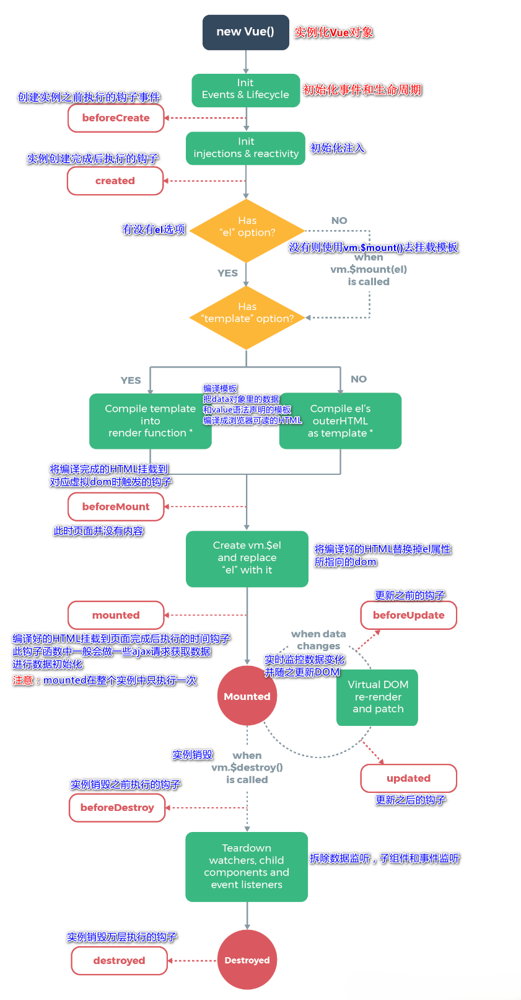

生命周期函数

​	创建期：beforeCreate	created

​	挂载期：beforeMount	mounted

​	更新期：beforeUpdate	updated

​	销毁期：beforeUnmount	unmounted


#### 生命周期应用

组件生命周期会随着对vue了解得更多，也越来越重要

1. 通过`ref`获取元素dom结构
2. 模拟网络请求渲染数据


在页面框架渲染后加载数据

```vue
<template>
    <p>userInfo</p>
    <ul>
        <tr v-for="(user,index) in userInfo" :key="index">{{ user.name }},{{ user.age }},{{ user.sex }}</tr>
    </ul>
</template>
<script>
    export default{
        data(){
            return{
                userInfo:[]
            }
        },
        mounted(){
            this.userInfo=[
                {name:'zhangs',age:18,sex:'man'},
                {name:'lis',age:19,sex:'woman'},
                {name:'wangw',age:20,sex:'man'}
            ]
        }
    }
</script>
```


### 动态组件

实现组件之间来回切换

`<component :is=""></compent>`


App.vue

```vue
<template>
    <component :is="getComponent"></component>
    <button @click="changeComponent">change</button>
</template>
<script>
    import son from './components/son.vue';
    import parent from './components/parent.vue';
    export default{
        components:{
            parent,
            son
        },
        data(){
            return{
                getComponent:'parent'
            }
        },
        methods:{
            changeComponent(){
                this.getComponent=this.getComponent==='parent'? 'son':'parent'
            }
        }
    }
</script>
<style></style>
```

parent.vue

```vue
<template>
    <p>parent</p>
</template>
<script></script>
```
son.vue

```vue
<template>
    <p>son</p>
</template>
<script></script>
```


### 异步组件

优化项目性能

在大项目中，可能需要拆分应用为更小的快，并仅在需要时从服务器加载相关组件

`defineAsyncComponent`方法实现此功能

App.vue

```vue
<template>
    <component :is="getComponent"></component>
    <button @click="changeComponent">change</button>
</template>
<script>
    import {defineAsyncComponent} from 'vue';
    import parent from './components/parent.vue';
    const son=defineAsyncComponent(()=>import('./components/son.vue'))
    export default{
        components:{
            parent,
            son
        },
        data(){
            return{
                getComponent:'parent'
            }
        },
        methods:{
            changeComponent(){
                this.getComponent=this.getComponent==='parent'? 'son':'parent'
            }
        }
    }
</script>
<style></style>
```

parent.vue

```vue
<template>
    <p>parent</p>
</template>
<script></script>
```
son.vue

```vue
<template>
    <p>son</p>
</template>
<script></script>
```


### 依赖注入

通常情况下，需要从父组件向子组件传递数据时，会使用`props`，想象一下这样的结构：有一些多层级嵌套的组件，形成了一颗巨大的组件树，而某个深层的子组件需要一个较远的祖先组件中的部分数据，这种情况下，如果仅使用props则必须将其沿着组件链逐级传递，称为`props逐级透传问题`

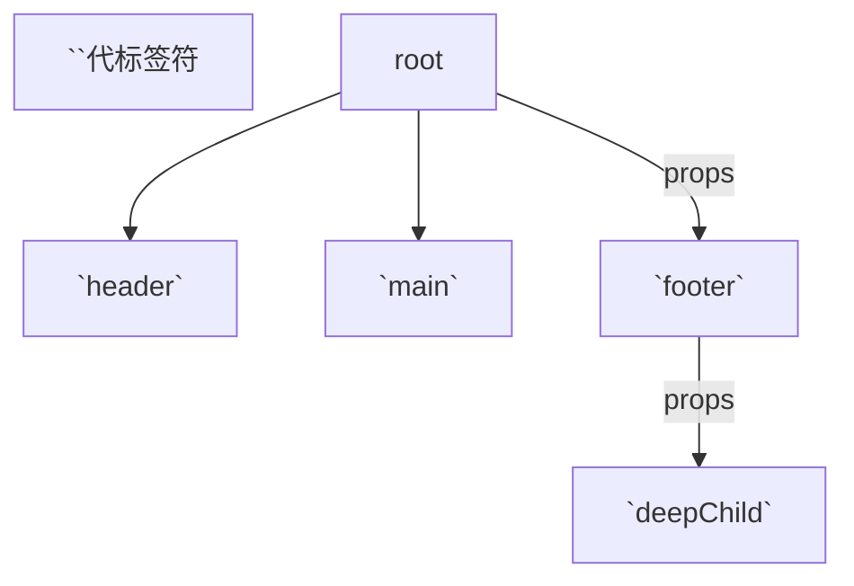


`provide`和`inject`可以解决这一问题，一个父组件相对于其他所有的后代组件，会作为==依赖提供者==，任何后代的组件，无论层级有多深，都可以==注入==父组件提供给整条链路的依赖

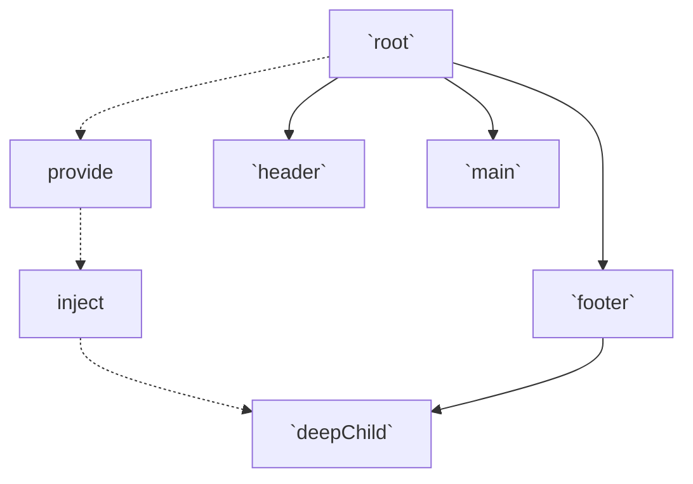

App.vue当作grandpa

```vue
<template>
    <parent/>
</template>
<script>
    import parent from './components/parent.vue';
    export default{
        provide:{
                msg:"grandpa's money"
        },
        components:{
            parent,
        },
        
    }
</script>
<style></style>
```

parent.vue

```vue
<template>
    <p>parent</p>
    <son/>
</template>
<script>
import son from './son.vue';

export default{
    components:{
        son
    }
}
</script>
```

son.vue

```vue
<template>
    <p>son1</p>
    <p>{{ msg }}</p>
</template>
<script>
import { inject } from 'vue';

export default{
    data(){
        return{
            inject:['msg']
        }
    }
}
</script>
```


也可以从`data`中读取数据，结合上面的代码只改App.vue

App.vue

```vue
<template>
    <parent/>
</template>
<script>
    import parent from './components/parent.vue';
    export default{
        data(){
            return{
                msg:"grandpa's money"
            }
        },
        provide(){
            return{
                msg:this.msg
            }
        },
        components:{
            parent,
        },
        
    }
</script>
<style></style>
```

> [!NOTE]
>
> `provide`和`inject`只能上到下传不能反向传


写全局数据任何地方都能读取

main.js

```javascript
import { createApp, provide } from 'vue'
import App from './App.vue'


const app=createApp(App)
//必须在这中间写组件的注册
app.provide('msgData','全局数据')

app.mount('#app')
```


### vue应用

#### 应用实例

每个vue应用都是通过`createApp`函数创建一个新的应用实例，一个vue项目只能有一个vue应用实例对象

mian.js

```javascript
import { createApp } from 'vue';

const app =createApp({
    //根组件选项
})
```


#### 根组件

传入`createApp`的对象实际上是一个组件，每个应用都需要一个根组件，其他组件将作为其子组件

main.js

```javascript
import { createApp } from 'vue';
//从一个单文件组件中导入根组件
import App from './App.vue';

const app = creatApp(App)
```


#### 挂载应用

应用实例必须在调用了`.mount()`方法后才会渲染出来，该方法接收一个容器参数，可以是一个实际的dom元素或是一个css选择器

main.js

```javascript
app.mount('#app')
```
index.html
```html
<div id="app"></div>
```


#### 公共资源

在`src`目录下`assets`文件夹的作用就是存放公共资源，如图片，公共css等


### 选项式api VS 组合式api

两种代码风格


#### 选项式api（Options api）

可以用包含多个选项的对象类描述组件的逻辑。如，`data`、`methods`和`mounted`，选项式定义的属性都会暴露在函数内部的`this`上，指向当前的组件实例

App.vue

```vue
<template>
<button @click="add">number:{{ count }}</button>
</template>
<script>
    export default{
        data(){
            return{
                count:0
            }
        },
        methods:{
            add(){
                this.count++
            }
        }
    }
</script>
```


#### 组合式api（Composition api）

通过组合式api，可以使用导入api函数来描述组件逻辑

parent.vue

```vue
<template>
<button @click="add">number:{{ count }}</button>
<br>
<son/>
</template>
<script>
import son from './son.vue'
    export default{
        components:{
            son
        },
        data(){
            return{
                count:0
            }
        },
        methods:{
            add(){
                this.count++
            }
        }
    }
</script>
```

son.vue(组合式)

```vue
<template>
    <button @click="increment">count:{{ cou }}</button>
</template>
<script setup>

import {ref,onMounted} from 'vue';
const cou=ref(0)
function increment(){
    cou.value+=2
}
onMounted(()=>{
    console.log(`this count is ${cou.value}`);
})
</script>
```


#### 两种风格区别

##### 选项式api

1. 在vue2.x项目中使用的就是选项式api写法
2. 优点：易于学习和使用，写代码的位置已经约定好了
3. 缺点：代码组织性差，相似的逻辑代码不能便于复用，逻辑代码多了不好阅读

##### 组合式api

1. 在vue3中使用的是组合式api
2. 优点：功能逻辑复杂繁多的情况下，各个功能逻辑代码组织在一起，便于阅读和维护
3. 缺点：需要良好的代码组织能力和拆分逻辑能力


### 组合式api 响应式

#### 选项式api 响应式

```vue
<template>
<button @click="add">number:{{ count }}</button>
</template>
<script>
    export default{
        data(){				//依赖于data
            return{
                count:0
            }
        },
        methods:{
            add(){
                this.count++
            }
        }
    }
</script>
```


#### 组合式api 响应式

App.vue

```vue
<template>
    <son/>
</template>
<script>
    import son from './components/son.vue';
    export default{
        components:{
            son
        },
        
    }
</script>
<style></style>
```

son.vue

```vue
<template>
    <p>组合式api</p>
    <p>{{ msg }}</p>
</template>
<script>
    import {ref} from 'vue';

    export default{
        //组合式api关键字
        setup(){
            const msg=ref('api data')
            //外部想要访问必须return
            return{
                msg
            }
        }
    }
</script>
```

或

```vue
<template>
    <p>组合式api</p>
    <p>{{ msg }}</p>
    <p>{{ userInfo.name }}</p>
</template>
<script>
    import {ref,reactive} from 'vue';

    export default{
        //组合式api关键字
        setup(){
            const msg=ref('api data')
            const userInfo=reactive({
                name:'zhangs'
            })
            //外部想要访问必须return
            return{
                msg,
                userInfo
            }
        }
    }
</script>
```

> [!NOTE]
>
> `ref`和`reactive`的区别
>
> `ref`用于创建基本类型响应式数据，如String，Number，Boolean
>
> `reactive`用于创建引用式响应数据，如Array，Object


#### 组合式api 简约写法

son.vue

```vue
<template>
    <p>组合式api</p>
    <p>{{ msg }}</p>
    <p>{{ userInfo.name }}</p>
</template>
<script setup>
    import {ref,reactive} from 'vue';

    const msg=ref('api data')
    const userInfo=reactive({
        name:'zhangs'
    })

</script>
```


### 组合式api 计算属性

选项式api，所有的属性必须放在`computed`中，但组合式api就不用


#### 选项式api

```vue
<template>
    <p>组合式api</p>
    <p>{{ msg }}</p>
    <p>{{ reverse }}</p>
</template>
<script>

    export default{
        data(){
            return{
                msg:'123456'
            }
        },
        computed:{
            reverse(){
                return this.msg.split('').reverse().join('')
            }
        }
    }
</script>
```


#### 组合式api

```vue
<template>
    <p>组合式api</p>
    <p>{{ msg }}</p>
    <p>{{ reverse }}</p>
</template>
<script setup>

    import {ref,computed} from 'vue';
    const msg =ref('123456')
    //必须用.value读取信息
    const reverse =computed(()=>{
        return msg.value.split('').reverse().join('')
    })

</script>
```


### 组合式api 事件处理

方法可以直接用js方式编写

```vue
<template>
    <p>组合式api</p>
    <p>{{ count }}</p>
    <button @click="add">add</button>
</template>
<script setup>

    import {ref} from 'vue';
    const count =ref(0)
    function add(){
        count.value++
    }

</script>
```


### 组合式api 侦听器

watch(侦听的数据，回调函数)

```vue
<template>
    <p>组合式api</p>
    <p>{{ count }}</p>
    <button @click="add">add</button>
</template>
<script setup>

    import {ref,watch} from 'vue';
    const count =ref(0)
    function add(){
        count.value++
    }
    watch(count,(newValue,oldValue)=>{
        console.log(newValue,oldValue);
    })

</script>
```

watch也能写成独立的js

```vue
<template>
    <p>组合式api</p>
    <p>{{ count }}</p>
    <button @click="add">add</button>
</template>
<script setup>

    import {watched} from './utils'
    import {ref,watch} from 'vue';

    const count =ref(0)
    function add(){
        count.value++
    }
    watched(count)

</script>
```

util.js

```javascript
import { watch } from "vue"

export function watched(count){
    watch(count,(newValue,oldValue)=>{
        console.log(newValue,oldValue);
    })
}
```


### 组合式api 生命周期

不同于选项式，生命周期函数用onMounted……

```vue
<template>
    <p>组合式api</p>
</template>
<script setup>

    import {onMounted, ref,watch} from 'vue';

    onMounted(()=>{
        console.log('组件渲染后');
    })

</script>
```


### 组合式api 模板引用

使用特殊的`ref`Attribute

```vue
<template>
    <p ref="msg">组合式api</p>
</template>
<script setup>

    import {onMounted, ref} from 'vue';
    //声明一个ref来存放该元素的引用，必须和模板的ref同名
    const msg=ref(null)
    //必须保证dom渲染完成再去读取dom
    onMounted(()=>{
        msg.value.innerHTML='new data'
    })

</script>
```


### 组合式api props

parent.vue

```vue
<template>
    <p>组合式api parent</p>
    <son title="parent' data"/>
</template>
<script setup>
    //不用写components，能直接调用
    import son from './son.vue';
</script>
```

son.vue

```vue
<template>
    <p>组合式api son</p>
    <p>{{ title }}</p>
</template>
<script setup>

    const props=defineProps({
        title:{
            type:String,
            default:''
        }
    })
</script>
```


### 组合式api 事件

parent.vue

```vue
<template>
    <p>组合式api parent</p>
    <p ></p>
    <son @receiveD="showData"/>
</template>
<script setup>
    //不用写components，能直接调用
    import son from './son.vue';
    function showData(data){
        console.log(data);
    }
</script>
```

son.vue

```vue
<template>
    <p>组合式api son</p>
    <button @click="sendD">send</button>
</template>
<script setup>

    const emit=defineEmits(['receiveD'])
    function sendD(){
        emit("receiveD",'son data')
    }
</script>
```


### 自定义指令基础

#### 选项式api 自定义指令

```vue
<template>
    <p v-name>text</p>
</template>
<script>
    export default{
        //自定义指令
        directives:{
            name:{
                mounted(element){
                    element.innerHTML+='YI'
                }
            }
        }
    }
</script>
```


#### 组合式api 自定义指令

```vue
<template>
    <p v-name>text</p>
</template>
<script setup>
    //需要加v
    const vName={
        mounted:(element)=>{
            element.innerHTML+='YI'
        }
    }
</script>
```


### 全局与局部注册指令

局部

```vue
<template>
    <p v-red>text</p>
</template>
<script setup>
    const vRed={
        mounted:(element)=>{
            element.style.color='red'
        }
    }
</script>
```


全局main.js

```vue
import { createApp} from 'vue'
import App from './App.vue'


const app=createApp(App)
//必须在这中间写组件的注册
app.directive('blue',{
    mounted:(element)=>{
        element.style.color='blue'
    }
})

app.mount('#app')
```


### 自定义指令钩子函数

```vue
<template>
    <p v-receive>text</p>
</template>
<script setup>
    const vReceive={
        mounted(){
            console.log('mounted');
        }
    }
</script>
```


### 自定义指令钩子函数参数

常用el，value

`el`：指令绑定到元素，可以直接操作dom

`binding`：一个对象，包含以下属性

- `value`：传递给指令的值，如`v-my-derective=“1+1”`中，参数是2
- `oldValue`：之前的值，仅在`beforeUpdate`和`updated`中使用，无论值是否更改，都可用
- `arg`：传递给指令的参数（如果有的话），如在`v-my-derective.foo`中参数是`foo`
- `modifiers`：一个包含修饰符的对象（如果有的话），如`v-my-derective.foo.bar`中，修饰符对象是`{foo:true,bar:true}`
- `instance`：使用该指令的组件实例
- `dir`：指令的定义对象

`vnode`：代表绑定元素的底层VNode

`prevNode`：之前的渲染中代表指令所绑定元素的VNode，仅在`beforeUpdate`和`updated`钩子中可用

```vue
<template>
    <p v-myderective>text</p>
</template>
<script setup>
    const vMyderective={
        mounted(el,binding,vnode,prevNode){
            console.log(el);
            console.log(binding);
            console.log(vnode);
            console.log(prevNode);
        }
    }
</script>
```


## Pinia

### 安装

```cmd
npm install pinia
```


### 使用

main.js中导入

```js
import { createApp } from 'vue'
import App from './App.vue'
import { createPinia } from 'pinia'

const app =createApp(App)
const pinia =createPinia()

app.use(pinia)
app.mount('#app')
```


```js
import { definePinia } from 'pinia'

export const useUserStore = defineStore('userStore',{
    state: ()=>({
        users:[
            {username: 'zhangs', age: 18},
            {username: 'lis', age: 20}
        ]
    }),
    
    //获取
    getter: {
        get_username(){
            return this.users.filter(d => d.username)
        }
    },
    //set方法
    actions: {
        
    }
})
```


创建CounterStore.js文件

```js
//导入defineStore
import {defineStore} from 'pinia'
import { ref,computed } from 'vue'

export const useCounterStore = defineStore('count',()=>{
    //定义数据 state
    const count = ref(0)
    
    //定义修改数据的方法(action 同步+异步)
    function increment(){
		count.value++
    }
    
    //getter定义
    const doubleCount = computed(()=> count.value * 2)
    
    //以对象的方式返回给组件使用 
    return {count, increment, doubleCount}
    
})
```


组件使用，创建一个vue组件

```vue
<script setup>
import { useCounterStore } from 'CounterStore.js文件路径'

const counterStore = useCounterStore()
</script>
<template>
<p>count:{{ counterStore.count }} </p>
<button @click="counterStore.increment"> increment </button>
<p>{{counterStore.doubleCount}} </p>
</template>
```


解决响应式丢失问题

```vue
import {storeToRefs} from 'pinia'
//方法不用管
const {count,doubleCount} = storeToRefs(counterStore)
```


## Router

### 安装

```cmd
npm install vue-router
```


### 使用

创建路由实例

```js
import { createWebHistory,createRouter } from 'vue-router'

//路由映射
const routes = [
    {path: '访问路径', component: 组件名, name: 'name'}，
]

const router = createRouter({
    history: createWebHistory(),
    routes
})

export default router
```


注册路由器，main.js

```js
import { createApp } from 'vue'
import App from './App.vue'
import {router} from '@/routers/router'

const app = createApp(App)
app.use(router)
app.mount('#app')
```


.vue

```vue
<template>
	<div>
    	<router-link to= "访问路径">home</router-link>
        <router-link :to="{ name: 'name'}">about</router-link>
        <router-view></router-view>  <!-- 显示访问的router-link的内容-->
    </div>
</template>
```


### 参数

js

```js
import { createWebHistory,createRouter } from 'vue-router'

//路由映射
const routes = [
        {path: '.../:id', component: 组件名, name: 'name'},  //id为的参数，在router-link必须写
        {path: '.../:id?', component: 组件名, name: 'name1'},  //id为路径的参数，可从url直接获取
]

const router = createRouter({
    history: createWebHistory(),
    routes
})

export default router
```

vue

```vue
<template>
<router-link :to="{ name: 'name', params: {id = 'value'}}">home</router-link>

<router-link :to="{ name: 'name1', }">t</router-link>
<router-view></router-view>
<h1>this is {{ $route.params.id }}</h1> <!--获取id-->
</template>
```


### props


### redirect 重定向

```js
import { createRouter,createWebHistory } from "vue-router";

import home from "@/template/home.vue";
import t from "@/template/t.vue";

const routes = [
    
    {path: '/...', component: home, name: 'home'},
    {path: '/kk', redirect: '/...'},

]

const router = createRouter({
    history: createWebHistory(),
    routes
})

export default router
```


### catchall 404

```js
import { createRouter,createWebHistory } from "vue-router";

import home from "@/template/home.vue";
import notFound from "@/template/notFound.vue";

const routes = [
    {path: '/:catchAll(.*)', component: notFound, name: 'notFound'},

]

const router = createRouter({
    history: createWebHistory(),
    routes
})

export default router
```


## Chart.js

下载安装在项目目录下，cmd

```cmd
npm i chart.js vue-chartjs
```


使用示例，圆环

```vue
<template>
	<Pie :data="pieData" :option="pieOption"/>
</template>
<script setup>
import {ref} from 'vue'
import { Pie } from 'vue-chartjs'
import { Chart as ChartJS, ArcElement, Tooltip, Legend} from 'chart.js'
    
ChartJS.register(ArcElement, Tooltip, Legend)
const pieData=ref({
    labels: ['A','B','C'],	//产品名
    datasets: [{
        data: [15,26,88],	//产品数据
        backgroundColor: ['red','green','blue'],	//产品圆弧颜色
        borderWith: 1	//饼图扇区边框宽度
    }]
})
const pieOption=ref({
    responsive:true,	//当设置为 true 时，图表会自动适应父容器的大小变化
    maintainAspectRatio: true,  //当设置为 true 时，图表会保持原始的宽高比（通常是 1:1，即正方形），不会因									//为容器大小改变而变形
    cutout: '50%',  //0%为扇形圆，占比越大圆环越小
    plugins: {
        legend: {
            position: 'left',	//设置图例位置
            align: 'center'
        },
        tooltip: {
            enabled: true, //为true放在图形上能显示产品数据信息
            backgroundColor: 'rgba(0,0,0,0.8)',
            titleColor: 'white',
            bodyColor: '#ddd',
            borderColor: '#667eea',
            borderWidth: 1,
            callbacks: {
                label: (context) =>{
                    const value=context.raw	//当前扇区原始数据
                    const total=context.dataset.data.reduce((a, b) => a + b, 0)	//计算总和
                    const percent = ((value / total) * 100).toFixed(1)	//计算百分比，保留1位小数
                    return `${context.label}: ${value} (${percent}%)`	// 返回要显示的文本
                }
            }
        }
    }
})
</script>
```


## 技巧

### 组件切换

```vue
<script setup>
import UserInformation from './Port/UserInformation.vue';
import Friends from './Port/Friends.vue';
import FlowerUpload from './Port/FlowerUpload.vue';

import { computed, ref } from 'vue';
    
const currentTab = ref('UserInformation')
const asideTabs = [
    {name: 'UserInformation', component: UserInformation},
    {name: 'Friends', component: Friends},
    {name: 'FlowerUpload', component: FlowerUpload},
]
const currentComponent = computed(()=>{
    const tab = asideTabs.find(t=>t.name === currentTab.value)
    return tab ? tab.component : null
})
</script>
<template>
<ul class="pt-3 pb-3 ps-2 pe-2">
    <li 
        v-for="i in asideTabs" 
        :key="i.name" class="aside-li" 
        @click="currentTab = i.name"
        :class="{'aside-li-active': i.name === currentTab}">
        {{ i.name }}
    </li>
</ul>

<component :is='currentComponent'></component>
</template>
```

