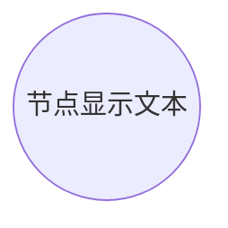

# Markdown文档

### 一~六级标题

```markdown
Ctrl+1~6
```


### 加粗

```markdown
Ctrl+b
**文本**
```


### 斜体

```markdown
Ctrl+i
*文本*
```


### 高亮

```markdown
Ctrl+shift+~
或
`` 中间写文本
```


### 选取单行

```markdown
Ctrl+L
```


### 代码块

~~~markdown
Ctrl+shift+k
或
```语言 + enter
~~~


### 分割线

```markdown
--- + enter
```


### 流程图

要在`设置`中打开图表选项


| 标志 | 方向                  |
| :--- | :-------------------- |
| TB   | top bottom - 从上到下 |
| BT   | bottom top - 从下到上 |
| RL   | right left - 从右到左 |
| LR   | left right - 从左到右 |
| TD   | 等同于 TB             |


#### 节点形状（默认方形）

圆角

````markdown

````


圆形

~~~markdown

~~~


非对称形

~~~markdown

~~~


菱形

~~~markdown

~~~


六角形

~~~markdown

~~~


平行四边形

~~~markdown

~~~


梯形

~~~markdown

~~~


#### 连接线

基本线

~~~markdown

~~~


无向线段

~~~markdown

~~~


点状线

~~~markdown

~~~

```mermaid
graph LR
    A -.- B -. 带文字连接线 .-> C
```

粗实线

~~~markdown
```mermaid
graph LR
    A ==> B == 带文字连接线 ==> C
```
~~~

```mermaid
graph LR
    A ==> B == 带文字连接线 ==> C
```


#### 视图分组

~~~markdown
```mermaid
graph TB
    c1-->a2
    subgraph 第一组
    a1-->a2
    end
    subgraph 第二组
    b1-->b2
    end
    subgraph 第三组
    c1-->c2
    end
```
~~~

```mermaid
graph TB
    c1-->a2
    subgraph 第一组
    a1-->a2
    end
    subgraph 第二组
    b1-->b2
    end
    subgraph 第三组
    c1-->c2
    end
```


冒泡排序流程图

~~~markdown
```mermaid
graph LR
    执行1[i = 1]
  执行2[j = 0]
  执行3[i ++]
  执行4["a = arr[j], b = arr[j + 1]"]
  执行5[交换 a, b]
  执行6[j ++]
    判断1["i < n"]
    判断2["j < n - i"]
  判断3["a > b"]
  开始 --> 执行1
  执行1 --> 判断1
  判断1 --Y--> 执行2
  执行2 --> 判断2
  判断2 --Y--> 执行4
  判断2 --N--> 执行3
  执行3 --> 判断1
  执行4 --> 判断3
  判断3 --N--> 判断2
  判断3 --Y--> 执行5
  执行5 --> 执行6
  执行6 --> 判断2
  判断1 --N--> 结束
```
~~~

```mermaid
graph LR
    执行1[i = 1]
  执行2[j = 0]
  执行3[i ++]
  执行4["a = arr[j], b = arr[j + 1]"]
  执行5[交换 a, b]
  执行6[j ++]
    判断1["i < n"]
    判断2["j < n - i"]
  判断3["a > b"]
  开始 --> 执行1
  执行1 --> 判断1
  判断1 --Y--> 执行2
  执行2 --> 判断2
  判断2 --Y--> 执行4
  判断2 --N--> 执行3
  执行3 --> 判断1
  执行4 --> 判断3
  判断3 --N--> 判断2
  判断3 --Y--> 执行5
  执行5 --> 执行6
  执行6 --> 判断2
  判断1 --N--> 结束
```

