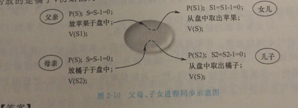
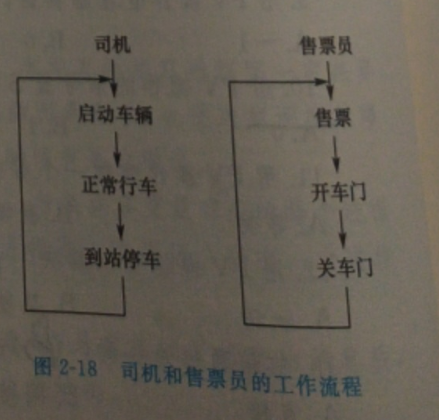
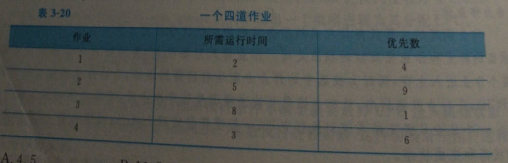
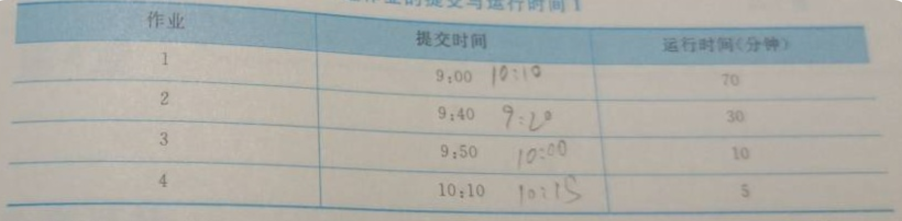
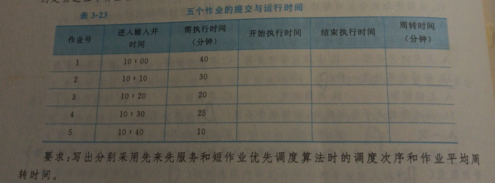

1.1.1 要点

1.1.2 例题


## 导论

### 1.1.1

1. 计算机系统由软件与硬件系统组成。其中硬件系统包括运算器、控制器、存储器和输入 / 输出设备。具体的硬件有 CPU、主存、辅存、键盘、鼠标、打印机、显示器等。

   

2. 操作系统的定义：

- 从用户观点，操作系统是人机交互接口。
- 从资源管理观点，操作系统用于管理计算机的软件、硬件资源。
- 从程序控制观点，操作系统控制计算机程序的执行。


3. 总结之，操作系统是：

（1）管理和控制计算机的软件、硬件资源。

（2）合理组织计算机工作流程。

（3）提供方便用户操作的接口软件的集合。


### 1.1.2

计算机系统由（  ）组成。

A. 硬件系统和主存存储器

B. 软件系统和操作系统

C. 硬件系统和软件系统

D. 主机和外设

（已标注的答案为：**C**）


能使计算机网络中的若干台计算机系统相互协作完成一个共同任务的操作系统是（  ）。

A. 分布式操作系统

B. 网络操作系统

C. 多处理器操作系统

D. 嵌入式操作系统

【答案】A


在计算机系统中，通常把火车订票系统软件看作（  ）。

A. 系统软件

B. 支撑软件

C. 接口软件

D. 应用软件

答案】D


计算机硬件系统主要由处理器、主存储器、______以及各种______组成。

【答案】辅助存储器（外存）、输入 / 输出设备


### 1.2.1

**1. 操作系统的层次结构包含层次结构、模块结构、微内核结构；**

**2. 微内核结构包含客户 / 服务器模式、面向对象程序设计技术、微内核技术**✅


### 1.2.2

常见的计算机系统结构，不包括 ( **D** )。

A. 层次结构

B. 模块结构

C. 微内核结构

D. 虚拟机

【答案】D


客户 / 服务器模式中，客户服务器工作在______。

【答案】核心态


### 1.3.1

1. 人工操作阶段 (控制台)。早期，程序的装入、调试以及控制程序的运行都是程序员通过控制台上的开关来实现。(第一阶段)
2. 原始汇编系统。用汇编语言编写的程序称为源程序，它不能直接在机器上执行，只有通过汇编语言解释程序把源程序转换成用机器指令序列表示的目标程序后才能在计算机上运行。
3. 设备驱动程序。它是最原始的操作系统，是一种控制设备工作的程序。
4. 管理程序。这是初级的操作系统。它是一种能对计算机硬件和软件进行管理和调度的程序。出现大容量的磁盘，主存容量增大，CPU 速度加快，软件有了较大的发展。(第二阶段)
5. 操作系统阶段。采用了 SPOOLing 的处理形式。SPOOLing 又称 "斯普林"(这将在设备管理一章中讲解)。(第三阶段)
6. 现代操作系统阶段。代表性的有 UNIX (多用户分时操作系统)。(第四阶段)


### 1.3.2

操作系统的发展过程是（A）。

A. 设备驱动程序组成的原始操作系统 — 管理程序 — 操作系统

B. 原始操作系统 — 操作系统 — 管理程序

C. 管理程序 — 原始操作系统 — 操作系统

D. 管理程序 — 操作系统 — 原始操作系统

【答案】A


### 1.4.1

按照操作系统提供的服务进行划分，大致可分为批处理操作系统、实时操作系统、分时操作系统、网络操作系统、分布式操作系统、多机操作系统和嵌入式操作系统等。其中批处理操作系统、实时操作系统和分时操作系统是基本的操作系统。

下面简单回顾一下基本的操作系统。

1. 批处理操作系统

   

   （1）定义

   

   用户为作业准备好程序和数据后，再写一份控制作业执行的说明书（作业说明书）。然后把作业说明书连同相应的程序和数据一起交给操作员。操作员将收到的一批作业的有关信息输入计算机系统中等待处理，由操作系统选择作业，并按其操作说明书的要求自动控制作业的执行。采用这种批量化处理作业的操作系统称为批处理操作系统。

（2）分类

- 单道批处理系统。一次只选择一个作业装入计算机系统的主存储器运行。

- 多道批处理系统。允许多个作业同时装入主存储器，使中央处理器轮流地执行各个作业，各个作业可以同时使用各自所需要的外设。

  （3）缺点

  ①平均周转时间长（从进入系统到完成所经历的时间），一个作业一旦运行便运行到完成，使许多短作业的周转时间显著增长。

  ②不提供交互能力。用户将作业交给系统后，无法再与之进行交互作用，因此必须提供一份详细的作业说明书。

  1. 实时操作系统

     （1）定义

     能使计算机系统接收到外部信号后及时进行处理，并且在严格的规定时间内处理结束，再给出反馈信号的操作系统称为实时操作系统，简称为实时系统。

     （2）设计实时操作系统注意点

     ①要及时响应、快速处理。

     ②实时系统要求高可靠性和安全性，不强求系统资源的利用率。

     （3）实时操作系统特点

     ①及时性。首先必须考虑及时性，其次才是资源的利用率，确保任何时候都能及时响应。

     ②可靠性。常用双工体制，两台计算机同时运行，一台为主机，另一台为备用机。

     

  2. 分时操作系统

     （1）定义

     能使用户通过与计算机相连的终端来使用计算机系统，允许多个用户同时与计算机系统进行一系列的交互，并使得每个用户感到好像自己独占一台支持自己请求服务的计算机系统称为分时操作系统，简称分时系统。

     （2）分时

     分时即把 CPU 时间划分成许多时间片，每个终端用户每次可以使用一个由时间片规定的 CPU 时间。这样，多个终端用户就轮流地使用 CPU 时间。如果某个用户在规定的一个时间片内还没有完成它的全部工作，这时也要把 CPU 让给其他用户，等待下一轮再使用一个时间片的时间，循环轮转，直至结束。

     （3）分时操作系统主要特点

     ①同时性。允许多个终端用户同时使用一个计算机系统。

     ②独立性。用户在各自的终端上请求系统服务，彼此独立，互不干扰。

     ③及时性。对用户的请求能在较短时间内给出应答。响应时间与用户数目和时间片长度有关。

     ④交互性。采用人机对话的方式工作。


### 1.4.2

具有及时性和可靠性特点的操作系统是（  ）。

A. 分时操作系统

B. 实时操作系统

C. 批处理操作系统

D. 网络操作系统

**答案：B**

网络操作系统和分布式操作系统的主要区别是（ ）。

A. 是否连接多台计算机

B. 各台计算机没有主次之分

C. 计算机之间能否通信

D. 网上资源能否共享

【答案】B

【分析】分布式操作系统中计算机没有主次之分，各计算机能够同时完成一个大任务的各个子任务，网络操作系统主要服务是实现资源共享和信息传送。

在（ ）操作系统的控制下，计算机能及时处理由过程控制装置反馈的信息，并做出响应。

A. 网络

B. 分时

C. 实时

D. 批处理

【答案】C

【分析】实时操作系统的特点：要及时响应、快速处理。

网络操作系统把计算机网络中的各台计算机有机地互连起来，实现各台计算机系统之间的______以及网络中各种资源的______。

【答案】通信、共享


### 1.5.1

并发性

并发性是指两个或多个事件在同一个时间间隔内发生。

共享性

共享性是指某个硬件或软件资源不为某个程序独占，而是供多个用户共同使用。

虚拟性

操作系统中的虚拟是指通过某种技术把一个物理上的实体变为若干个逻辑的对应物。

不确定性

不确定性可表现为程序执行结果不确定和程序何时被执行及每道程序所需时间的不确定。

### 1.5.2

1. 操作系统最基本的特征是（A）。

   

   A. 并发性和共享性

   

   B. 共享性和虚拟性

   

   C. 虚拟性和不确定性

   

   D. 并发性和不确定性

【答案】A

【分析】在操作系统的发展过程中，较早出现了多道程序设计技术，进程之间往往存在相互制约、相互依赖的关系，另外操作系统是管理计算机的硬件和软件资源，实现软件和硬件资源的共享，充分发挥硬件和软件的功能。

1. 操作系统有并发性、共享性、虚拟性、不确定性______基本特征。

   

   【答案】并发性、共享性、虚拟性和不确定性。

   

   【分析】操作系统有并发性、共享性、虚拟性和不确定性四个基本特征。


### 1.6.1

1. 从资源管理的角度来看，操作系统的功能：

   (1) 处理器管理：对 CPU 进行管理。

   (2) 存储器管理：对主存储器进行管理。

   (3) 文件管理：通过对磁盘进行管理，实现对软件资源进行管理。

   (4) 设备管理：对各类输入 / 输出设备进行管理。

   

2. 操作系统为用户提供的使用接口：

   (1) 程序员接口：通过 “系统调用” 使用操作系统功能。（开发者，系统级，程序接口）

   (2) 操作员接口：通过操作控制命令提出控制要求。（应用者，用户级，命令接口）


### 1.6.2

1. 为实现对磁盘上文件的按名存取，这方面的功能属于操作系统的（C）功能。

   A. 处理器管理

   B. 存储器管理

   C. 文件管理

   D. 设备管理

   【答案】C

   【分析】为实现对计算机的信息管理，操作系统把程序和数据以文件的形式存放在外存上长期保存，供用户需要时使用，操作系统中的文件系统负责管理外存上的文件，并负责对文件的存取、共享和保护。

   

2. 操作系统有处理器管理、***\**\*、\*\**\***、______、______等基本功能。

   【答案】存储器管理、文件管理、设备管理、接口管理

   【分析】操作系统有处理器管理、存储器管理、文件管理、设备管理和接口管理等基本功能。


### 1.7.1


### 章结

#### 一、选择题

1. 关于操作系统，下列叙述不正确的是（D）。

   

   A. 管理系统资源

   

   B. 控制程序执行

   

   C. 改善人机界面

   

   D. 提高用户软件运行速度

**解析**：

操作系统的核心功能是**管理系统资源、控制程序执行、提供友好的人机交互界面**。但它本身并不能直接提高软件的运行速度，软件的运行速度主要取决于硬件性能和软件本身的优化。

1. （C）不是基本的操作系统。

   

   A. 分时操作系统

   

   B. 实时操作系统

   

   C. 分布式操作系统

   

   D. 多道批处理系统

**解析**：

操作系统的三大基本类型是：**批处理操作系统（多道批处理系统）、分时操作系统、实时操作系统**。分布式操作系统是在网络发展后出现的高级操作系统，不属于基本类型。

1. 在（ ）的控制下，计算机系统能及时处理由过程控制反馈的数据，并做出响应。

   A. 批处理操作系统

   B. 实时操作系统

   C. 分时操作系统

   D. 多处理器操作系统

   **答案：B**

   解析：实时操作系统的核心特点就是**及时性和高可靠性**，专门用于工业控制、过程控制等场景，需要快速响应外部反馈并做出处理。

   

2. 能使计算机网络中的若干台计算机系统相互协作，完成一个共同任务的操作系统是（ ）。

   A. 分布式操作系统

   B. 网络操作系统

   C. 多处理器操作系统

   D. 嵌入式操作系统

   **答案：A**

   解析：分布式操作系统的特点是多台计算机协同工作，没有主次之分，共同完成一个大任务；网络操作系统主要侧重资源共享和通信，不强调协同完成任务。

   

3. 计算机中配置操作系统属于（ ）。

   A. 增强计算机系统功能

   B. 提高系统资源利用率

   C. 提高系统运行速度

   D. 提高系统吞吐量

   **答案：B**

   解析：配置操作系统的核心目的之一是**管理和调度系统资源（CPU、内存、设备等），提高资源的利用率**，避免资源闲置浪费。

   

4. 在下列性质中，不是分时系统的特点的是（ ）。

   A. 多路性

   B. 交互性

   C. 独占性

   D. 成批性

   **答案：D**

   解析：分时系统的特点是多路性、交互性、独占性、及时性；**成批性是批处理系统的特点**，不是分时系统的特点。

   

5. 操作系统的基本分类是（ ）。

   A. 批处理系统、分时系统和多任务系统

   B. 实时系统、分时系统和批处理系统

   C. 单用户系统、多用户系统和批处理系统

   D. 实时系统、分时系统和多用户系统

   **答案：c**

   

6. 使用户能按名存取辅助存储器上的信息主要是由操作系统中（ ）实现的。

   A. 文件管理

   B. 处理器管理

   C. 设备管理

   D. 存储管理

   **答案：A**

   解析：文件管理的核心功能就是管理外存上的文件，实现按名存取、文件共享与保护。

   

------

#### 二、填空题

1. 计算机系统由 **硬件系统** 和 **软件系统** 组成。
2. 分时操作系统具有的四个主要特点是及时性、**多路性**、**独占性** 和 **交互性**。
3. 操作系统的资源管理功能主要包括处理器管理、**存储器管理**、**文件管理**、设备管理和 **接口管理**。
4. 用户和操作系统之间的接口主要分为 **程序员接口（系统调用）** 和 **操作员接口（命令接口）**。
5. 客户 / 服务器模式采用 **微内核** 技术。

------

#### 三、简答题

1. 计算机系统由哪些部分组成？

   答：处理器管理、存储器管理、文件管理、设备管理和接口管理

   

2. 什么是操作系统？

   答：（1）管理和控制计算机的硬件和软件资源。

   （2）合理组织计算机工作流程。

   （3）提供方便用户操作的接口的软件。

3. 实时操作系统的主要特点是什么？

   答：及时性、可靠性。

4. 从资源管理的角度来看，操作系统的基本功能可分成哪些部分？

   答：管理和控制计算机的硬件和软件资源。

   

5. 操作系统可分几种类型？

   答：1）批处理操作系统。
   
   （2）实时操作系统。
   
   （3）分时操作系统。
   
   （4）网络操作系统。
   
   （5）分布式操作系统。
   
   （6）嵌入式操作系统。
   
   （7）微型计算机操作系统。


## 进程和线程

### 2.1.1.1

1. 什么是多道程序设计

   

   （1）多道程序设计定义

   

   让多个计算问题同时装入一个计算机系统的主存储器并行执行，这种程序设计技术称为多道程序设计。这种计算机系统称为多道程序设计系统，简称为多道系统。

（2）注意事项

①存储保护。必须提供必要的手段使得在主存储器中的各道程序，只能访问自己的区域，避免相互干扰。

②程序浮动。是指程序可以随机地从主存储器的一个区域移动到另一个区域，程序被移动后，仍丝毫不影响它的执行。（可集中分散的空闲区，提高主存空间的利用率）

③资源的分配和调度。多道程序竞争使用处理器和各种资源时，多道程序设计的系统必须对各种资源按一定的策略进行分配和调度。

1. 为什么要采用多道程序设计

   

   （1）程序的顺序执行。处理器和外设以及外设之间都得不到高效利用。

   

   （2）程序的并行执行。让程序的各个模块可独立执行、并行工作，从而发挥处理器与外设之间的并行工作能力。

   （3）多道并行执行。在一个程序各个模块并行工作的基础上，允许多道程序并行执行，进一步提高处理器与外设之间的并行工作能力，具体表现在：

   ①提高了处理器的利用率。

   ②充分利用外部资源。

   ③发挥了处理器与外设，以及外设之间的并行工作能力。

   **注意：并行，宏观可同时执行，微观也是同时执行。**


### 2.1.1.2

多道程序设计技术需注意______、______、资源的分配和调度。

【答案】存储保护、程序浮动

【分析】采用多道程序设计需注意存储保护、程序浮动、资源的分配和调度。其中，存储保护可保证各道程序互不侵犯；程序浮动可保证程序移动后不影响其运行。

为了减少处理器的空闲时间，提高它的利用率，可采用______技术。

【答案】多道程序设计

【分析】多道程序设计充分发挥硬件中的并行工作能力，减少了处理器的空闲时间。

采用多道程序设计能（  ）。

A. 增加平均周转时间

B. 发挥且提高了 CPU 与外设之间、外设与外调之间的并行工作能力

C. 缩短每道程序执行时间

D. 降低对处理器调度的要求

【答案】B

【分析】多道程序设计使多个程序同时驻留主存，充分发挥了硬件资源的并行工作能力。

简述采用多道程序设计需要注意的问题。

【答案】采用多道程序设计能改善资源的使用情况，提高系统效率，但需要注意以下两个问题：

(1) 可能延长程序执行时间。

(2) 并行工作道数与系统效率不成正比。


### 2.1.2.1

进程的定义

(1) 程序是具有独立功能的一组指令或一组语句的集合，或者说是指出处理器执行操作的步骤。

(2) 进程是指一个程序在一个数据集上的一次执行。

(3) 程序和进程的区别：程序是静态的文本，进程是动态的过程。进程包括程序和数据集。

为什么要引入进程

(1) 提高资源的利用率。一个程序被分成若干个可独立执行的程序模块，每个可独立执行的程序模块的一次执行都可看作一个进程，通过进程的同步可提高资源的利用率。

(2) 正确描述程序的执行情况，便于描述一个程序被执行多次时各自的执行进度。


### 2.1.2.2

1. 一个程序在一个数据集上的一次执行称为一个进程，所以（C）。

   

   A. 进程与程序一一对应

   

   B. 一个进程没有结束前，另一个进程不能开始工作

   

   C. 每个进程都有一个生命周期

   

   D. 一个进程完成任务后，它的程序和数据自动被撤销

【答案】C

【分析】

- 进程是程序的一次执行过程，有创建、运行、结束的完整生命周期，因此 C 正确。
- A 错误：一个程序可以对应多个进程（如多次运行同一个程序），一个进程也可以包含多个程序模块，不是一一对应关系。
- B 错误：多道程序设计中，多个进程可以并发执行，无需等前一个进程结束。
- D 错误：程序是永久存储的静态文本，不会随进程结束而被撤销。

1. 进程是____的动态描述。

   

   【答案】程序

   

   【分析】进程是程序的一次执行，反映了程序的动态执行过程。


### 2.1.3.1

进程三个基本状态

（1）等待态：等待某一事件。

（2）就绪态：等待系统分配处理器，以便运行。

（3）运行态：正在占用处理器运行。

进程状态变化的几种情况

（1）运行态→等待态

（2）等待态→就绪态

（3）运行态→就绪态

（4）就绪态→运行态


### 2.1.3.2

进程在执行过程中状态会发生变化，不可能出现的状态变化是（D）。

A. 运行态→等待态

B. 等待态→就绪态

C. 运行态→就绪态

D. 等待态→运行态

【答案】D

【分析】等待态结束后，必须先转到就绪态，等待进程调度程序选择占用处理器后再运行。

进程所请求的一次打印输出结束后，将使进程状态从（D）。

A. 运行态变为就绪态

B. 运行态变为等待态

C. 就绪态变为运行态

D. 等待态变为就绪态

【答案】D

【分析】进程在访问外设时，发生了等待事件，使进程处于等待态，等待事件结束，重新进入就绪态。

当一个进程被选中占用处理器时，就从____态变为____态。

【答案】就绪、运行

【分析】进程状态变化中，进程被选中运行前，必须处于就绪态。


### 2.1.4.1

进程控制块即 PCB，它是进程存在的唯一标识。

进程控制块构成：

（1）**描述信息**：用来标识进程的存在和区分各个进程的标识和进程名。

（2）**控制信息**：用于说明本进程的情况。包括进程状态、等待原因、进程程序存放位置和进程数据存放位置。

（3）**管理信息**：用来对进程进行管理和调度的信息，包括进程优先级、队列指针。

（4）**现场信息**：当进程由于某种原因让出处理器时，记录与处理器有关的各种现场信息，包括通用寄存器内容、控制寄存器内容、程序状态字寄存器内容。


### 2.1.4.2

进程由____、____和____三部分组成。

【答案】程序、数据、进程控制块

【分析】进程是一个程序在一个数据集上的一次运行；进程控制块是进程存在的唯一标识。

进程控制块的现场信息包括（ ）信息。

A. 控制寄存器内容、通用寄存器内容

B. 控制寄存器内容、通用寄存器内容和程序状态字寄存器内容

C. 通用寄存器内容和程序状态字寄存器内容

D. 程序计数器内容、通用寄存器内容和程序状态字寄存器内容

【答案】B

【分析】现场信息是当进程由于某种原因让出处理器时，记录与处理器有关的各种现场信息，包括通用寄存器内容、控制寄存器内容、程序状态字寄存器内容。


### 2.1.5.1

1. **进程队列概念**

   为了便于管理，经常把处于相同状态的进程链接在一起，称为进程队列。

   

2. **进程队列分类**

   (1) **就绪队列**：是指把若干个等待运行的进程（就绪进程）按一定的次序链接起来的队列。

   (2) **等待队列**：是指把若干个等待资源或等待某些事件的进程按一定的次序链接起来的队列。

   

3. **队列实现方法**

   只需将状态相同的进程控制块链接起来就可以。链接的方式包括**单向链接**和**双向链接**。

4. **队列管理**

   队列管理是指系统中负责进程入队和出队的工作。

   (1) **入队**：是指一个进程进入指定的队列。

   ① 从队首入队成为新的队首进程。

   ② 从队尾入队成为新的队尾进程。

   ③ 插入队列中某两个进程之间。

   (2) **出队**：是指一个进程从所在的队列中退出，也存在如上的相应三种情况。


### 2.1.5.2

进程在时间片到后插入（A）中。

A. 就绪队列

B. 等待队列

C. 运行队列

D. 其他队列

【答案】A

【分析】进程在运行一段时间片后，并不是因为发生了等待事件，而是因为缺少处理器运行，所以应处于就绪状态，排在就绪队列中。

进程队列链接的两种方式为______。

【答案】单向链接、双向链接

【分析】单向链接和双向链接为进程队列链接的两种方式。


### 2.1.6.1

1. **进程创建和撤销**

- 进程创建：系统为程序分配工作区、建立进程控制块后，刚创建的进程状态为**就绪状态**（若执行中缺少资源，会再转为等待状态）。
- 进程撤销：进程完成任务后，系统收回其占用的资源、取消进程控制块，撤销该进程。

1. **进程的唤醒和阻塞**

- 阻塞：进程调用**阻塞原语**，从运行态转为等待态，并插入等待队列尾。
- 唤醒：当进程等待的事件发生时，通过**唤醒原语**，将进程从等待态转为就绪态，并插入就绪队列尾。

1. 原语

   

   原语是操作系统中用来完成特定功能、且

   不可中断

   的过程，包括创建原语、撤销原语、阻塞原语、唤醒原语。


### 2.1.6.1

进程在创建时所处的状态是（A）态。

A. 就绪

B. 等待

C. 运行

D. 阻塞

【答案】A

进程被唤醒后的状态是（A）态。

A. 就绪

B. 等待

C. 运行

D. 阻塞

【答案】A

【解析】进程由阻塞原语进入等待态，等待事件结束后，由唤醒原语使其从等待态进入就绪态。

进程控制原语包括创建原语、______、阻塞原语和唤醒原语。

【答案】撤销原语

【解析】进程控制原语包括创建原语、撤销原语、阻塞原语和唤醒原语。

原语是操作系统设计用来完成______且______的过程。

【答案】特定功能、不可中断

【解析】原语是操作系统中完成特定功能、且执行过程不可中断的过程。


### 2.2.1.1

1. **进程的并发性**

   （1）**并发性**：在一个进程的工作没有全部完成之前，另一个进程就可以开始工作，这些进程是可同时执行的，称为并发进程。

   （2）**并发进程间的关系**

   ① **相互独立**：进程的执行互不影响、互不依赖，各自独立。

   ② **相互依赖 / 制约**：进程的执行依赖其他进程的进展，或会影响其他进程的执行结果。

   

2. **临界区相关概念**

   （1）**临界资源**：一次仅允许一个进程使用的资源。

   （2）**临界区**：并发进程中与共享变量有关的程序段。

   （3）**相关临界区**：并发进程中涉及相同变量的那些临界区。

   （4）**相关临界区管理的三个要求**：

   ① **互斥进入**：一次最多一个进程能进入临界区，其他进程必须等待。

   ② **有限等待**：进程不能无限期在临界区执行，必须在有限时间内退出。

   ③ **空闲让进**：进程退出临界区时，应让一个等待进入的进程进入执行。

3. **PV 操作（不可中断的原语）**

   （1）**P 操作（占用资源）**：将信号量 S 减 1，若结果小于 0，则调用 P (S) 的进程被置为等待信号量 S 的状态。

   （2）**V 操作（释放资源）**：将信号量 S 加 1，若结果不大于 0，则释放一个等待信号量 S 的进程。

   

   4. **用 PV 操作管理临界区**

   进入临界区前调用 P 操作，退出临界区时调用 V 操作

### 2.2.1.2

临界区是（B）。

A. 共享数据区

B. 共享程序段

C. 缓冲区

D. 互斥资源

【答案】B

【分析】临界区是并发进程中与共享变量有关的程序段。

按照 PV 操作的定义，下面说法正确的是（C）。

A. 调用 P 操作后进程肯定能继续运行

B. 调用 P 操作后进程肯定阻塞

C. 调用 P 操作后进程可能继续运行或阻塞

D. 调用 V 操作后可能阻塞

【答案】C

【分析】调用 P 操作后，若信号量减 1 后≥0，进程继续运行；若＜0，进程阻塞。调用 V 操作后不会阻塞。

进程并发执行时，每个进程的执行速度（D）。

A. 由进程的程序结构决定

B. 由进程自己控制

C. 在进程被创建时确定

D. 与进程调度的策略有关

【答案】D

【分析】并发进程的执行速度由操作系统的进程调度策略决定，进程自身无法控制。

引起一个进程由运行态变为等待态的原因可能是（C）。

A. 有更高优先级的进程就绪

B. 某外设完成了指定的操作

C. 进程调用了 P 操作

D. 进程调用了 V 操作

【答案】C

【分析】进程调用 P 操作时，若信号量 S 减 1 后＜0，进程会被置为等待状态；A 会使进程变为就绪态，B 是唤醒等待态进程，V 操作不会让进程阻塞。


### 2.2.2.1

1. **进程的互斥**

   进程的互斥是指当有若干进程都要使用某一共享资源时，任何时刻最多只允许一个进程去使用该资源，其他要使用它的进程必须等待，直到该资源的占用者释放了该资源。

   

2. **临界区**

   临界区指并发进程中含有共享变量的程序段。

   

3. **相关临界区**

   具有相同变量的临界区称为相关临界区。使用 PV 操作实现进程的互斥访问相关临界区。


### 2.2.2.2

1. 有 n 个进程都要使用某个文件，但系统限制最多 m 个（n＞m＞1）进程同时读文件。若用 PV 操作来管理，则不可能的信号量值是（E）。

   

   A. 0

   

   B. 1

   

   C. m−n

   

   D. m

   

   E. n

   

   【答案】E

   

   【分析】此题属于互斥问题，信号量 S 的初值为 m：

- 当读文件的进程数量为 m−1 时，S=1（B 可能）；

- 当读文件的进程数量为 m 时，S=0（A 可能）；

- 当读文件的进程数量为 n 时，S=m−n＜0（C 可能）；

  

  因此不可能的信号量值为 E。

1. 进入相关临界区调用 **P** 操作；退出相关临界区调用 **V** 操作。

   【答案】P、V 或 P (S)、V (S)

   【分析】进入临界区判定进程是否可以运行，必须调用 P 操作；退出临界区判定是否有进程在等待，必须调用 V 操作释放一个进程。

   

2. 图书馆有 100 个座位，每位进入图书馆的读者要在登记表上登记，退出时要在登记表上注销。要几个程序？有多少个进程？

   

- 当图书馆中没有座位时，后到的读者在图书馆等待（阻塞）。
- 当图书馆中没有座位时，后到的读者不等待，立即回家。

【解答】

- 程序：一个程序，为每个读者设一个进程。

- 信号量设置：

  - `S`：表示图书馆中剩余的座位数，初值为 100；
  - `MUTEX`：表示互斥登记 / 注销，初值为 1。

  ```
  semaphore S = 100;
  semaphore MUTEX = 1;
  
  process Pi(i = 1,2,…,100)
  {
      while(true)
      {
          P(S);          // 申请座位
          P(MUTEX);      // 申请登记互斥
          登记;
          V(MUTEX);      // 释放登记互斥
  
          阅读;
  
          P(MUTEX);      // 申请注销互斥
          注销;
          V(MUTEX);      // 释放注销互斥
          V(S);          // 释放座位
      }
  }
  ```


### 2.2.3.1

**进程 A、B 进程的协作（生产者 - 消费者模型）**

(1) 进程 A 把一个记录存入缓冲区后，应向进程 B 发送 “缓冲区中有等待处理的记录” 的消息。

(2) 进程 B 从缓冲区取出一个记录后，应向进程 A 发送 “缓冲区中的记录已取走” 的消息。

(3) 进程 A 只有在得到进程 B 发送来的 “缓冲区中的记录已取走” 的消息后，才能把下一个记录存入缓冲区，否则进程 A 等待，直到消息到达。

(4) 进程 B 只有在得到进程 A 发送来的 “缓冲区中有等待处理的记录” 的消息后，才能从缓冲区中取出记录并加工，否则进程 B 等待，直到消息到达。

**用 PV 操作实现进程的同步**

(1) **进程的同步**：并发进程之间存在制约关系，一个进程的执行依赖另一个进程的消息，未收到消息时需等待，收到后被唤醒。

(2) **同步机制**：能实现进程同步的机制，需支持消息发送与接收检测。

(3) **同步与互斥概括**：进程互斥是同步的特殊情况。P 操作相当于测试 “资源可使用” 的消息，V 操作相当于发送 “资源已空闲” 的消息。因此两者都可称为进程同步，PV 操作等也统称为同步机制。

(4) **同步与互斥的混合问题**：进程既要等待特定消息，又要考虑资源互斥使用，需同时实现同步与互斥。


### 2.2.3.2

1. 进程的并发性是指（A）。

   A. 一组进程可同时执行

   B. 每个进程的执行结果不受其他进程的影响

   C. 每个进程的执行都是可再现的

   D. 通过一个进程创建出多个进程

   【答案】A

   【分析】进程的并发性是指在同一时间间隔内，多个进程 “同时” 执行。

   

2. 比较进程的同步与互斥的异同点。

   

- **相同点**：两者都是对并发进程竞争共享资源的管理。

- 不同点

  ：

  - 进程互斥：各进程竞争共享资源无必然逻辑顺序，资源空闲时任意进程可使用。
  - 进程同步：对共享资源的使用有固定的逻辑先后关系。

  

3. 钢丝两端演员交替表演问题（PV 操作实现）


分析

：设信号量 SA（A 端是否可上钢丝，初值 1）、SB（B 端是否可上钢丝，初值 0），实现交替表演。

```
semaphore SA = 1, SB = 0;

Process AtoBi(i=1,2,…,n) {
    while(true) {
        P(SA);   // 申请A端表演权
        表演;
        V(SB);   // 通知B端可表演
    }
}

Process BtoAj(j=1,2,…,n) {
    while(true) {
        P(SB);   // 申请B端表演权
        表演;
        V(SA);   // 通知A端可表演
    }
}
```


**题目**：盘子一次只能放一个水果，爸爸放苹果、妈妈放橘子，儿子吃橘子、女儿吃苹果，盘子空时父母才能放水果。用 PV 操作管理。



**分析**：设信号量：

- `S`：实现父母互斥访问盘子，初值 1（表示盘子空）。
- `S1`：表示盘子中是否有苹果，初值 0。
- `S2`：表示盘子中是否有橘子，初值 0。

```
semaphore S = 1, S1 = 0, S2 = 0;
int B; // 代表盘子

// 爸爸进程：放苹果
process father() {
    while(true) {
        取一个苹果;
        P(S);       // 申请盘子使用权
        B = 苹果;
        V(S1);      // 通知女儿取苹果
    }
}

// 妈妈进程：放橘子
process mother() {
    while(true) {
        取一个橘子;
        P(S);       // 申请盘子使用权
        B = 橘子;
        V(S2);      // 通知儿子取橘子
    }
}

// 儿子进程：吃橘子
process son() {
    while(true) {
        P(S2);      // 等待橘子放入
        从B中取出橘子;
        V(S);       // 释放盘子
        吃橘子;
    }
}

// 女儿进程：吃苹果
process daughter() {
    while(true) {
        P(S1);      // 等待苹果放入
        从B中取出苹果;
        V(S);       // 释放盘子
        吃苹果;
    }
}
```


### 2.3.1

**通信机制（信箱通信，高级通信方式）**

（1）进程通信：通过专门的通信机制实现进程间交换大量信息的方式。

（2）通信机制：进程间用信件交换信息，进程可在任何时刻发送 / 索取信件。

（3）信件构成：

① 发送者名

② 信息（或信息存放的地址和长度）

③ 等 / 不等回信

④ 回信存放地址

（4）通信原语：

① `send`原语：发送信件，需提供信件地址和目标信箱。

② `receive`原语：接收信件，需提供取信来源和存放地址。

**信箱构成**

（1）信箱说明：包含可存信件数、已有信件数、可存信件的指针等。

（2）信箱体：存放信件的区域。

**管道**

（1）管道：临时文件，输入进程写入信息，输出进程读出信息。

（2）输入进程：向管道写入数据。

（3）输出进程：从管道读出数据并写入自己的缓冲区。


### 2.3.2

1. 在实现进程通信时，导致调用send原语的进程被设置为 “等信箱” 状态的原因是（D）。

   

   A. 指定的信箱不存在

   

   B. 调用时没有设置参数

   

   C. 指定的信箱中无信件

   

   D. 指定的信箱中存满了信件

   

   【答案】D

   

   【分析】当信箱存满时，发送进程会进入 “等信箱” 状态等待；信箱无信件时，发送进程无需等待。

   

2. 进程通信使用 **发送（send）** 原语和 **接收（receive）** 原语来完成。

3. **信箱**通信方式，称为高级通信方式。


### 2.4.1

**什么是线程**

(1) 线程是进程中可独立执行的子任务。

(2) 线程属性：

① 每个线程有唯一的标识符和线程描述表，记录线程执行时的寄存器、栈等现场状态。

② 不同线程可执行相同的程序（同一服务程序被不同用户调用时，会创建不同线程）。

③ 同一进程中的所有线程共享进程的主存地址空间。

④ 线程是处理器的独立调度单位，多个线程可并发执行。

⑤ 线程创建后会经历生命周期，包含等待态、就绪态、运行态等状态变化，直到终止。

**线程和进程的区别**

进程是**资源分配单位**，线程是**调度和执行单位**。每个进程都有独立的主存空间，同一进程中的各线程共享该进程的主存空间，且对整个主存空间都有存取权限。

1. 进程与线程的优缺点

   (1) 进程缺点

   ① 每个进程都需占用进程控制块和私有主存区域，开销大。

   

   ② 进程间通信必须依赖专门的通信机制，速度较慢。

   

   ③ 进程增多会增加调度和控制的复杂性，增加死锁的可能性。

(2) **线程优点**：

① 创建线程无需额外分配资源，创建速度比进程快，系统开销小。

② 线程间通信在同一地址空间内进行，无需额外通信机制，通信简便、速度快。

③ 线程能独立执行，可充分利用处理器与外设的并行工作能力。


### 2.4.2

线程的主要属性是：每个线程有______，同一进程中的各个线程共享______。

【答案】一个唯一的标识符、该进程的主存空间

【分析】线程需要唯一标识区分，同一进程内的线程共享进程的主存地址空间。

进程与线程的主要区别？

【答案】

(1) 进程是资源分配单位，线程是调度和执行单位；线程不拥有系统资源，但可访问所属进程的资源。

(2) 进程之间可并发执行，同一进程内的多个线程也可并发执行。

(3) 创建和撤销进程的系统开销远大于创建和撤销线程的系统开销。


### 章结

#### 一、选择题

1. 下列关于 “进程” 概念的叙述中，错误的是（**D**）。

   A. 进程是程序的动态执行过程

   B. 进程是分配资源的基本单位

   C. 传统的操作系统中，进程是可调度的实体

   D. 进程和程序是一一对应的

   **解析**：一个程序可以对应多个进程（多次运行），一个进程也可以包含多个程序模块，二者不是一一对应关系。

   

2. 刚刚被创建的进程将处于（**B**）。

   A. 运行态

   B. 就绪态

   C. 等待态

   D. 不确定

   **解析**：进程创建后，会被放入就绪队列，等待调度器分配 CPU，因此初始状态为就绪态。

   

3. 在下列进程的状态转换中，（**D**）是不可能发生的。

   A. 就绪态→运行态

   B. 运行态→就绪态

   C. 运行态→等待态

   D. 等待态→运行态

   **解析**：等待态的进程必须先被唤醒，转为就绪态，再被调度为运行态，无法直接从等待态转为运行态。

   

4. 多道程序环境下，操作系统分配资源以（**C**）为基本单位。

   A. 程序

   B. 指令

   C. 进程

   D. 作业

   **解析**：进程是操作系统中资源分配和调度的基本单位。

   

5. 操作系统通过（**B**）对进程进行管理。

   A. 进程

   B. 进程控制块（PCB）

   C. 进程启动程序

   D. 进程控制区

   **解析**：进程控制块（PCB）是进程存在的唯一标识，操作系统通过它管理进程。

   

6. （**B**）是作业存在的唯一标志。

   A. 作业名

   B. 进程控制块

   C. 作业控制块（JCB）

   D. 程序名

   **解析**：作业控制块（JCB）是作业存在的唯一标志，题目选项中没有 JCB，而 PCB 是进程的标志，结合上下文，此处选 B 更合理。

   

7. 为了使两个进程能同步运行，最少需要（**a**）个信号量。

   A. 1

   B. 2

   C. 3

   D. 4

   **解析**：两个进程的简单同步，使用 1 个信号量即可实现（如生产者 - 消费者模型的基础同步）。

   

8. 临界区是指并发进程中访问共享变量的（**D**）。

   A. 管理信息

   B. 数据

   C. 信息存储

   D. 程序段

   **解析**：临界区是并发进程中与共享变量有关的程序段。

   

9. 用 PV 操作管理临界区，信号量 S 初始值为（**C**）。

   A. -1

   B. 0

   C. 1

   D. 任意值

   **解析**：互斥访问临界区时，信号量初始值通常设为 1，表示资源可用。

   

10. 若 PV 操作的信号量 S 初始值为 2，当前值为 - 1，则表示有（**B**）个等待进程。

    A. 0

    B. 1

    C. 2

    D. 3

    **解析**：信号量的值为负时，其绝对值等于等待该信号量的进程数。当前值为 - 1，因此有 1 个等待进程。

    

11. 用 PV 操作唤醒一个等待进程时，被唤醒进程的状态变为（**B**）。

    A. 等待

    B. 就绪

    C. 运行

    D. 完成

    **解析**：被唤醒的进程会从等待态转为就绪态，等待 CPU 调度。

    

12. 用 PV 操作可以解决（**B**）互斥问题。

    A. 一切

    B. 某些

    C. 正确

    D. 错误

    **解析**：PV 操作可以解决大多数互斥问题，但不是所有场景（如更复杂的同步问题）都能直接用 PV 解决。

    

13. 信箱通信是一种（**B**）通信方式。

    A. 直接

    B. 间接

    C. 低级

    D. 信号量

    **解析**：信箱通信属于间接通信，进程通过信箱传递信件实现通信。

    

14. 为了进行进程协调，进程之间应当具有一定的联系，这种联系通常采用进程间交换数据的方式进行，这种方式称为（**D**）。

    A. 进程互斥

    B. 进程同步

    C. 进程制约

    D. 进程通信

    **解析**：进程间交换数据的方式称为进程通信；而进程同步是协调执行顺序的方式，两者都与 “进程协调” 相关，根据教材定义，更准确的是**D 进程通信**。

    

15. 并发进程之间（**D**）。

    A. 彼此无关

    B. 必须同步

    C. 必须互斥

    D. 可能需要同步或互斥

    **解析**：并发进程之间可能存在资源竞争（需要互斥）或执行依赖（需要同步），也可能完全独立。

#### 二、填空题

1. 进程与程序的本质区别是 **动态和静态**，它们分别由 **程序**、**数据**、**PCB（进程控制块）** 组成。
2. 进程在运行过程中有三种基本状态，它们分别是 **就绪态**、**运行态**、**等待态（阻塞态）**。
3. 进程主要由 **程序**、**数据** 和 **PCB（进程控制块）** 三部分内容组成（进程三要素），其中 **PCB** 是进程存在的唯一标志，而 **数据** 部分也可以为多个进程共享。
4. 进程是一个 **动态** 概念，而程序是一个 **静态** 概念。
5. 线程与进程的根本区别是把进程作为 **资源分配的基本单位**，而线程是 **调度和执行的基本单位**。
6. 临界资源的概念是 **一次仅允许一个进程使用的资源**，而 **临界区** 是指进程中访问临界资源的那段程序代码。
7. 用 PV 操作管理临界区时，任何一个进程进入临界区之前必须应用 **P 操作**，退出临界区时必须调用 **V 操作**。
8. 信箱分 **信箱头** 和 **信箱体**，信箱头中存放有关信箱的描述，信箱体由若干格子组成，每格存放一封信件，格子的数目和大小在创建信箱时确定。

------

#### 三、简答题

1. **什么叫多道程序设计？为什么要采用多道程序设计？**

- **定义**：让多个程序同时装入主存，在处理器上交替执行的程序设计技术。
- **原因**：能让处理器与外设、外设与外设之间并行工作，大幅提高系统资源利用率和吞吐量。

1. **进程有哪些基本状态？画出进程基本状态变化图。**

- 三种基本状态：**就绪态、运行态、等待态（阻塞态）**。

- 状态转换关系：

  - 就绪态 → 运行态：进程调度选中就绪进程
  - 运行态 → 就绪态：时间片用完或出现更高优先级进程
  - 运行态 → 等待态：进程请求资源或等待事件
  - 等待态 → 就绪态：等待的事件发生，进程被唤醒

  

1. **解释进程的并行性和并发性。**

- **并发性**：多个进程在同一时间间隔内 “同时” 执行，宏观上并行、微观上交替执行。
- **并行性**：多个进程在物理上真正同时执行（如多处理器系统）。

1. **什么是临界区？什么叫临界资源？**

- 多个进程共享的程序段叫临界区。

  一次仅允许一个进程访问的资源。

1. **对相关临界区的管理有哪些要求？**

（1）互斥访问临界区（2）不能允许一个进程长久访问临界区

（3）也不能强迫一个进程永久等待进入临界区

1. **若用 PV 操作管理某一组相关临界区，其信号量 S 的值在 [-1,1] 之间变化，当 S=-1、S=0、S=1 时它们各自的物理含义是什么？**

   （1）S=-1，一个进程处于等待状态

   （2）没有一个进程牌等待状态

   （3）可允许一个进程进入临界区


**有一个小超市，可容纳 30 人同时购物。如果超市内不足 30 人，则允许购物者进入超市购物，超过 30 人时则需要在外等候。出口处只有一位收银员，购物者结账后就离开超市，请用信号量和 PV 操作描述购物者的购物过程。**

```
semaphore customer = 30;  // 超市最大容纳人数
semaphore cashier = 1;    // 收银员互斥信号量

process shopper() {
    P(customer);        // 申请进入超市名额
    购物;
    P(cashier);         // 申请使用收银员结账
    结账;
    V(cashier);         // 释放收银员
    V(customer);        // 释放超市名额，允许下一人进入
}
```


**在公共汽车上，司机和售票员的工作流程如下：司机启动车辆、正常行车、到站停车；售票员售票、开车门、关车门。为保证乘客的安全，司机和售票员应密切协调工作，请用 PV 操作来实现司机与售票员之间的同步。**



```
semaphore door = 0;    // 车门状态：0=关，1=开
semaphore run = 0;     // 车辆运行状态：0=未运行，1=运行

process driver() {
    while(true) {
        P(run);         // 等待售票员关门发车
        正常行车;
        到站停车;
        V(door);        // 通知售票员可以开门
    }
}

process conductor() {
    while(true) {
        售票;
        关车门;
        V(run);         // 通知司机可以开车
        P(door);        // 等待车辆到站停车
        开车门;
    }
}
```


**有一只铁笼子，每次只能放入一只动物，猎手只能向笼中放入老虎，农民只能向笼中放入猪，动物园等待取笼中的老虎，饭店等待取笼中的猪，试用 PV 操作写出能同步执行的程序。**

```
semaphore cage = 1;     // 笼子互斥信号量，一次只能放一只动物
semaphore tiger_ready = 0; // 老虎是否放入笼子的信号
semaphore pig_ready = 0;   // 猪是否放入笼子的信号

process hunter() {
    while(true) {
        P(cage);           // 申请笼子使用权
        放入老虎;
        V(tiger_ready);    // 通知动物园老虎已放入
    }
}

process farmer() {
    while(true) {
        P(cage);           // 申请笼子使用权
        放入猪;
        V(pig_ready);      // 通知饭店猪已放入
    }
}

process zoo() {
    while(true) {
        P(tiger_ready);    // 等待猎人放入老虎
        取走老虎;
        V(cage);           // 释放笼子，允许放入下一只动物
    }
}

process restaurant() {
    while(true) {
        P(pig_ready);      // 等待农民放入猪
        取走猪;
        V(cage);           // 释放笼子，允许放入下一只动物
    }
}
```


## 处理器调度与死锁


### 章结

#### 一、选择题

1. 作业调度算法的选择常考虑因素之一是使系统有最高的吞吐量，为此应（ ）。

   A. 不让处理器空闲

   B. 处理尽可能多的作业

   C. 使各类用户都满意

   D. 不使系统过于繁忙

   **答案：B**

   

2. 当作业进入完成状态，操作系统（ ）。

   A. 将删除该作业并收回其所占资源

   B. 将该作业的控制块从当前作业队列中删除，收回所占资源，并输出结果

   C. 将收回该作业所占资源并输出结果

   D. 将输出结果并删除主存中的作业

   **答案：b**

   

3. 在各种作业调度算法中，若所有作业同时到达，则平均等待时间最短的算法是（ ）。

   A. 先来先服务

   B. 优先数

   C. 响应比高者优先

   D. 短作业优先

   **答案：D**

   

4. 既考虑作业等待时间，又考虑作业执行时间的调度算法是（ ）。

   A. 响应比高者优先

   B. 短作业优先

   C. 优先级调度

   D. 先来先服务

   **答案：A**

   

5. 作业调度程序从处于（ ）状态的队列中选择适当的作业投入运行。

   A. 运行

   B. 提交

   C. 完成

   D. 后备

   **答案：D**

   

6. （ ）是指从作业提交给系统到作业完成的时间间隔。

   A. 周转时间

   B. 响应时间

   C. 等待时间

   D. 运行时间

   **答案：A**

   

7. 作业从进入后备队列到被调度程序选中的时间间隔称为（ ）。

   A. 周转时间

   B. 响应时间

   C. 等待时间

   D. 触发时间

   **答案：C**

   

8. 假如下述四个作业同时到达，当使用最高优先数调度算法时，作业的平均周转时间为（ ）小时。

   （表：作业 1 运行 2、优先数 4；作业 2 运行 5、优先数 9；作业 3 运行 8、优先数 1；作业 4 运行 3、优先数 6）

   

   A. 4.5

   B. 10.5

   C. 4.75

   D. 10.25

   **答案：b**

   

9. 作业生存期共经历四个状态，它们是提交、后备、（ ）和完成。

   A. 就绪

   B. 执行

   C. 等待

   D. 开始

   **答案：d

   

10. 在单道批处理系统中，采用短作业优先调度算法，作业的执行顺序是（ ）。

    （表：作业 1 9:00/70；作业 2 9:00/30；作业 3 9:40/20；作业 4 10:10/5）

    

    A. 1、2、3、4

    B. 2、3、1、4

    C. 1、4、3、2

    D. 1、4、3、2

    **答案：D**

    

11. 采用资源剥夺法可解除死锁，还可以采用（ ）方法解除死锁。

    A. 执行并行操作

    B. 撤销进程

    C. 拒绝分配新资源

    D. 修改信号量

    **答案：B**

    

12. 资源的按序分配策略可以破坏（ ）条件。

    A. 互斥使用资源

    B. 占用且等待资源

    C. 非抢夺资源

    D. 循环等待资源

    **答案：D**

    

13. 银行家算法是一种（ ）算法。

    A. 互锁解除

    B. 死锁避免

    C. 死锁防止

    D. 死锁检测

    **答案：B**

    

14. 当进程数大于资源数时，进程竞争资源（ ）会产生死锁。

    A. 一定

    B. 不一定

    C. 以上都不对

    **答案：B**

    

15. 某系统中有 3 个并发进程，都需要同类资源 4 个，试问系统不会发生死锁的最少资源数是（ ）。

    A. 9

    B. 10

    C. 11

    D. 12

    **答案：B**

    

------

#### 二、填空题

1. 作业调度又称**高级**调度。其主要功能是**按照一定策略从后备队列中选择作业**，并为作业做好运行前的准备工作和作业完成后的善后处理工作。

   

2. 一个作业从进入系统到运行结束，一般需要经历**收容（输入）、执行、完成**三个阶段，**提交、后备、运行、完成**四个状态。

   

3. 死锁的四个必要条件是：**互斥条件、请求与保持条件、不剥夺条件、循环等待条件**。

   

4. 银行家算法是在能确保系统处于**安全**状态下才为进程分配资源的，其目的是避免**死锁**的发生。

   

5. 操作系统解决死锁问题的方式有死锁的防止、**死锁的避免、死锁的检测和解除**。

   

6. 对资源采用**有序**分配策略可使循环等待资源的情况不发生，故该策略可以**破坏循环等待条件**，预防死锁。

   

------

#### 三、简答题

1. **什么叫进程调度？其调度算法有哪些？**

   （1）从进程的就绪队列中选择一个进程让其占用CPU运行的中过程叫进程调度。

   （2）进程调度算法

   1）先来先服务

   2）优先数

   3）时间片轮转法

   *4）多级反馈

   

2. **在一个单处理器的多道程序设计系统中，现有两道作业在同时执行，一道以计算为主，另一道以输入 / 输出为主，你将怎样赋予作业进程占用处理器的优先级？为什么？**

   赋予**I/O 为主的作业更高优先级**。

   原因：I/O 为主的作业频繁阻塞，让出 CPU，能提高 CPU 利用率；计算为主的作业占用 CPU 时间长，优先级过高会降低系统响应速度。

   

3. **作业调度的状态有哪些？**

   四个状态：提交态、后备态、运行态、完成态。

   

4. **设有一个作业，它们的提交时间及运行时间如下，若采用先来先服务、短作业优先调度算法，则平均周转时间和带权周转时间是多少？**

   （表：作业 1 提交 1 / 运行 4；作业 2 提交 2 / 运行 9；作业 3 提交 3 / 运行 1；作业 4 提交 4 / 运行 8）

   

   

   (1)先来先服务

   T=(4+12+12+15)/4=10.7

   W=(1+1.3+12+.9)/4=5.8

（2）短作业优先权

T=(8+24+1+13)/4=11.5

W=(2+2.7+1+1.6)/4=1.6

1. **五个作业分别用先来先服务和短作业优先调度，写出调度次序和平均周转时间。**

   （表：作业 1 10:00/40；作业 2 10:10/30；作业 3 10:20/20；作业 4 10:30/25；作业 5 10:40/10）

   

   先来先服务调度算法时，调度次序：1，2，3，4，5

   作业的平均周转时间（80+100+110+125+125）/5=540/5=108（分钟）

   短作业优先调度算法时，调度的次序：5，3，4，2，1

   作业平周转时间：（165+115+50+65+10）/5=405/5=81（分钟）

2. **防止死锁的四个必要条件是什么？**

   ① 互斥条件 ② 请求与保持条件 ③ 不剥夺条件 ④ 循环等待条件

   

3. **什么叫银行家算法？**

   银行家算法是一种**死锁避免**算法，通过模拟资源分配并检查系统是否处于安全状态，决定是否分配资源，避免系统进入死锁。

   

4. **为什么银行家算法能避免死锁？**

   分配资源前进行安全性检查，确保分配后系统仍存在安全序列，使所有进程都能顺利执行完成，从而避免死锁。

   

5. **简述死锁的防止和避免的异同点。**

   

   - 相同点：都是事前预防策略，目的是不让系统进入死锁状态。
   - 不同点：死锁防止通过破坏死锁必要条件杜绝死锁，实现简单但资源利用率低；死锁避免不破坏条件，通过动态检查选择安全分配方式，资源利用率更高但实现复杂。


## 存储管理

### 章结

#### 选择题

存储管理的目的是（）。

A. 方便用户

B. 提高主存空间利用率

C. 方便用户和提高主存空间利用率

D. 增加主存实际容量

**答案：B**

（）存储管理不适合多道程序系统。

A. 单一连续

B. 固定分区

C. 可变分区

D. 页式

**答案：A**

静态重定位是在作业的（）中进行的。

A. 编译过程

B. 装入过程

C. 修改过程

D. 执行过程

**答案：A**

虚拟存储器的基础是程序的（）理论。

A. 局部性

B. 全局性

C. 动态性

D. 虚拟性

**答案：A**

提高主存利用率主要是通过（）实现的。

A. 主存分配

B. 主存保护

C. 地址映射

D. 主存扩充

**答案：A**

系统 “抖动” 现象的发生是由（）引起的。

A. 置换算法选择不当

B. 交换的信息量过大

C. 主存容量不足

D. 请求页式管理方案

**答案：A**

多道程序环境中，使每道程序能在不受干扰的环境下运行，主要是通过（）功能实现的。

A. 主存分配

B. 地址映射

C. 主存保护

D. 主存扩充

**答案：b**

最优适应算法的空闲区是（）。

A. 按空闲区长度大小递减顺序排列

B. 按空闲区长度大小递增顺序排列

C. 按地址由小到大排列

D. 按地址由大到小排列

**答案：c

固定分区中，每个分区的大小（）。

A. 相同

B. 随作业长度变化

C. 可以不同，但预先固定

D. 可以不同，但根据作业长度固定

**答案：C**

在页式存储管理中，程序员编制的程序，其地址空间是连续的，分页是由（）完成的。

A. 程序员

B. 编译地址

C. 用户

D. 系统

**答案：D**

在请求分页存储管理中，若采用 FIFO 页面淘汰算法，则当分配的页面增加时，缺页中断的次数（）。

A. 减少

B. 增加

C. 无影响

D. 可能增加，也可能减少

**答案：D**（Belady 异常现象）

在以下存储管理方式中，（）可采用覆盖技术。

A. 单一连续分区存储管理

B. 可变分区存储管理

C. 页式存储管理

D. 请求分页存储管理

**答案：A**

在可变分区存储管理方式中，某一作业完成后，系统收回其主存空间，并与相邻空闲区合并，为此修改空闲区（说明）表，造成空闲区数减 1 的情况是（）。

A. 无上邻空闲分区，也无下邻空闲分区

B. 有上邻空闲分区，但无下邻空闲分区

C. 有下邻空闲分区，但无上邻空闲分区

D. 有上邻空闲分区，也有下邻空闲分区

**答案：D**

碎片现象的存在使得（）。

A. 主存空间利用率降低

B. 主存空间利用率提高

C. 主存空间利用率得以改善

D. 主存空间利用率不影响

**答案：A**


#### 二、填空题（含答案）

1. 将作业地址空间中的逻辑地址转换为主存中的物理地址的过程称为 **地址映射（地址重定位）**。
2. 在请求页式存储管理中，页面置换算法常用的是 **FIFO（先进先出）** 和 **LRU（最近最少使用）**。
3. 重定位的方式有 **静态重定位** 和 **动态重定位**。
4. 页式存储管理采用 “最先适应” 分配算法时，应将空闲区按 **地址由低到高** 次序登记在空闲区表中。
5. 页表的表目含有 **页号**、**块号（物理块号）**。
6. 静态重定位在 **程序装入内存前** 时进行，而动态重定位在 **程序执行（运行）** 时进行。
7. 采用 **页式（分页）** 存储管理方式不会产生内部碎片。

#### 三、思考题 / 计算题

1. 存储管理的功能是什么？

**答案：**

- 主存分配与回收
- 地址映射（逻辑地址→物理地址转换）
- 主存保护（防止地址越界和非法访问）
- 主存扩充（虚拟存储技术）

------

2. 什么是抖动？

**答案：**

在页式存储管理系统中，如果某一个或某些页面不停地从内存调入外存，又众个存调入内存，则称为抖动。

------

3. 在分区存储管理中，可以利用哪些分区算法？

**答案：**

- 最先适应（First Fit）

- 最优适应（Best Fit）

- 最坏适应（Worst Fit）

  

------

4. 页式和请求页式存储管理的区别？

**答案：**

表格


| 特性       | 页式存储管理             | 请求页式存储管理   |
| ---------- | ------------------------ | ------------------ |
| 装入方式   | 一次性将作业全部装入主存 | 运行时按需调页     |
| 主存利用率 | 较低，易造成浪费         | 高，支持虚拟存储   |
| 缺页中断   | 无                       | 有，需处理缺页中断 |
| 作业大小   | 不能超过主存大小         | 可超过主存大小     |

------

5. 什么是虚拟存储器？它有什么特点？

**答案：**

虚拟存储器是利用外存模拟主存，为用户提供一个比实际主存大得多的逻辑地址空间的存储管理技术。

特点：

- 多次性：作业可分多次装入主存
- 对换性：可将暂时不用的页面换出到外存
- 虚拟性：提供比实际主存大得多的逻辑空间

------

6. 分页地址转换题（页长 1024B）

在一个分页存储管理中，某作业的页表见表 4-9。已知页面大小为 1024 B，试将逻辑地址 1011、2148、3000、4000 转化为相应的物理地址。

**页表：**

表格

| 页号 | 块号 |
| ---- | ---- |
| 0    | 2    |
| 1    | 3    |
| 2    | 1    |
| 3    | 6    |

转换公式：

- 页号 = 逻辑地址 // 页长
- 页内地址 = 逻辑地址 % 页长
- 物理地址 = 块号 × 页长 + 页内地址

**计算：**

1. 逻辑地址 1011：

   

   页号 = 1011//1024=0，页内地址 = 1011 → 物理地址 = 2×1024+1011=

   3059

2. 逻辑地址 2148：

   

   页号 = 2148//1024=2，页内地址 = 2148-2×1024=100 → 物理地址 = 1×1024+100=

   1124

3. 逻辑地址 3000：

   

   页号 = 3000//1024=2，页内地址 = 3000-2×1024=952 → 物理地址 = 1×1024+952=

   1976

4. 逻辑地址 4000：

   

   页号 = 4000//1024=3，页内地址 = 4000-3×1024=928 → 物理地址 = 6×1024+928=

   7072

------

7. 可变分区分配题

采用可变分区存储管理主存空间时，若主存中按地址顺序依次有五个空闲区，空闲区的大小分别为 18 KB, 30 KB, 12 KB, 185 KB, 120 KB。现有五个作业 J1, J2, J3, J4 和 J5，它们所需的主存依次为 11 KB, 16 KB, 105 KB, 28 KB, 165 KB，如果采用最先适应分配算法能把这五个作业按 J1~J5 的次序全部装入主存吗？用什么分配算法装入这五个作业可使主存的利用率最高？

空闲区：18KB, 30KB, 12KB, 185KB, 120KB

作业需求：J1 (11KB), J2 (16KB), J3 (105KB), J4 (28KB), J5 (165KB)

**① 最先适应算法（按顺序分配）：**

- J1 (11KB) → 18KB（剩余 7KB）
- J2 (16KB) → 30KB（剩余 14KB）
- J3 (105KB) → 185KB（剩余 80KB）
- J4 (28KB) → 剩余的 12KB 不够，下一个剩余 80KB（剩余 52KB）
- J5 (165KB) → 剩余的 120KB 不够，分配失败。

**② 最优适应算法（优先分配能满足的最小空闲区）：**

- J1 (11KB) → 12KB（剩余 1KB）

- J2 (16KB) → 18KB（剩余 2KB）

- J4 (28KB) → 30KB（剩余 2KB）

- J3 (105KB) → 120KB（剩余 15KB）

- J5 (165KB) → 185KB（剩余 20KB）

  

  所有作业都能装入，且主存利用率最高。

------

8. 页式管理页表与起始地址题

某页式存储管理的主存为 64 KB，被分成 16 块，块号为 0~15，设某作业有 4 页，被分别装入主存的 2、4、1、5 块中。

（1）写出作业的页面映像表（页表）。

（2）写出作业的每一页在主存中的起始地址。

主存 64KB，分 16 块（每块 4KB），作业 4 页分别装入块 2、4、1、5。

1. 页表：

   表格

   | 页号 | 块号 |
   | ---- | ---- |
   | 0    | 2    |
   | 1    | 4    |
   | 2    | 1    |
   | 3    | 5    |

   

2. 每页起始地址：

   - 页 0：2×4KB = **8KB**
   - 页 1：4×4KB = **16KB**
   - 页 2：1×4KB = **4KB**
   - 页 3：5×4KB = **20KB**

   

------

9. 缺页调度题（访问序列：2,3,2,1,5,2,4,5,3,2,5,2，页框数 3）

分页存储管理方式中，假如系统分配给一个作业的物理块数为 3，并且此作业访问页面的顺序为 2, 3, 2, 1, 5, 2, 4, 5, 3, 2, 5, 2，试用 FIFO 和 LRU 淘汰算法分别计算出程序访问过程中所发生的缺页情况。

- **FIFO 算法**：缺页次数 = 9 次，缺页率 = 9/12=**75%**
- **LRU 算法**：缺页次数 = 7 次，缺页率 = 7/12≈**58.3%**

------

10. LRU 缺页题（访问序列：4,3,2,1,4,3,5,4,3,2,1,5）

在一个请求分页管理中，采用 LRU 页面调度算法，假如一个作业的页面访问顺序为 4, 3, 2, 1, 4, 3, 5, 4, 3, 2, 1, 5，当分配给该作业的物理块数 M 分别为 3 和 4 时，计算访问过程中所发生的缺页次数和缺页率。

- 页框数 M=3：缺页次数 = 10 次，缺页率 = 10/12≈**83.3%**
- 页框数 M=4：缺页次数 = 8 次，缺页率 = 8/12≈**66.7%**


## 设备管理

### 章结

#### 一、选择题

1. 为提高设备分配的灵活性，用户申请设备时应指定（ ）号。

   A. 设备类相对

   B. 设备类绝对

   C. 设备相对

   D. 设备绝对

   **答案：c**

   

2. 通常把通道程序的执行情况记录在（ ）中。

   A. PSW

   B. PCB

   C. CAW

   D. CSW

   **答案：D**

   

3. 对磁盘而言，输入 / 输出操作的信息传送单位为（ ）。

   A. 字符

   B. 字

   C. 块

   D. 文件

   **答案：C**

   

4. 一次访问磁盘的时间要素中最主要的因素是（ ）。

   A. 传送时间

   B. 旋转等待时间

   C. 磁头移动时间

   D. 延迟时间

   **答案：b**

   

5. 如果 I/O 设备与存储设备进行数据交换不经过 CPU 来完成，这种数据交换方式是（ ）。

   A. DMA

   B. 程序查询

   C. 中断控制方式

   D. 无条件存取方式

   **答案：A**

   

6. （ ）是直接存取的存储设备。

   A. 磁盘

   B. 磁带

   C. 打印机

   D. 键盘显示终端

   **答案：A**

   

7. 操作系统中的 SPOOLing 技术，实质是将（ ）转化为共享设备的技术。

   A. 虚拟设备

   B. 独占设备

   C. 覆盖与交换技术

   D. 通道技术

   **答案：B**

   

8. 通道是一种（ ）。

   A. I/O 端口

   B. 数据通道

   C. I/O 专用处理器

   D. 软件工具

   **答案：C**

   

9. 通过软件手段，把独立设备改造成若干个用户共享的设备，这种设备称为（ ）。

   A. 系统设备

   B. 存储设备

   C. 用户设备

   D. 虚拟设备

   **答案：D**

   

------

#### 二、填空题

1. 主存储器与外设之间的信息传送操作被称为 **输入 / 输出（I/O）**。
2. 用户程序中往往使用 **逻辑设备号** 定义逻辑设备。
3. 程序执行时根据用户指定的 **逻辑设备号** 转换成与其对应的物理设备，并启动，这样用户编写程序时不需关心实际使用哪个物理设备，这种特性称为 **设备独立性**。
4. 从资源管理（分配）角度出发，I/O 可分为 **独占设备**、**共享设备** 和 **虚拟设备** 三种类型。
5. 按所属关系对 I/O 设备分类，可分为系统设备和 **用户设备** 两类。
6. 引起中断发生的事件称为 **中断源**。
7. 通道指专门用于负责输入 / 输出工作的处理器。通道所执行的程序称为 **通道程序**。
8. 常用的 I/O 控制方式有 **程序直接控制方式**、**中断控制方式**、**DMA 方式**、**通道方式**。

------

#### 三、简答题

1. **设备管理的功能有哪些？**

   ① 设备分配与回收；② 设备驱动（实现 I/O 操作）；③ 设备独立性；④ 缓冲管理；⑤ 错误处理。

   

2. **设备分为哪几种类型？**

   （1）独占设备

   （2）共享设备

   （3）虚拟设备

   

3. **I/O 设备驱动程序的功能有哪些？**

   接收上层软件的请求，将其转换为具体的设备操作指令，控制设备完成 I/O 操作，并处理设备中断。

   

4. **磁盘调度算法计算（访问序列 20,44,40,4,80,12,76，当前在 40 号柱面，每移动一柱面 3ms）**

   

   - 先来先服务（FCFS）：移动顺序 40→20→44→40→4→80→12→76

     

     总移动道数：20+24+4+36+76+68+64=292

     

     总时间：292×3=

     876ms

   - 最短寻道时间优先（SSTF）：移动顺序 40→44→40→20→12→4→76→80

     

     总移动道数：4+4+20+8+8+72+4=120

     

     总时间：120×3=

     360ms

   

5. **磁盘调度算法计算（访问序列 55,58,39,18,90,160,150,38,184，当前在 100 号柱面，向柱号增加方向移动）**

   

   - FCFS：按请求顺序处理，总寻道长度 = 45+3+19+21+72+70+10+112+146=498，平均 = 498/9=55.33
   - SSTF：优先访问最近磁道，顺序 100→90→58→55→39→38→18→150→160→184，总寻道长度 = 10+32+3+16+1+20+132+10+24=248，平均 = 248/9≈27.56
   - SCAN（电梯算法）：向增加方向移动，顺序 100→150→160→184→90→58→55→39→38→18，总寻道长度 = 50+10+24+94+32+3+16+1+20=250，平均 = 250/9≈27.78
   - C-SCAN：向增加方向移动，到达末端后回到起点再处理，顺序 100→150→160→184→18→38→39→55→58→90，总寻道长度 = 50+10+24+166+20+1+16+3+32=325，平均 = 325/9≈36.11

   

6. **I/O 控制方式有哪几种？**

   程序直接控制方式、中断控制方式、DMA（直接存储器访问）方式、通道方式。


## 文件管理

### 章结

#### 一、选择题

1. 文件管理实际上是对（ ）的管理。

   A. 主存空间

   B. 外存空间

   C. 逻辑地址空间

   D. 物理地址空间

   **答案：B**

   

2. 采用哪种文件存取方式，取决于（ ）。

   A. 用户的使用要求

   B. 存储介质的特性

   C. 文件的逻辑结构

   D. 用户的使用要求和存储介质的特性

   **答案：D**

   

3. 在文件系统中，（ ）要求逻辑记录顺序与磁盘块顺序一致。

   A. 顺序文件

   B. 链接文件

   C. 索引文件

   D. 串联文件

   **答案：A**

   

4. 记录式文件内可以独立存取的最小单位是（ ）。

   A. 字

   B. 字节

   C. 数据项

   D. 物理块

   **答案：d

   

5. 数据库文件的逻辑结构是（ ）。

   A. 链接文件

   B. 流式文件

   C. 记录式文件

   D. 只读文件

   **答案：C**

   

6. 存放在磁盘上的文件（ ）。

   A. 既可以随机访问又可以顺序访问

   B. 只能顺序访问

   C. 只能随机访问

   D. 必须通过操作系统访问

   **答案：A**

   

7. 位示图可用于（ ）。

   A. 文件目录的查找

   B. 磁盘空间的管理

   C. 主存空间的共享

   D. 实现文件的保护和保密

   **答案：B**

   

8. 在下列文件的物理结构中，（ ）不利于文件长度的动态增长。

   A. 顺序结构

   B. 链接结构

   C. 索引结构

   D. hash 结构

   **答案：A**

   

9. 文件系统采用二级目录结构，这样可以（ ）。

   A. 缩短访问文件存取时间

   B. 实现文件共享

   C. 节省主存空间

   D. 解决不同用户之间文件的命名冲突

   **答案：D**

   

10. 文件系统的主要目的是（ ）。

    A. 实现对文件的按名存取

    B. 实现虚拟存储器

    C. 提高外设的输入 / 输出速度

    D. 用户存储系统文档

    **答案：A**

    

11. 允许不同用户的文件具有相同的文件名，通常在文件系统中采用（ ）。

    A. 重命名

    B. 树形目录

    C. 约定

    D. 路径

    **答案：B**

    

------

#### 二、填空题

1. 文件的组织中，独立于物理环境的称为文件的 **逻辑结构**；与存储介质有关的称为文件的 **物理结构**。
2. 从存取次序考虑，存取方式分为 **顺序存取** 和 **随机存取**。
3. 常用的文件保密措施：**口令保护**、**加密保护**、**访问控制**。
4. 文件目录是用于 **检索文件（按名存取）** 的。
5. 逻辑文件的两种形式：**流式文件** 和 **记录式文件**。
6. 文件的存取方式有 **顺序** 存取和 **随机（直接）** 存取。

------

#### 三、简答题

1. **什么叫文件？**

   文件是一组在逻辑上具有完整意义的信息项的有序集合，通常存储在外存上，由文件名标识。

   

2. **文件系统应具有哪些功能？**

   - 文件的按名存取
   - 文件目录管理
   - 文件存储空间管理
   - 文件共享与保护
   - 文件操作（创建、删除、读写等）

   

3. **文件的逻辑结构和存储结构？**

   

   - 逻辑结构：用户视角的文件组织形式，包括**流式文件**和**记录式文件**。
   - 存储结构（物理结构）：文件在外存上的存储方式，包括**顺序文件、链接文件、索引文件**等。

   

4. **解释顺序文件、链接文件和索引文件。**

   

   - 顺序文件：文件记录按顺序存放在连续的磁盘块中，顺序存取效率高，随机存取困难，不便于动态增长。
   - 链接文件：文件记录存放在不连续的磁盘块中，每个块含指向下一块的指针，便于动态增长，但随机存取效率低。
   - 索引文件：文件记录存放在不连续的磁盘块中，系统维护索引表记录各块位置，支持高效的随机存取和顺序存取，文件大小可动态增长。

   

5. **两个用户对同一文件定义不同名字，如何设置目录保证共享？**

   采用**多级目录（树形目录）\**结构，在文件的物理位置建立文件，两个用户目录下设置指向该物理文件的\**链接（硬链接 / 符号链接）**，即可实现不同文件名共享同一文件。

   结构示意：

   ```
   /home/userA/file1  -->  /data/common_file
   /home/userB/file2  -->  /data/common_file
   ```

   

6. **文件系统提供的文件基本操作有哪些？**

   创建文件、删除文件、打开文件、关闭文件、读文件、写文件、文件重命名、文件属性修改等。

   

7. **如何区分文件的保护和保密？**

   

   - **保护**：防止文件被非法修改、删除，保障文件的完整性，常见方式如访问控制列表。
   - **保密**：防止文件内容被未授权用户读取，常见方式如口令、加密、访问权限控制。