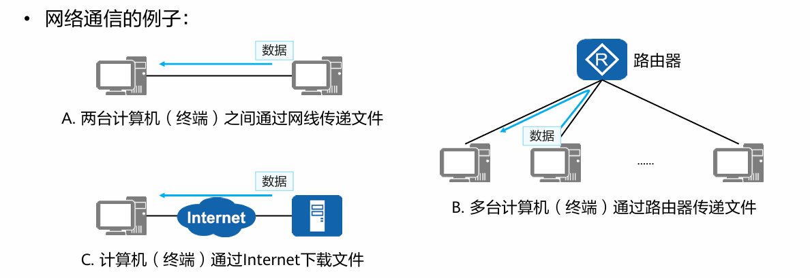
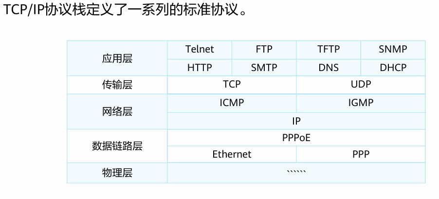
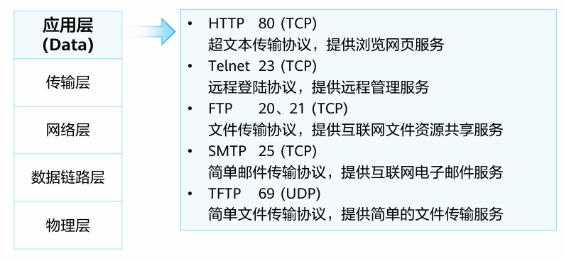
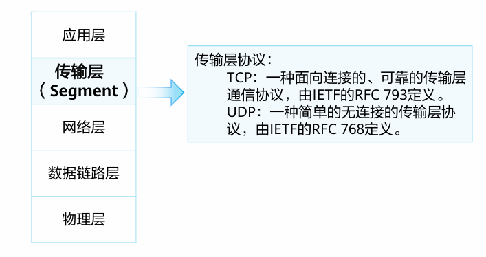
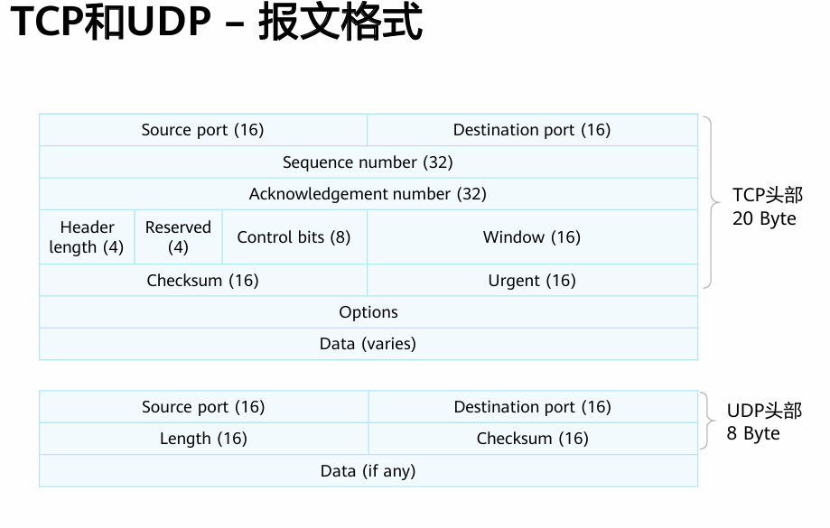
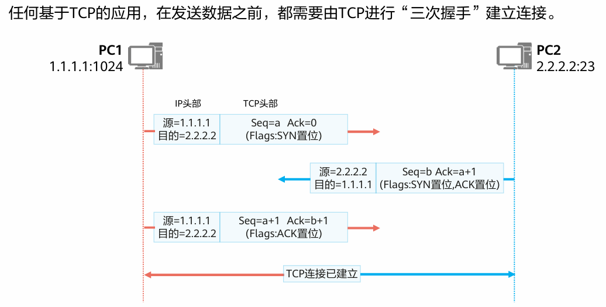
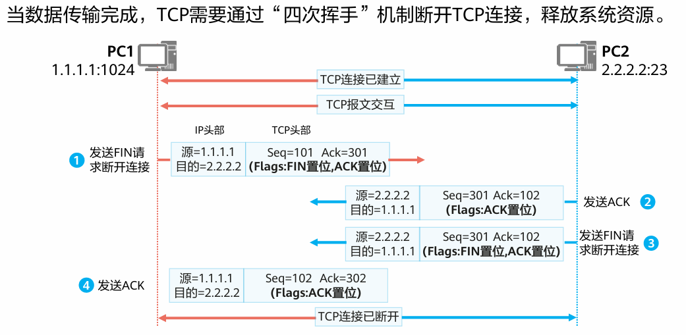
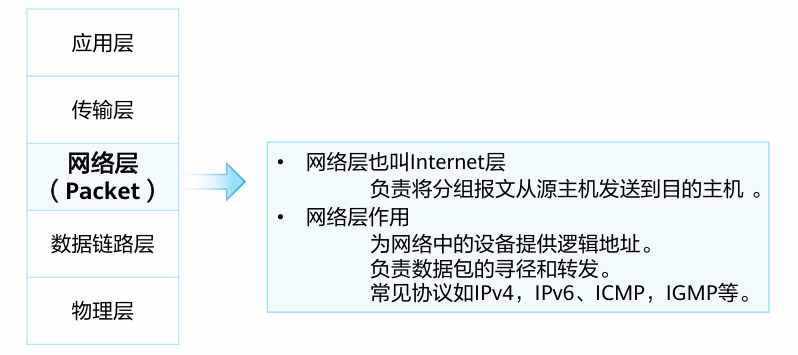
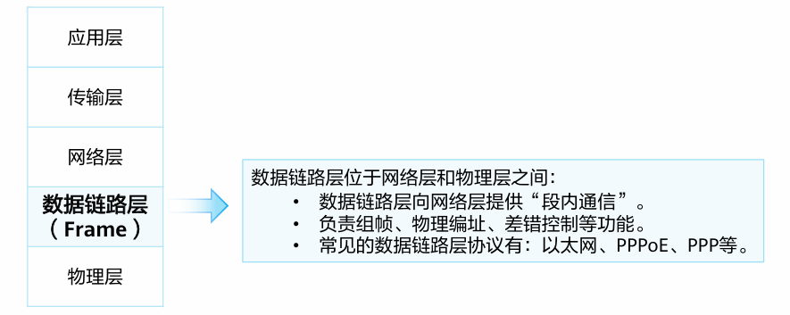

# 数据通信

### 通信与网络

通信：指人与人、人与物、物与物之间通过某种媒介和行为进行的信息传递与交流

网络通信：指终端设备之间通过计算机网络进行的通信

网络通信的例子：

​	A、两台计算机通过一根网线相连，组成一个简单的网络

​	B、有一台路由器（或交换机）和多台计算机组成的小型网络。两台计算机可以通过路由中转自由传输文件

C、当计算机想从网站获取文件，必须先接入Internet，然后下载文件

internat（英特网）是目前世界上规模最大的计算机网络

### 常见术语

> 数据载荷

可以理解为最终想要传递的信息，但实际上，在具有层次化结构的通信过程中，上一层协议传递给下一层协议的数据单元（报文）都可以称为下一层协议的数据载荷

> 报文

网络中交换与传输的数据单元，具有一定的内在格式，通常都具有头部+数据载荷+尾部基础结构。传输过程中报文的格式和内容可能发生改变

> 头部

在组装报文时，在数据载荷的前面添加的信息段统称为报文头部

> 尾部

在组装报文时，在数据载荷的后面添加的信息段统称为报文尾部。但是很多报文是没有尾部的

> 封装

分层协议所采用的一种技术，底层协议到来自上层协议的消息时，将该消息附加到底层帧的数据部分

> 解封装

是封装的逆过程，也就是去掉报文头部和尾部，获取数据载荷的过程

> 网关

是在采用不同体系结构或协议的网络之间进行互通时，用于提供协议转换、路由选择、数据交换等功能的网络设置。网关是一种根据部署位置和功能而命名的术语，而不是一种特定设备类型

> 路由器

为报文选择传递路径的网络设备

> 终端设备

数据通信系统的端设备，作为数据的发送者或接收者，提供用户接入协议操作必要功能，可以是计算机、服务器、VoIP、手机等

### 网络参考模型

#### TCP/IP常见协议

#### 应用层

#### 传输层

##### TCP和UDP报文格式

##### tcp建立三次握手

##### tcp关闭四次挥手

#### 网络层

#### 数据链路层

地址解析协议（ARP）

