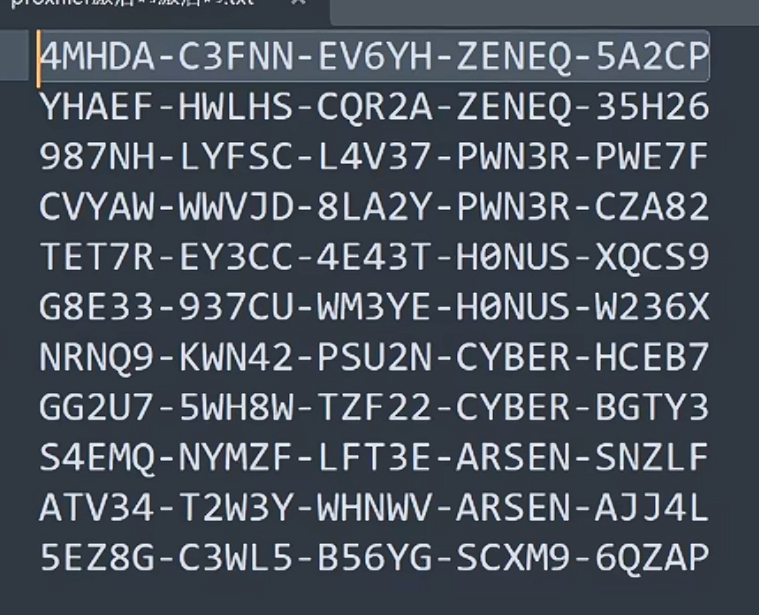

# 网络安全

## 系统/软件安装

### vm安装

[VMware网址](https://www.vmware.com/products/desktop-hypervisor/workstation-and-fusion)跳转（CTRL+鼠标左键）


### kali镜像安装

[Kali Linux](https://www.kali.org/get-kali/#kali-virtual-machines)下载有VMware图标的镜像


#### kali配置

设置root账号权限

打开控制台：`sudo passwd root`


更换镜像源

```
#进入root：
sudo su
#更改镜像源地址
vim /etc/apt/sources.list
```


### docker安装

kail镜像中打开终端用**`apt-get update`**更新软件列表

apt-get upgrade更新依赖

安装docker：apt-get install docker.io


## POC

开源poc

wepoc

nuclei_plus


## 微信小程序抓包程序

proxifier

激活码




## 浏览器插件

LoveJs：收集接口信息，隐藏端口

Proxy SwitchOmega：proxy代理管理

wappalyzer：解析使用的技术栈

temp Mail：临时邮箱

User-Agent switcher and manager：ua头


## XSS漏洞

xss漏洞通常以javascript脚本进行攻击，一般用于攻击用户，这种漏洞一般出现在有输入输出的地方，例如输入框，评论区

### 反射型（中低危）

所见即所得，将所写的js代码打包，向服务器请求数据，并返回给前端由前端进行渲染输出，数据库不进行存储一次性代码


```
http://example.com?id=<script>alert('xss')</script>
将攻击代码写入请求中，让浏览器能够渲染执行
'">闭合标签
```


### 存储型（高危）

向服务器发送请求，并且将js代码存储在数据库中，其他用户访问时能够执行，长期存储


### DOM型（中低危）

DOM型可以说是反射或存储型，DOM很多时候是通过js代码进行操作，可以不向服务器发送请求通过js代码进行操作，修改html的DOM结构属性进行攻击，DOM型并不常用


### 手动/工具扫描

burp suite，浏览器插件hackbar等手动测试

appscan,awvs,xray等大型漏洞扫描工具
