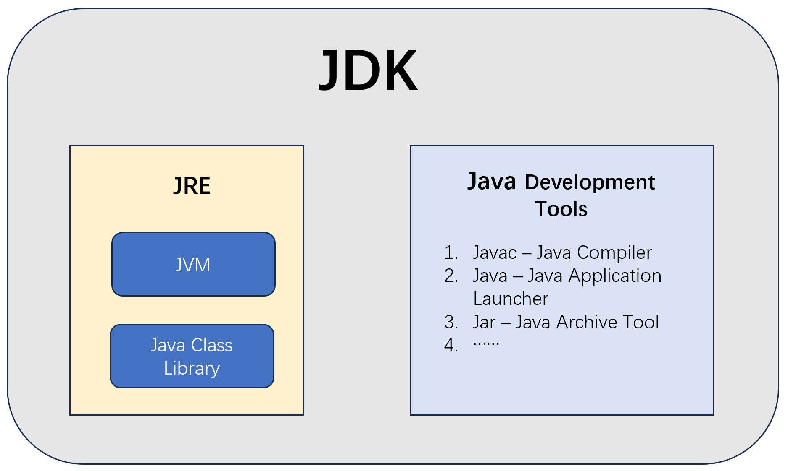

# 常见面试

## 1.  Java

### 1.1  JVM、JDK、JRE

#### 1.1.1  JVM

jvm是运行Java字节码的虚拟机。jvm有针对不同系统的特定实现，目的是让相同的字节码文件输出相同的结果

字节码和不同的系统的jvm是java实现一次编译随处运行的关键


.svg)

jvm并不是统一一致的只要符合jvm规范公司或企业可以自定义专属的jvm，平时接触到的 HotSpot VM，J9 VM、Zing VM、JRockit VM 等JVM，仅仅是是 JVM 规范的一种实现而已。


#### 1.1.2  JDK和JRE

JDK是一个功能齐全的java工具包，帮助开发者创建和编译java程序。包含了JRE，以及编译器javac和其他工具，如javadoc（文档生成器），jdb（调试器），jconsole（监控工具），javap（反编译工具）等。

JRE是运行已编译的java环境，主要为两方面：

1. JVM
2. java基础类（Class Library）：是一种标准的类库，提供常用的功能和API（如I/O操作，网络通信，数据结构等）

简单来说JRE只包含了能够运行Java程序的环境没有开发和调试的工具



> [!note]
>
> JDK9开始不用区分JDK，JRE之间的关系，被模块系统取代，JDK11之后不提供单独下载的JRE


### 1.2  什么是字节码？采用字节码的好处

在Java中JVM能看懂的叫字节码（扩展名为`.class`），不面向任何特定的处理器只面向虚拟机。保留了解释型语言可移植性的特点

好处：**① 跨平台（一次编译到处运行）**、**② JVM 运行时优化（JIT）**、**③ 安全（字节码校验、沙箱）**、**④ 语言无关（Kotlin/Scala 等都能跑）**。

代价是**多一层翻译，性能/内存/启动有损耗**，但 JIT 后差距不大。**核心价值是“平台无关的中间层”。**


### 1.3  为什么说Java语言编译与解释并存

**编译型语言**：编译器会将代码一次性编译成该平台可执行的机器码，一般来说编译型语言执行效率高，开发效率低，如C，C++，Go，Rust等

**解释型语言**：解释器将一条条语言解释成机器码执行，开发效率高，执行速度慢，如python，JavaScript，PHP

.svg)

为什么说是并存：Java源文件先由编译器生成字节码文件，字节码可由JVM解释执行，也可以通过JIT（Just-in-time即时编译）编译执行，取决于JVM实行决定

### 1.4  基础语法

#### 1.4.1  自增自减运算符

编写程序时常会给一个变量加1或减1，java提供了自增（++）和自减（--）

`++`或`--`可以放在变量前或后

**前缀式**（++a或--a）：就是将变量先自增或自减后的值，参与计算

**后缀式**（a++或a--）：是原本的值参与计算，再进行自增或自减操作

```java
int a = 10;
int b,c = 0;
b = a++;  //b=10
c = ++a;  //c=12, b的时候a自增了一次
```


#### 1.4.2  位移运算符

位移运算中数据被视为二进制数，位移就是将其左右移动若干位的运算

`<<`：左移（右补0），乘2的n次方（前提不溢出）

`>>`：右移（带符号，左边正补0，负补1），除以2的n次方，

`>>>`：右移（不带符号），一律向左边补0

```java
int a = 10;
int b = a >> 2;  //b=2
int c = a >>> 2;  //c=2
```

使用位移运算符的**主要原因**：

1. 高效：硬件有专门的位移处理器做位移运算。通常情况下，计算位移运算在一个时间周期，乘除之类的运算会应用更多时间周期
2. 节约内存：通过位移操作，可以用一个整数来存储多个布尔值或标志位


> [!note]
>
> 常用于快速计算2的次幂
>
> 其他重要作用：
>
> **位字段管理**：如可以存储和管理多个布尔值
>
> **哈希算法和加密解密**：通过位移、与、或运算来混淆数据
>
> **数据压缩**：如霍夫曼编码通过位移运算实现快速处理和操作二进制数据，使数据紧凑实现数据压缩
>
> **数据校验**：如CRC（循环冗余校验），通过位移和多项式除法生成和校验数据完整性


### 1.5  基本类和包装类的区别

**存储方式**：基本类局部变量值存储在栈中，对象字段值在堆中，包装类是对象，变量存的是引用，属性本身在堆中

**内存占用**：相较于包装类型，基本类型所占用的空间更小

包装类可用于泛型，有方法如equals、parseInt等方法

基本类有默认值但不为null，包装类默认值为null


#### 1.5.1  包装类的缓存机制

包装类大部分都用了缓存机制来提升性能

Byte, Short, Integer, Long 这4类都创建了默认范围[ -128 ~ 127 ]

Character创建了[ 0 ~ 127 ]

Boolean直接返回True或False

Float,Double没有实现缓存机制


> [!warning]
>
> Integer能够手动调节上限（其他不能)，但下限-128不能调，在实际使用时不建议将上限调的太高，会造成内存浪费，甚至是OOM（OutOfMemoryError 内存溢出错误）


### 1.6  自动装箱与拆箱，原理

什么是装箱与拆箱

**装箱**：是将数据以对应的引用类型包装起来

**拆箱**：是将包装类型拆解成基本数据类型

```java
Integer a = 1;  //装箱
int b = a;  //拆箱
```

在字节码中，装箱就是调用了包装类的valueOf()方法，拆箱就是调用了xxxValue()方法

等价于：

```java
Integer a = Integer.valueOf(1);
int b = a.intValue();
```


> [!caution]
>
> 尽量避免频繁的拆装箱，导致系统性能下降


### 1.7  浮点数精度丢失

**存在原因**：计算机的有限位宽的二进制表示**double**和**float**，有些十进制小数在转换二进制时会无限循环，只能舍入成有限数位，因此存在精度丢失风险

**如何解决**：

**BIgDecimal**可以精确表示十进制数，但还是有可能出现舍入，大部分需要精确计算的业务场景（如金钱相关）使用

```java
BigDecimal a = new BigDecimal("0.2");
```


### 1.8  静态方法与实例方法有何不同

在调用静态方法时可以用`类名.方法名`或`实例对象.方法名`
